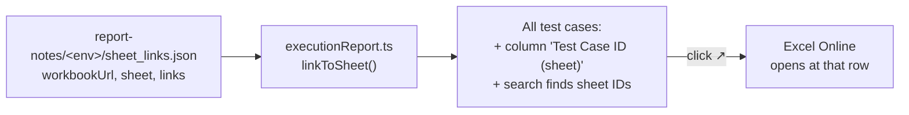
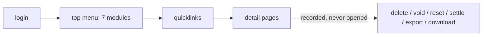
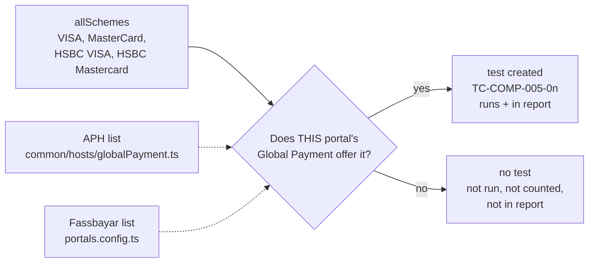
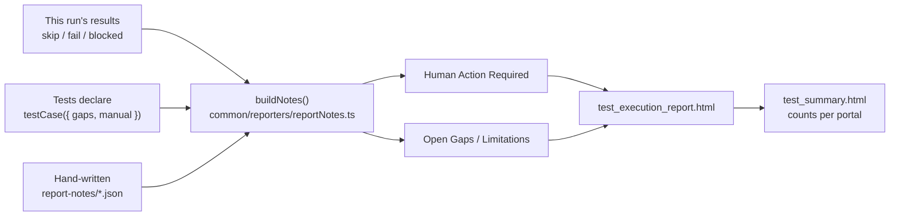
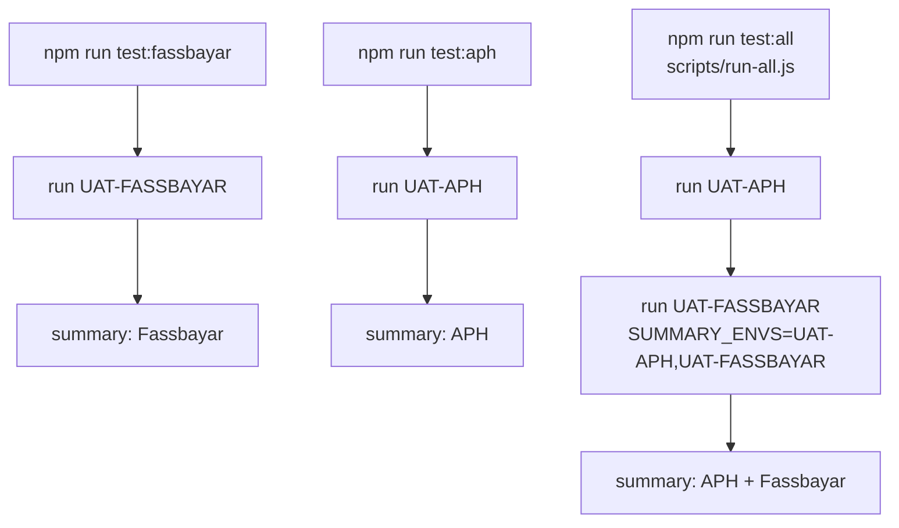
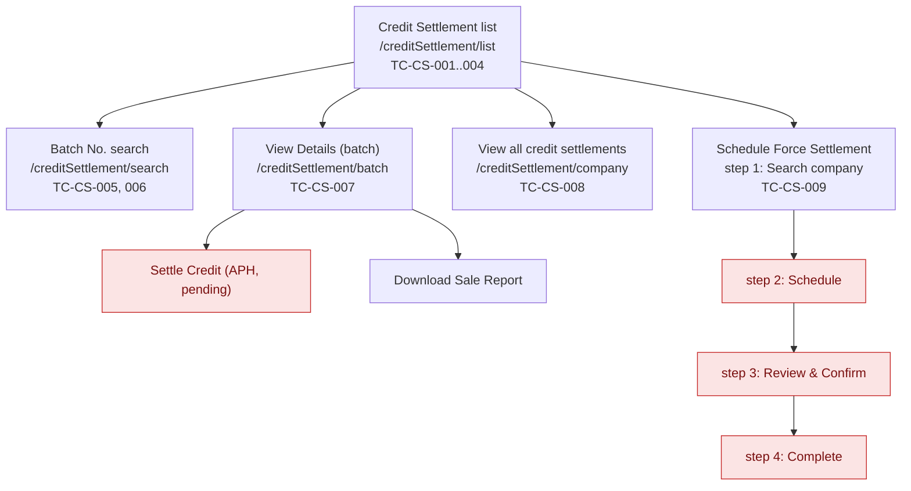

# Changelog

Every change to this project is recorded here: **what** changed, **why**, **which files / folders**,
the **key code**, and **how to run or check it**. Newest first. Flows and diagrams are welcome
(` ```mermaid ` blocks render on GitHub and in VS Code's Markdown preview); images go in
`docs/images/` and are linked as ``.

> **Rule:** every time something is added, changed or removed, add an entry at the top of
> [Changes](#changes) in the same commit. Use the template below.

<details>
<summary>Entry template (copy this)</summary>

~~~markdown
### YYYY-MM-DD: <short title>

**Why:** <the reason / request>

| File / folder | Change |
|---|---|
| `path/to/file.ts` | New / Changed / Removed: what |

**Key code**
```ts
// the important lines
```

**How to run / check**
```powershell
<command>
```
~~~
</details>

## Changes

- [2026-11-20: Automated tests mapped to the APH and FassBayar baseline test case workbooks](#2026-11-20-automated-tests-mapped-to-the-aph-and-fassbayar-baseline-test-case-workbooks)
- [2026-11-20: Report links each test to its row in the Excel test case sheet (from ecom-automation)](#2026-11-20-report-links-each-test-to-its-row-in-the-excel-test-case-sheet-from-ecom-automation)
- [2026-11-20: Open any Markdown file in the browser (npm run md)](#2026-11-20-open-any-markdown-file-in-the-browser-npm-run-md)
- [2026-11-20: Site map of both portals: every module, flow and difference](#2026-11-20-site-map-of-both-portals-every-module-flow-and-difference)
- [2026-11-19: "Settle Credit" can appear on both portals (no longer APH-only)](#2026-11-19-settle-credit-can-appear-on-both-portals-no-longer-aph-only)
- [2026-11-19: Card scheme tests exist only on the portal that offers the scheme](#2026-11-19-card-scheme-tests-exist-only-on-the-portal-that-offers-the-scheme)
- [2026-11-19: Human Action and Gaps tables generated automatically on every run](#2026-11-19-human-action-and-gaps-tables-generated-automatically-on-every-run)
- [2026-11-19: Human Action and Gaps tables always shown in the report](#2026-11-19-human-action-and-gaps-tables-always-shown-in-the-report)
- [2026-11-19: Summary shows only the portal(s) of the run](#2026-11-19-summary-shows-only-the-portals-of-the-run)
- [2026-11-18: Project pushed to GitHub](#2026-11-18-project-pushed-to-github)
- [2026-11-18: New module: Manage Credit Settlements (TC-CS-001 to 009)](#2026-11-18-new-module-manage-credit-settlements-tc-cs-001-to-009)
- [2026-11-18: Stability fixes for APH (Add a Company)](#2026-11-18-stability-fixes-for-aph-add-a-company)
- [2026-11-18: Random company data on Add a Company (Fassbayar: all fields)](#2026-11-18-random-company-data-on-add-a-company-fassbayar-all-fields)
- [2026-11-18: Summary counts "applicable for one portal only" skips separately](#2026-11-18-summary-counts-applicable-for-one-portal-only-skips-separately)
- [2026-11-18: Global Payment card scheme tests (TC-COMP-004, 005-01 to 04)](#2026-11-18-global-payment-card-scheme-tests-tc-comp-004-005-01-to-04)
- [2026-11-18: Duplicate MID test runs on Fassbayar too (TC-COMP-003)](#2026-11-18-duplicate-mid-test-runs-on-fassbayar-too-tc-comp-003)

---

### 2026-11-20: Automated tests mapped to the APH and FassBayar baseline test case workbooks

**Why:** each automated test in the report should link to its test case(s) in the team's baseline workbooks.

| File / folder | Change |
|---|---|
| `report-notes/uat-aph/sheet_links.json` | **New**: 12 of 16 APH tests -> `APH_System_Portal_Baseline_Test_Cases_v1.0.xlsx`, sheet "Test Case Library" |
| `report-notes/uat-fassbayar/sheet_links.json` | **New**: 11 of 18 Fassbayar tests -> `FassBayar_System_Portal_Baseline_Test_Cases_v1.0.xlsx`, sheet "Test Case Library" |

Only exact or reasonable partial matches are linked; the rest show "-":

| Automation ID | APH (TC-APH-BP-...) | FassBayar (TC-FB-BP-...) |
|---|---|---|
| TC-APH-001 Login / logout | AUTH-002, AUTH-013 | AUTH-002, AUTH-010 |
| TC-COMP-001 Add company (GP) | CMP-013, CMP-008 | CMP-014, CMP-008 |
| TC-COMP-002 GP Retail or IPP | CMP-013 | - (no case) |
| TC-COMP-003 Duplicate MID | CMP-020 | CMP-019 |
| TC-COMP-004 / 005 card schemes | - (no per-scheme case; no HSBC case) | - |
| TC-CS-001 list | STL-001 | STL-001 |
| TC-CS-002..005 filters / batch search | STL-002 | STL-002 |
| TC-CS-006 no record | XCUT-002, STL-004 | XCUT-002 |
| TC-CS-007 batch details | STL-003 | STL-003 |
| TC-CS-008 company settlements | - | - |
| TC-CS-009 schedule force settlement | STL-007 | STL-006 |

Gaps in the workbooks (no case to link): GP card scheme list / HSBC schemes, "View all credit settlements".
When a workbook gets new rows, update the `row` numbers (Excel row of the case).

**How to run / check**
```powershell
$env:ENV_NAME='UAT-APH'; npx playwright test --list     # rebuilds the report without running
start execution-report-uat-aph	est_execution_report.html
```

---

### 2026-11-20: Report links each test to its row in the Excel test case sheet (from ecom-automation)

**Why:** like ecom-automation's report, each test in "All test cases" should show the test case ID(s) of
the Excel test case sheet and open the workbook at that row.

| File / folder | Change |
|---|---|
| `common/reporters/executionReport.ts` | Changed: `linkToSheet()` replaced by ecom's version, made generic (any test ID; column title and workbook name from the mapping) |
| `report-notes/README.md` | Changed: `sheet_links.json` format (new optional `workbookName`, `columnLabel`) |

Before: the sheet ID was a small link under the automation ID. Now (ecom style):

| Automation ID | Test Case ID (SSR-xxx v1.0) | Module | ... |
|---|---|---|---|
| TC-CS-001 | TC-SP-CS-001 ↗ | Credit Settlement | |
| TC-CS-005 | TC-SP-CS-010 ↗<br>TC-SP-CS-011 ↗ | Credit Settlement | |
| TC-CS-002 | - (not in the sheet) | Credit Settlement | |



- No mapping file -> report unchanged (no column). Nothing is mapped yet: the System Portal test case
  workbook link, sheet name and rows are needed.
- Checked with a temporary mapping on the Fassbayar report: column, links (`activeCell='<sheet>'!A<row>`),
  "-" rows and search all work; the temporary mapping was removed.

**Key code**
```ts
.replace('<th>Test Case ID</th>',
  `<th>Automation ID</th><th title="${esc(workbook)}, sheet '${esc(mapping.sheet)}'">${esc(label)}</th>`)
.replace(/data-search="([^\s"]+)/g, (match, id) => ...sheet IDs + id...)        // search
.replace(/(<tr[^>]*data-search=...>\s*)<td class="mono">([^<]+)<\/td>/g, ...)   // + sheet cell
```

**How to run / check**: add `report-notes/uat-fassbayar/sheet_links.json`, then rebuild without running:
```powershell
$env:ENV_NAME='UAT-FASSBAYAR'; npx playwright test --list
start execution-report-uat-fassbayar	est_execution_report.html
```

---

### 2026-11-20: Open any Markdown file in the browser (npm run md)

**Why:** a browser shows a `.md` file as raw text; the module map and changelog should open as a formatted page.

| File / folder | Change |
|---|---|
| `scripts/md-to-html.js` | **New**: writes `<file>.html` next to the `.md` (tables formatted, mermaid diagrams drawn) and opens it |
| `package.json` | Changed: `npm run md` |
| `.gitignore` | Changed: the generated `.html` files stay local |

**How to run / check**
```powershell
npm run md -- docs/portal-module-map.md
npm run md -- CHANGELOG.md
```
The page loads its Markdown / diagram libraries from the internet (CDN).

---

### 2026-11-20: Site map of both portals: every module, flow and difference

**Why:** understand every module and flow on APH and Fassbayar, and how they differ, before automating more.
Crawled read-only with the dedicated automation accounts (`automationaph`, `automationfb`).

| File / folder | Change |
|---|---|
| `explore/scan/siteMap.scan.ts` | **New**: read-only crawler (opens pages only; never submits; never opens delete / void / reset / settle / export / download links) |
| `docs/portal-module-map.md` | **New**: module table, flows (mermaid), APH vs Fassbayar differences, automation status |
| `.gitignore` | Changed: crawl output `explore/scan/results/site-map-*.json` stays local (real MIDs / names; repo is public) |

**Result:** APH 49 pages, Fassbayar 56. Same 7 top-menu modules. Fassbayar only: Fasstap, Replace Readers +
report, Bulk Company Upload (Edit), Upload / Remove Company Logo, Bill Payment Report, Export SSO List,
Home dashboard. APH only: Host Settings, Fassbayar Sync History / Retrigger Sync, View Parent.



**How to run / check**
```powershell
$env:ENV_NAME='UAT-FASSBAYAR'; npx playwright test --config explore/scan/scan.config.ts siteMap
start docs\portal-module-map.md
```

---

### 2026-11-19: "Settle Credit" can appear on both portals (no longer APH-only)

**Why:** the full run failed TC-CS-007 on Fassbayar: pending batch **000022** showed **Settle Credit**,
while pending batch 485 (18 Nov) did not. The button is not APH-only; it appears on SOME pending
batches on both portals (the rule is not visible on the page). Not a product defect: a wrong assumption in the test.

| File / folder | Change |
|---|---|
| `portals.config.ts` | Removed: `settleCreditButton` from `creditSettlement` rules (both portals) |
| `common/tests/creditSettlement.spec.ts` | Changed: TC-CS-007 records whether Settle Credit is shown (never clicks it) instead of expecting it per portal; the "test Settle Credit by hand" Human Action now applies to both portals |

**Key code**
```ts
await test.step('Pending batch: "Settle Credit" shown or not is recorded (never clicked)', async () => {
  const settle = page.getByRole('link', { name: 'Settle Credit' });
  const shown = (await settle.count()) > 0;
  test.info().annotations.push({ type: 'info', description: `Settle Credit ${shown ? 'shown' : 'not shown'} on pending batch ${sample.batchNo}` });
  if (shown) await expect(settle).toHaveAttribute('href', /settleCredit/);   // looked at, never clicked
});
```

**Result** (full run, 19 Nov): APH 16 test cases, 15 passed, 1 skipped (archive 22:00-06:00);
Fassbayar 18 / 18 passed. Human action items: APH 3, Fassbayar 2. Gaps: 14 each.

**Open question for the team:** when should Settle Credit appear on a pending batch?

**How to run / check**
```powershell
npm run test:all
start test_summary.html
```

---

### 2026-11-19: Card scheme tests exist only on the portal that offers the scheme

**Why:** a test that is not applicable to a portal should not run there, not be counted as a test case
there, and not appear in that portal's report (before: HSBC tests showed as "Skipped" on APH).

| File / folder | Change |
|---|---|
| `common/tests/addCompanyCardScheme.spec.ts` | Changed: a TC-COMP-005 test is only **created** when this portal's Global Payment offers the scheme; the "Applicable for ... only" skip is removed |

Not in `common/pages`: pages only describe a screen. Which test exists where is decided in the test
file, from the scheme lists in `common/hosts/globalPayment.ts` (APH) and `portals.config.ts` (Fassbayar).

**Flow**


**Key code**
```ts
// One test per scheme THIS portal offers (ID numbered over all portals' schemes)
for (const [i, scheme] of allSchemes.entries()) {
  if (!host?.cardSchemes.includes(scheme)) continue;   // not on this portal: no test at all
  test(`Global Payment with card scheme ${scheme}: ...`,
    testCase({ id: `TC-COMP-005-${String(i + 1).padStart(2, '0')}`, ... }), ...);
}
```

| | APH | Fassbayar |
|---|---|---|
| TC-COMP-005-01 VISA, 005-02 MasterCard | run | run |
| TC-COMP-005-03 HSBC VISA, 005-04 HSBC Mastercard | **not created** (not in report) | run |

APH: 16 test cases in total (was 18). IDs stay the same on every portal.

**How to run / check**
```powershell
$env:ENV_NAME='UAT-APH'; npx playwright test --list    # no HSBC tests listed
npm run test:aph                                        # APH report without HSBC rows
```

---

### 2026-11-19: Human Action and Gaps tables generated automatically on every run

**Why:** the two tables must be filled in from what happened in the run, without anyone writing them by hand.

| File / folder | Change |
|---|---|
| `common/reporters/reportNotes.ts` | **New**: the rules that build both tables |
| `common/reporters/executionReport.ts` | Changed: `optionalCards()` calls `buildNotes()` on every run and writes `data/human_action_items.json` + `data/gaps.json` |
| `common/utils/testCase.ts` | Changed: `testCase()` accepts `gaps` and `manual` |
| `common/tests/*.spec.ts` (all 5) | Changed: each test declares what it does not cover |
| `report-notes/` | Hand-written items still work and are listed first |

**Flow**


**What goes in each table**

| In the run | Table |
|---|---|
| Skipped for a reason a person can act on (APH archive 22:00-06:00, no settlements today, no known MID) | Human Action, with what to do |
| Failed because of the environment (server down, session logged out by the same account elsewhere, no login in `.env`) | Human Action |
| Any other failure | Gap, status **Open** (gone when the test passes again) |
| `testCase({ manual: [...] })` | Human Action (e.g. Settle Credit, Schedule Force Settlement) |
| `testCase({ gaps: [...] })` | Gap, status **Known limitation** |
| Skip "Applicable for <portal> only" / "is not a host of" | Left out (not this portal's scenario) |

**Key code**: declaring gaps / manual checks in a test:
```ts
testCase({
  id: 'TC-CS-009', module: MODULE, priority: 'Medium',
  manual: [{
    title: 'Schedule Force Settlement: Schedule > Review & Confirm > Complete',
    reason: 'Finishing the wizard schedules a real force settlement, so automation stops at step 1.',
    handling: 'Test scheduling by hand on a test company before each release.'
  }],
  gaps: [{ description: '...what is not covered...', impact: '...what could slip through...' }]
})
```
A rule in `reportNotes.ts` (skip reason -> what to do):
```ts
{
  match: /Archive data can only be viewed between (\d{1,2}:\d{2}) and (\d{1,2}:\d{2})/,
  handling: (m) => `Re-run this test between ${m[1]} and ${m[2]} ...`
}
```

**How to run / check**: run any portal, then open its report; the run also prints
`[execution-report] Human action items: N, gaps / limitations: N`.
```powershell
npm run test:all
start execution-report-uat-aph\test_execution_report.html
```
Result of the first run: APH 3 human actions / 14 gaps, Fassbayar 1 / 14.

---

### 2026-11-19: Human Action and Gaps tables always shown in the report

**Why:** the two tables must be in every report, even with nothing to report.

| File / folder | Change |
|---|---|
| `common/reporters/executionReport.ts` | Changed: nothing to list -> one "none" row ("No human action required" / "No open gaps or limitations recorded") |
| `report-notes/README.md` | Changed: explains the always-shown cards |

The summary page (`summaryReport.ts`) already counts those "none" rows as 0.

---

### 2026-11-19: Summary shows only the portal(s) of the run

**Why:** running Fassbayar only should give a Fassbayar-only summary; APH only -> APH only; both -> both.

| File / folder | Change |
|---|---|
| `playwright.config.ts` | Changed: works out which report folders the summary shows (`SUMMARY_ENVS`) |
| `common/reporters/summaryReport.ts` | Changed: new `folders` option, shows only those |
| `scripts/run-all.js` | **New**: runs portals one after another; the last run's summary includes all of them |
| `package.json` | Changed: `test:all`, `test:aph`, `test:fassbayar` |
| `README.md` | Changed: the new commands under *Running* |

**Flow**


**Key code** (`playwright.config.ts`):
```ts
//   default                            -> only the environment of THIS run
//   SUMMARY_ENVS=UAT-APH,UAT-FASSBAYAR -> those (npm run test:all sets it on its last run)
//   SUMMARY_ENVS=all                   -> every execution-report-* folder
const summaryFolders = summaryEnvs === 'all'
  ? undefined
  : summaryEnvs ? summaryEnvs.split(',').map((e) => reportFolderOf(e.trim())) : [reportDir];
```

**How to run / check**
```powershell
npm run test:fassbayar     # summary: Fassbayar only
npm run test:aph           # summary: APH only
npm run test:all           # summary: both
start test_summary.html
```

---

### 2026-11-18: Project pushed to GitHub

**Why:** keep the project on GitHub: https://github.com/ss-derrick/BCP-project-progress-automation

| Branch | Content |
|---|---|
| `main` | This project |
| `old-main` | Backup of the previous `main` (older BCP codebase, 274 files) |
| `system-portal-automation` | Same as `main` (first push; can be deleted) |

`.env` (passwords), `node_modules`, reports and test results are **not** uploaded (`.gitignore`).

**How to push later changes**
```powershell
git add .
git commit -m "what you changed"
git push
```

---

### 2026-11-18: New module: Manage Credit Settlements (TC-CS-001 to 009)

**Why:** automate Manage Credit Settlements (`/creditSettlement/list`) on both portals. All tests are **read-only**:
nothing is settled, scheduled or created.

| File / folder | Change |
|---|---|
| `common/pages/CreditSettlementPage.ts` | **New**: shared page (list, filters, batch search, View Details, View all, Schedule Force Settlement) |
| `common/tests/creditSettlement.spec.ts` | **New**: TC-CS-001 to 009 |
| `common/fixtures/base.ts` | Changed: `creditSettlementPage` fixture |
| `portals.config.ts` | Changed: `creditSettlement` rules per portal (Batch Details differences) |
| `explore/scan/creditSettlement.scan.ts` | **New**: read-only explorer of the module (first run hung; needs fixing before re-use) |

**Module map** (what the tests open; red = never clicked)


| ID | Scenario |
|---|---|
| TC-CS-001 | List: batch search, filters (TID, Mobile User ID, Status, Date = today), columns, quicklinks |
| TC-CS-002 | Filter by each Status shows only that status |
| TC-CS-003 | Filter by TID |
| TC-CS-004 | Filter by Mobile User ID |
| TC-CS-005 | Search an existing Batch No. |
| TC-CS-006 | Search a Batch No. that does not exist -> "No record found" (APH: skipped in the day, archive 22:00-06:00) |
| TC-CS-007 | View Details: batch no., status message, totals, filters, transactions, Back |
| TC-CS-008 | View all credit settlements (company) |
| TC-CS-009 | Schedule Force Settlement opens at step 1 of 4 |

**Portal differences** (`portals.config.ts`):
```ts
creditSettlement: {               // APH
  showsRefundedTotal: false,
  batchFilters: ['Terminal ID (TID)', 'Approval Code', 'Status', 'Amount', 'Date'],
  transactionStatuses: ['Approved', 'Reversed', 'Voided', 'Pending Signature', 'Settled', 'Refunded', 'Expired']
},
creditSettlement: {               // Fassbayar
  showsRefundedTotal: true,
  batchFilters: ['Terminal ID (TID)', 'Status', 'Date'],
  transactionStatuses: ['Approved', 'Reversed', 'Voided', 'Pending Signature', 'Settled', 'Expired']
}
```
Handled inside the shared page: date field `to` (APH) / `from` (Fassbayar) -> located by `.filterDate`;
APH zero-padded batch numbers -> compared as numbers.

**How to run / check**
```powershell
$env:ENV_NAME='UAT-FASSBAYAR'; npx playwright test common/tests/creditSettlement.spec.ts
```

---

### 2026-11-18: Stability fixes for APH (Add a Company)

**Why:** two APH failures that were timing, not product defects.

| File / folder | Change |
|---|---|
| `common/pages/AddCompanyFormPage.ts` | `open()`: waits for the page and clicks "Add a Company" again if the first click was lost |
| `common/pages/AddCompanyFormPage.ts` | `submitExpectingRejection()`: waits for the server's `/company/checkItemsAvailability` answer; clicks Submit again if it never arrives |

**Key code**
```ts
await expect(async () => {
  const answer = this.page.waitForResponse((r) => r.url().includes('/company/checkItemsAvailability'), { timeout: 20_000 });
  await this.submitButton.click();
  await answer;
}, 'Submit sends the availability check to the server').toPass({ timeout: 60_000 });
```

Note: the APH account is shared (a colleague logged in as the same user caused `error=concurrent` logouts).
Don't use the account elsewhere during a run.

---

### 2026-11-18: Random company data on Add a Company (Fassbayar: all fields)

**Why:** every Add a Company run should use different, realistic data, valid for the form's own rules.
Transaction limits stay at the form's default.

| File / folder | Change |
|---|---|
| `common/creation/randomCompanyData.ts` | **New**: pools of valid values (matching postcode / city / state, names, addresses, 31 banks, MCC codes, SST / TIN formats, references) |
| `common/creation/hostCompanyData.ts` | Changed: `createCompanyForHost()` builds random data; name, short name, user ID prefix, DBA and MID keep a timestamp (unique, traceable) |
| `common/creation/types.ts` | Changed: `CompanyExtras` (SST, TIN, bank, MCC, references) |
| `common/pages/AddCompanyFormPage.ts` | Changed: hooks `fillPortalCompanyFields()` and `verifyPortalReview()` |
| `fassbayar/pages/FassbayarAddCompanyFormPage.ts` | Changed: fills and checks SST, TIN, bank, MCC, Reference 1-5 |

**Key code** (`hostCompanyData.ts`):
```ts
const { name, trade } = R.businessName(s, form.businessNameMax);   // "Sinar Jaya Trading 261118103045"
const loc = pick(R.LOCATIONS);                                      // postcode + city + state match
const person = R.authoriserPerson();                                // salutation + name
...
email: AUTHORISER_EMAIL || R.emailFor(person.fullName),             // random @example.com
```

- Authoriser e-mail: random `@example.com` per company. Set `AUTHORISER_EMAIL` in `.env` to use one real mailbox.
- Checked: 500 generated companies per portal pass the form rules; the real Fassbayar form accepts them.

---

### 2026-11-18: Summary counts "applicable for one portal only" skips separately

**Why:** HSBC card schemes exist on Fassbayar only; on APH those tests must show as skipped, not as failures.

| File / folder | Change |
|---|---|
| `common/tests/addCompanyCardScheme.spec.ts` | Skip reason starts with `Applicable for Fassbayar only: ...` |
| `common/reporters/summaryReport.ts` | Such skips are listed as "Not applicable to this portal (skipped, not counted)" |

**Key code** (`summaryReport.ts`):
```ts
const OTHER_PORTAL = /^(Not verified on |Applicable for .+ only)/;
```

---

### 2026-11-18: Global Payment card scheme tests (TC-COMP-004, 005-01 to 04)

**Why:** Global Payment offers VISA, MasterCard on APH and VISA, MasterCard, HSBC VISA, HSBC Mastercard on
Fassbayar. Both portals list the same test cases; Review & Confirm only, nothing is created.

| File / folder | Change |
|---|---|
| `common/tests/addCompanyCardScheme.spec.ts` | **New**: TC-COMP-004 (exact scheme list) + one test per scheme of any portal |
| `common/pages/AddCompanyFormPage.ts` | Changed: `cardSchemeOptions()`, `captureCardSchemeList()`, `verifyReviewCardSchemes()` |

The scheme lists come from config, nothing hard-coded in the test:
`common/hosts/globalPayment.ts` (APH) and `portals.config.ts` (Fassbayar: `onPortal(GlobalPayment, { cardSchemes: [...] })`).

| ID | APH | Fassbayar |
|---|---|---|
| TC-COMP-004 GP offers exactly this portal's schemes | runs | runs |
| TC-COMP-005-01 VISA / 02 MasterCard | runs | runs |
| TC-COMP-005-03 HSBC VISA / 04 HSBC Mastercard | skipped (Fassbayar only) | runs |

---

### 2026-11-18: Duplicate MID test runs on Fassbayar too (TC-COMP-003)

**Why:** TC-COMP-003 was skipped on Fassbayar: no existing MID recorded.

| File / folder | Change |
|---|---|
| `common/testdata/existingMids.ts` | Added the Fassbayar MID created by TC-COMP-001 |

```ts
'UAT-FASSBAYAR': {
  mid: '261118140251604',
  hostCode: 'GP',
  note: 'Global Payment company created by TC-COMP-001 on 18 Nov 2026, 14:02'
}
```
