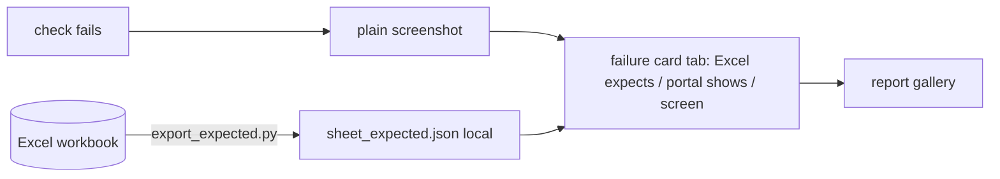
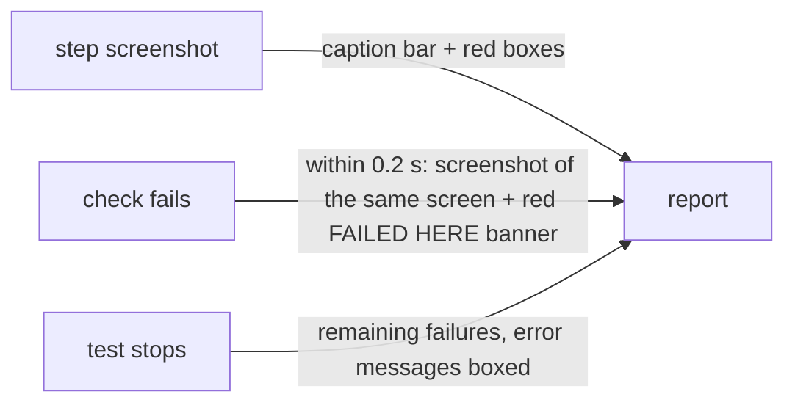
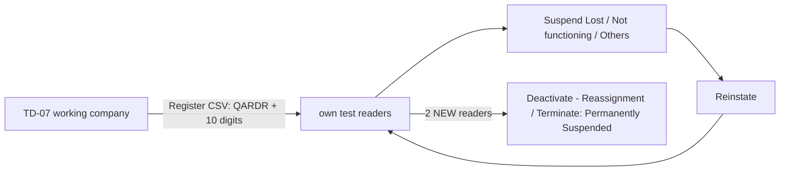
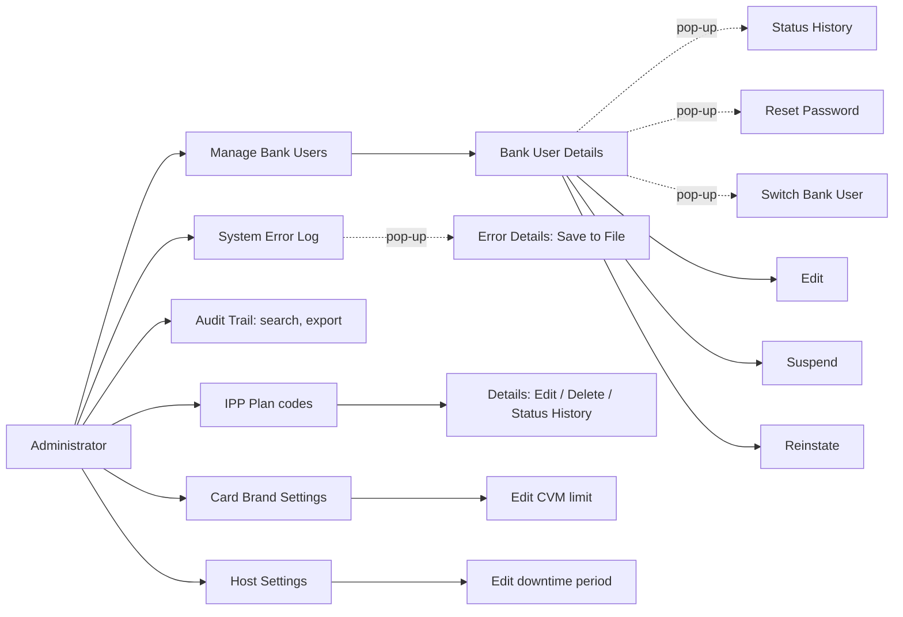
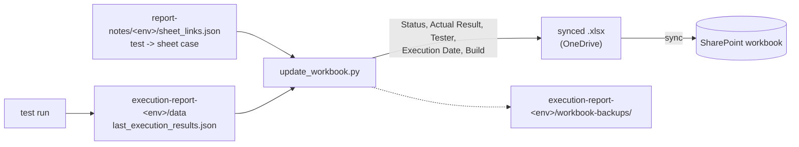
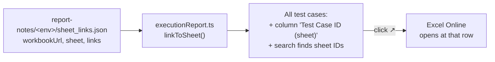
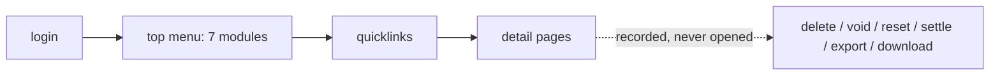

# Changelog: system-portal-automation (TryOut)

Every change to this folder is recorded here: **what** changed, **why**, **which files**, the **key code**
and **how to run or check it**. Newest first. Times are Malaysia time (MYT).

> **Rule:** every time something is added, changed or removed, add an entry at the top of
> [Changes](#changes). Code merged from a teammate says whose it is and what was adapted to fit
> the agreed structure (see README "Rules").

<details>
<summary>Entry template (copy this)</summary>

~~~markdown
### YYYY-MM-DD HH:MM: <short title>

**Why:** <the reason / request>

| File / folder | Change |
|---|---|
| `path/to/file.ts` | New / Changed / Removed: what |

**Key code**
```ts
// the important lines
```

**How to run / check**
```powershell
<command>
```
~~~
</details>

## Changes

- [2026-11-25 15:30: TC-AUTH-010 waits the real 15 minutes](#2026-11-25-1530-tc-auth-010-waits-the-real-15-minutes)
- [2026-11-25 14:53: TC-AUTH-003 uses each sheet's Test Data (Fassbayar TD-01)](#2026-11-25-1453-tc-auth-003-uses-each-sheets-test-data-fassbayar-td-01)
- [2026-11-25 14:47: AUTH tests shown as module "Login (AUTH)"](#2026-11-25-1447-auth-tests-shown-as-module-login-auth)
- [2026-11-25 14:42: TC-ADM-003 note explains the Fassbayar 3-character User ID failure](#2026-11-25-1442-tc-adm-003-note-explains-the-fassbayar-3-character-user-id-failure)
- [2026-11-25 14:30: "Failover Operator" no longer fails TC-ADM-001 / 002](#2026-11-25-1430-failover-operator-no-longer-fails-tc-adm-001--002)
- [2026-11-25 14:20: Login (AUTH) tests TC-AUTH-001..017 for both portals](#2026-11-25-1420-login-auth-tests-tc-auth-001017-for-both-portals)
- [2026-11-25 10:00: Home runs in sheet order; Fassbayar Quicklink case = TC-HOME-006](#2026-11-25-1000-home-runs-in-sheet-order-fassbayar-quicklink-case--tc-home-006)
- [2026-11-25 09:30: Fassbayar runs TC-HOME-002 (new sheet case TC-FB-BP-HOME-003)](#2026-11-25-0930-fassbayar-runs-tc-home-002-new-sheet-case-tc-fb-bp-home-003)
- [2026-11-25 09:05: TC-ADM-020 leaves "Failover Operator" to TC-ADM-001; Fassbayar sheet links re-aligned](#2026-11-25-0905-tc-adm-020-leaves-failover-operator-to-tc-adm-001-fassbayar-sheet-links-re-aligned)
- [2026-11-24 15:40: Failure cards: Excel's Expected Result next to what the portal shows, on every failed screen](#2026-11-24-1540-failure-cards-excels-expected-result-next-to-what-the-portal-shows-on-every-failed-screen)
- [2026-11-24 15:20: Home: each portal runs only its own sheet's cases](#2026-11-24-1520-home-each-portal-runs-only-its-own-sheets-cases)
- [2026-11-24 15:10: TC-HOME-001: a clock that does not tick is a finding, not a failure](#2026-11-24-1510-tc-home-001-a-clock-that-does-not-tick-is-a-finding-not-a-failure)
- [2026-11-24 15:00: Each portal's report lists only the cases that apply to it](#2026-11-24-1500-each-portals-report-lists-only-the-cases-that-apply-to-it)
- [2026-11-24 14:45: Home results in the main reports, workbooks and zip; not-applicable skips kept out of Human Action](#2026-11-24-1445-home-results-in-the-main-reports-workbooks-and-zip-not-applicable-skips-kept-out-of-human-action)
- [2026-11-24 14:20: Home: 5 test cases (TC-HOME-001..005) on both portals](#2026-11-24-1420-home-5-test-cases-tc-home-001005-on-both-portals)
- [2026-11-24 13:15: Report zip: short paths (Windows 260-character limit); in-zip warning only for real zip paths](#2026-11-24-1315-report-zip-short-paths-windows-260-character-limit-in-zip-warning-only-for-real-zip-paths)
- [2026-11-24 12:50: Summary checks each report folder; zip with standard "/" paths](#2026-11-24-1250-summary-checks-each-report-folder-zip-with-standard--paths)
- [2026-11-24 12:30: Summary warns when opened inside the zip or as a single file](#2026-11-24-1230-summary-warns-when-opened-inside-the-zip-or-as-a-single-file)
- [2026-11-24 12:00: Pushed to GitHub on branch readers-admin-report-highlights; local scan results ignored](#2026-11-24-1200-pushed-to-github-on-branch-readers-admin-report-highlights-local-scan-results-ignored)
- [2026-11-24 11:25: Report: failed screens highlighted red in the screenshot flow; "starts failing here"](#2026-11-24-1125-report-failed-screens-highlighted-red-in-the-screenshot-flow-starts-failing-here)
- [2026-11-24 11:10: TC-RDR-016: each kind of blank remarks tried separately](#2026-11-24-1110-tc-rdr-016-each-kind-of-blank-remarks-tried-separately)
- [2026-11-24 10:55: TC-ADM-019: Fassbayar also has no Audit Trail date limit by design](#2026-11-24-1055-tc-adm-019-fassbayar-also-has-no-audit-trail-date-limit-by-design)
- [2026-11-24 10:45: TC-ADM-019: APH has no Audit Trail date limit by design (QA Lead)](#2026-11-24-1045-tc-adm-019-aph-has-no-audit-trail-date-limit-by-design-qa-lead)
- [2026-11-24 10:30: Reader upload CSVs as files in common/testdata (RDR_01..08 with placeholders)](#2026-11-24-1030-reader-upload-csvs-as-files-in-commontestdata-rdr_0108-with-placeholders)
- [2026-11-24 10:00: Report screenshots mark the problem: captions, red boxes on error messages, "FAILED HERE" where a check fails](#2026-11-24-1000-report-screenshots-mark-the-problem-captions-red-boxes-on-error-messages-failed-here-where-a-check-fails)
- [2026-11-24 09:30: TC-ADM-014: Service Provider check only where the field exists (no test-wide skip)](#2026-11-24-0930-tc-adm-014-service-provider-check-only-where-the-field-exists-no-test-wide-skip)
- [2026-11-23 16:40: Shareable report zip; summary explains why "Open full report" can show 404](#2026-11-23-1640-shareable-report-zip-summary-explains-why-open-full-report-can-show-404)
- [2026-11-23 16:00: Sheet links checked: TC-CS-008 linked; every link matches its sheet row](#2026-11-23-1600-sheet-links-checked-tc-cs-008-linked-every-link-matches-its-sheet-row)
- [2026-11-23 15:55: Report: a screenshot of every page in every module](#2026-11-23-1555-report-a-screenshot-of-every-page-in-every-module)
- [2026-11-23 15:50: TC-RDR-010: valid remarks "sss" check (proves the remarks rule typo)](#2026-11-23-1550-tc-rdr-010-valid-remarks-sss-check-proves-the-remarks-rule-typo)
- [2026-11-23 15:45: Report: every "Human action required" case is listed in the Human Action table](#2026-11-23-1545-report-every-human-action-required-case-is-listed-in-the-human-action-table)
- [2026-11-23 15:15: Manage Readers: 16 test cases (TC-RDR-001..016) on both portals](#2026-11-23-1515-manage-readers-16-test-cases-tc-rdr-001016-on-both-portals)
- [2026-11-23 14:15: TC-ADM-018: screenshots of every suspend / reinstate / login step](#2026-11-23-1415-tc-adm-018-screenshots-of-every-suspend--reinstate--login-step)
- [2026-11-23 14:10: TC-ADM-022: screenshots of the form before each Submit](#2026-11-23-1410-tc-adm-022-screenshots-of-the-form-before-each-submit)
- [2026-11-23 13:55: Report Notes explain why a test failed or was skipped](#2026-11-23-1355-report-notes-explain-why-a-test-failed-or-was-skipped)
- [2026-11-23 13:25: TC-ADM-014: Service Provider "required" check only where a blank choice exists](#2026-11-23-1325-tc-adm-014-service-provider-required-check-only-where-a-blank-choice-exists)
- [2026-11-23 13:10: Report: dropdown choices shown in screenshots (Failover Operator)](#2026-11-23-1310-report-dropdown-choices-shown-in-screenshots-failover-operator)
- [2026-11-23 11:52: TC-TRX-001 uses today's newest transaction (APH archive hours)](#2026-11-23-1152-tc-trx-001-uses-todays-newest-transaction-aph-archive-hours)
- [2026-11-23 11:40: Report: a screenshot of every Administrator screen and every Submit result](#2026-11-23-1140-report-a-screenshot-of-every-administrator-screen-and-every-submit-result)
- [2026-11-23 10:38: Administrator test data from the workbooks' Test Data sheets (QA Lead update)](#2026-11-23-1038-administrator-test-data-from-the-workbooks-test-data-sheets-qa-lead-update)
- [2026-11-23 10:04: Team test mailbox: ADM-009 automated, ADM-018 ready (two dummy bank users)](#2026-11-23-1004-team-test-mailbox-adm-009-automated-adm-018-ready-two-dummy-bank-users)
- [2026-11-23 09:57: Resigned no longer tested (OQ-APH-23); findings shown on passed tests](#2026-11-23-0957-resigned-no-longer-tested-oq-aph-23-findings-shown-on-passed-tests)
- [2026-11-23 09:38: Fixes after the first full run with changes on; APH credit settlement Date filter finding](#2026-11-23-0938-fixes-after-the-first-full-run-with-changes-on-aph-credit-settlement-date-filter-finding)
- [2026-11-23 09:17: Skipped tests made runnable: dummy bank user, reusable plan codes, credit settlement look-back](#2026-11-23-0917-skipped-tests-made-runnable-dummy-bank-user-reusable-plan-codes-credit-settlement-look-back)
- [2026-11-23 09:10: First real run of the self-undoing Administrator changes; plan code delete is a form](#2026-11-23-0910-first-real-run-of-the-self-undoing-administrator-changes-plan-code-delete-is-a-form)
- [2026-11-23 08:42: Preview mode for the data-changing Administrator tests (ADM_PREVIEW_CHANGES)](#2026-11-23-0842-preview-mode-for-the-data-changing-administrator-tests-adm_preview_changes)
- [2026-11-23 01:20: Administrator on Fassbayar (FassBayar baseline rows 250-277) + TC-ADM-030](#2026-11-23-0120-administrator-on-fassbayar-fassbayar-baseline-rows-250-277--tc-adm-030)
- [2026-11-23 01:15: New module: Administrator (TC-ADM-001 to 029, APH baseline rows 220-248)](#2026-11-23-0115-new-module-administrator-tc-adm-001-to-029-aph-baseline-rows-220-248)
- [2026-11-22 23:20: Workbook "Automation ID" column filled from the mapping](#2026-11-22-2320-workbook-automation-id-column-filled-from-the-mapping)
- [2026-11-22 23:00: Relinked to the v1.1 baseline workbooks (v1.0 archived)](#2026-11-22-2300-relinked-to-the-v11-baseline-workbooks-v10-archived)
- [2026-11-22 22:30: Workbook: skipped tests -> Blocked with the reason; mapping re-checked](#2026-11-22-2230-workbook-skipped-tests---blocked-with-the-reason-mapping-re-checked)
- [2026-11-22 22:15: Merged Kai Wen's main (Smoke categories); TC-CS-001 on a day with no settlement](#2026-11-22-2215-merged-kai-wens-main-smoke-categories-tc-cs-001-on-a-day-with-no-settlement)
- [2026-11-20 17:05: Workbook update no longer leaves a temp file in the synced folder; FassBayar written](#2026-11-20-1705-workbook-update-no-longer-leaves-a-temp-file-in-the-synced-folder-fassbayar-written)
- [2026-11-20 16:50: First real write into the APH baseline workbook](#2026-11-20-1650-first-real-write-into-the-aph-baseline-workbook)
- [2026-11-20 15:55: Test categories: Smoke (tags + report Category column)](#2026-11-20-1555-test-categories-smoke-tags--report-category-column)
- [2026-11-20 14:45: Run results written into the APH / FassBayar test case workbooks](#2026-11-20-1445-run-results-written-into-the-aph--fassbayar-test-case-workbooks)
- [2026-11-20 11:45: Local .env uses the dedicated automation accounts](#2026-11-20-1145-local-env-uses-the-dedicated-automation-accounts)
- [2026-11-20 11:15: Merged Kai Wen's branch (kaiwen/tryout) into Derrick's repo](#2026-11-20-1115-merged-kai-wens-branch-kaiwentryout-into-derricks-repo)
- [2026-11-20 11:08: Automated tests mapped to the APH and FassBayar baseline test case workbooks](#2026-11-20-1108-automated-tests-mapped-to-the-aph-and-fassbayar-baseline-test-case-workbooks)
- [2026-11-20 11:00: Report links each test to its row in the Excel test case sheet (from ecom-automation)](#2026-11-20-1100-report-links-each-test-to-its-row-in-the-excel-test-case-sheet-from-ecom-automation)
- [2026-11-20 10:55: Open any Markdown file in the browser (npm run md)](#2026-11-20-1055-open-any-markdown-file-in-the-browser-npm-run-md)
- [2026-11-20 10:50: Site map of both portals: every module, flow and difference](#2026-11-20-1050-site-map-of-both-portals-every-module-flow-and-difference)
- [2026-11-20 10:41: Shared on GitHub (private repo, branch kaiwen/tryout)](#2026-11-20-1041-shared-on-github-private-repo-branch-kaiwentryout)
- [2026-11-19 17:30: Tests grouped by menu module (tests/&lt;module&gt;/)](#2026-11-19-1730-tests-grouped-by-menu-module-testsmodule)
- [2026-11-19 16:00: TC-CS-006 archive-hours message is an expected result, not a skip](#2026-11-19-1600-tc-cs-006-archive-hours-message-is-an-expected-result-not-a-skip)
- [2026-11-19 15:27: Structure map updated (no code change)](#2026-11-19-1527-structure-map-updated-no-code-change)
- [2026-11-19 14:41: Fassbayar pending batch shows "Settle Credit", same as APH (TC-CS-007)](#2026-11-19-1441-fassbayar-pending-batch-shows-settle-credit-same-as-aph-tc-cs-007)
- [2026-11-19 14:25: Fassbayar test transaction is now Settled (TC-TRX-001)](#2026-11-19-1425-fassbayar-test-transaction-is-now-settled-tc-trx-001)
- [2026-11-19 11:50: Full Test Execution Report is built again (tools/report-generator)](#2026-11-19-1150-full-test-execution-report-is-built-again-toolsreport-generator)
- [2026-11-19: APH test transaction is now Settled (TC-TRX-001)](#2026-11-19-aph-test-transaction-is-now-settled-tc-trx-001)
- [2026-11-19 10:52: Reporting and skipping from Derrick (auto Human Action / Gaps, per-portal summary, portal-only tests)](#2026-11-19-1052-reporting-and-skipping-from-derrick)
- [2026-11-19 09:47: Add a Company validations from Derrick (card schemes, Fassbayar extras, random data)](#2026-11-19-0947-add-a-company-validations-from-derrick)
- [2026-11-18 17:09: New module: Manage Credit Settlements (from Derrick)](#2026-11-18-1709-new-module-manage-credit-settlements-from-derrick)
- [2026-11-18 15:19: New Fassbayar-only module: Bill Payment Report](#2026-11-18-1519-new-fassbayar-only-module-bill-payment-report)
- [2026-11-18 15:07: Automation accounts in .env](#2026-11-18-1507-automation-accounts-in-env)
- [2026-11-18 15:01: New module: Transaction Summary](#2026-11-18-1501-new-module-transaction-summary)
- [2026-11-18 14:25: New module: Company Summary](#2026-11-18-1425-new-module-company-summary)
- [2026-11-18 afternoon: Old copied pages and specs removed](#2026-11-18-afternoon-old-copied-pages-and-specs-removed)
- [2026-11-18: Structure built: one codebase, two portals](#2026-11-18-structure-built-one-codebase-two-portals)

---

### 2026-11-25 15:30: TC-AUTH-010 waits the real 15 minutes

**Why:** the user asked whether TC-FB-BP-AUTH-010 (row 11) was run as the sheet says. It was not. The test fast-forwarded only
the page's clock, so the server session was still fresh, and that run cannot show a 15-minute sign-out. Its Fail was not valid.
The test now follows the steps in real time.

| File / folder | Change |
|---|---|
| `common/tests/login/auth.spec.ts` | Changed: TC-AUTH-010 stays idle for real. It checks that the dialog appears before 15 minutes with both buttons, then clicks a menu item at 15.5 minutes and expects the login page. Timeout 22 minutes |
| `common/tests/login/README.md` | Changed: AUTH-010 row (real wait, about 16 minutes per portal) |

**Result (both portals, real time):** the dialog appears at 14.5 minutes with both buttons. At 15:00 the page goes to `/auth/logout`,
which only redirects to Home. The menu click at 15.5 minutes opens All Companies, still logged in, so the case fails (workbook row 11).
TC-AUTH-011 still fast-forwards the page clock: its Yes / No checks are clicks, which do not depend on the expiry.

**How to run / check:** `$env:ENV_NAME='UAT-FASSBAYAR'; npx playwright test common/tests/login --grep "Idle session"` (about 16 minutes;
don't log in as the main user meanwhile)

### 2026-11-25 14:53: TC-AUTH-003 uses each sheet's Test Data (Fassbayar TD-01)

**Why:** the user pointed out that TC-FB-BP-AUTH-003 (Fassbayar row 4) says Test Data TD-01, with the precondition "Active bank
user, 0 failed attempts". The test used the TD-03 lockout user on both portals; on Fassbayar that user is locked ("Your account
is suspended"), so the case failed for a reason that is not part of it. Each portal now follows its own sheet.

| File / folder | Change |
|---|---|
| `portals.config.ts` | Changed: `AuthRules.wrongPasswordUser` (APH `TD-03`, Fassbayar `TD-01`) |
| `common/tests/login/auth.spec.ts` | Changed: TC-AUTH-003 uses that user; a correct login straight after the wrong password resets the counter to 0 |

**Result:** Fassbayar TC-AUTH-003 Pass (workbook row 4). APH is unchanged (TD-03 test180).

**How to run / check:** `$env:ENV_NAME='UAT-FASSBAYAR'; npx playwright test common/tests/login --grep "Wrong password"`

### 2026-11-25 14:47: AUTH tests shown as module "Login (AUTH)"

**Why:** the user looked for the AUTH tests in the report's module filter and did not find them under "Login". The label now
names the sheet's module too.

| File / folder | Change |
|---|---|
| `common/tests/login/auth.spec.ts` | Changed: `MODULE = 'Login (AUTH)'` |

**How to run / check:** `$env:ENV_NAME='UAT-APH'; npx playwright test --list` (rebuilds the report), then pick "Login (AUTH)" in the module filter.

### 2026-11-25 14:42: TC-ADM-003 note explains the Fassbayar 3-character User ID failure

**Why:** the user asked whether TC-FB-BP-ADM-003 really fails and whether the test follows the scenario. A check by hand
(Submit and Back only, never Confirm) shows that Fassbayar refuses every 3-character User ID and accepts 4; APH accepts 3.
On Submit, the page validates the User ID with `regex_muid` (Mobile User ID rule, min 4) instead of `regex_buid` (min 3).
The sheet and the QA Lead (OQ-FB-05) say 3-20, so this is a real failure; the report and workbook now say why.

| File / folder | Change |
|---|---|
| `common/tests/administrator/bankUsers.spec.ts` | Changed: TC-ADM-003 adds a finding with the cause, and the check is named "(page validates with the Mobile User ID rule, min 4)" |
| `explore/scan/buid.scan.ts` | New: read-only check of 3/4/5-character User IDs and the page's User ID rule |

**Key code:** `return successValidateField($("#userId").val(),regex_muid,"#userIdError",error_buid);` (portal page: the rule used on Submit)

**How to run / check:** `$env:ENV_NAME='UAT-FASSBAYAR'; npx playwright test --config explore/scan/scan.config.ts buid`

### 2026-11-25 14:30: "Failover Operator" no longer fails TC-ADM-001 / 002

**Why:** the user decided that "Failover Operator" (a Fassbayar-only role) does not affect the bank-user cases.
TC-ADM-001 and TC-ADM-002 should pass, as TC-ADM-020 already does.

| File / folder | Change |
|---|---|
| `common/tests/administrator/bankUsers.spec.ts` | Changed: `withoutFailover()` leaves "Failover Operator" out of the Role list comparisons in ADM-001, 002, 020 and 022, and adds a finding note instead |

**Key code**

```ts
expect.soft(withoutFailover(await admin.options('role'), 'Role filter'), 'Role filter (OPT_ROLE_FILTER)').toEqual(ROLE_FILTER);
```

**Result:** on Fassbayar, TC-ADM-001 and 002 now Pass (workbook rows 251, 252). TC-ADM-002 ran with the UAT-changes switch, which
created 5 bank users. APH TC-ADM-001 still passes.

**How to run / check:** `$env:ENV_NAME='UAT-FASSBAYAR'; npx playwright test common/tests/administrator/bankUsers.spec.ts --grep "Manage Bank Users shows search"`

### 2026-11-25 14:20: Login (AUTH) tests TC-AUTH-001..017 for both portals

**Why:** the user asked for test cases from APH and Fassbayar sheet rows 2-18 (TC-APH-BP-AUTH-001..017,
TC-FB-BP-AUTH-001..017). Both sheets have the same 17 cases, so one shared spec covers both portals, with IDs
that follow the sheet numbers. The old TC-APH-001 (login + logout only) is replaced by TC-AUTH-002 and TC-AUTH-012.

| File / folder | Change |
|---|---|
| `common/tests/login/auth.spec.ts` | New: TC-AUTH-001..017 (no 008: AUTH-008 = TC-ADM-018) |
| `common/tests/login/login.spec.ts` | Removed (TC-APH-001) |
| `common/tests/login/README.md` | New: case table, test users, passwords |
| `common/flows/bankUserFlow.ts` | New: `bankUserRow`, `bankUserStatus`, `setBankUserAccess` (moved from bankUsers.spec.ts, shared with AUTH-003/006) |
| `common/tests/administrator/bankUsers.spec.ts` | Changed: uses the shared flow (no behaviour change) |
| `portals.config.ts` | Changed: `AuthRules` (`lockoutUser`, `viewerUser` from the Test Data sheets), `LOCKOUT_USER_PASSWORD`, `VIEWER_PASSWORD` |
| `report-notes/uat-aph/sheet_links.json`, `report-notes/uat-fassbayar/sheet_links.json` | Changed: TC-AUTH-0xx -> rows 2-18; TC-ADM-018 also -> AUTH-008 (row 9); TC-APH-001 removed |
| `explore/scan/auth.scan.ts`, `explore/scan/authLogout.scan.ts` | New: read-only exploration (login page, messages, timeout script, logout, error pages) |
| `README.md`, `docs/portal-module-map.md` | Changed: Login row |

**Key code**

```ts
// idle dialog: the page's own timer, fast-forwarded (dialog at 14:30, sign-out at 15:00)
await page.clock.install(); await page.goto('/console');
await page.clock.fastForward('14:00'); await page.clock.fastForward('00:31');   // two jumps: script loader first
// sign-out by the dialog / timer goes to GET /auth/logout: check the session really ended
await expectSignedOut(page, () => dialog.locator('.btnNo').click(), 'After "No, sign me out"');
```

**Result (25 Nov), both portals:**
- Pass: 001, 002, 004, 005, 012, 013; also 003 on APH.
- Fail: 010 and 011. "No, sign me out" and the 15-minute idle sign-out go to GET /auth/logout, which only redirects to Home: the user stays logged in. The LOGOUT button (POST /logout) works.
- FB 003: Fail. Lockout user ZifvhxMD is "Active" in Manage Bank Users, but login says "Your account is suspended".
- Skipped:
  - 006: needs `ADM_ALLOW_UAT_CHANGES=true`.
  - 006, 007: need `<ENV>_LOCKOUT_USER_PASSWORD`.
  - 017: needs `<ENV>_VIEWER_PASSWORD`.
  - 009, 014, 015, 016: mailbox, Human Action.

**How to run / check**

```powershell
$env:ENV_NAME='UAT-APH'; npx playwright test common/tests/login
$env:ENV_NAME='UAT-APH'; npx playwright test --config explore/scan/scan.config.ts auth   # exploration
```

### 2026-11-25 10:00: Home runs in sheet order; Fassbayar Quicklink case = TC-HOME-006

**Why:** the user asked for Fassbayar Home to follow the sheet, including the Automation ID: rows 19, 20, 21 = TC-HOME-004, 005, 006.
This applies to the Home module only.

| File / folder | Change |
|---|---|
| `portals.config.ts` | Changed: `HomeRules.quicklinkId` (APH `TC-HOME-002`, Fassbayar `TC-HOME-006`) |
| `common/tests/home/home.spec.ts` | Changed: groups reordered (snapshot, header, Quicklinks, last login), so each portal runs in its sheet order. The Quicklink test uses `id: HOME.quicklinkId` |
| `common/tests/home/README.md` | Changed: TC-HOME-006 row |
| `report-notes/uat-fassbayar/sheet_links.json` | Changed: `TC-HOME-002` -> `TC-HOME-006` (TC-FB-BP-HOME-003, row 21) |

**Key code:** `testCase({ id: HOME.quicklinkId, module: MODULE, priority: 'Low' })`

**How to run / check:** `$env:ENV_NAME='UAT-FASSBAYAR'; npx playwright test common/tests/home`. The workbook row 21 Automation ID is now TC-HOME-006.

### 2026-11-25 09:30: Fassbayar runs TC-HOME-002 (new sheet case TC-FB-BP-HOME-003)

**Why:** the QA Lead added TC-FB-BP-HOME-003 "Each Quicklink opens the right page" (Fassbayar row 21), the same case
as APH TC-APH-BP-HOME-004. TC-HOME-002 now runs on both portals and is linked to both rows. Results are written to the workbook.

| File / folder | Change |
|---|---|
| `portals.config.ts` | Changed: `HomeRules.quicklinkCase` (APH true, Fassbayar true) |
| `common/tests/home/home.spec.ts` | Changed: TC-HOME-002 moved to its own group, gated by `quicklinkCase`. A portal error page fails only that link (soft), and the other Quicklinks are still checked. Slow pages get up to 60 s. Browser-tab title mismatch is now a finding (it is checked by XCUT-003), not a failure |
| `report-notes/uat-fassbayar/sheet_links.json` | Changed: `TC-HOME-002` -> TC-FB-BP-HOME-003, row 21 |

**Key code**

```ts
const errorPage = new URL(home.page.url()).pathname.startsWith('/issue/') || (await home.page.getByText('An error has occurred').count()) > 0;
expect.soft(errorPage ? `the portal error page "An error has occurred" (...)` : `the "${link.heading}" page`, `"${link.text}" opens`)
  .toBe(`the "${link.heading}" page`);
if (errorPage) { await home.captureStep(`${link.text} -> portal error page`); return; }
```

**Result (25 Nov):** Fassbayar 33 of 34 Quicklinks open the right page. **Terminal Summary** (`/terminal`) opens the
portal error page "An error has occurred" from Home, from Manage Mobile Users and by its address. This is a portal issue, so
TC-FB-BP-HOME-003 = Fail. APH TC-HOME-001..003 still pass.

**How to run / check**

```powershell
$env:ENV_NAME='UAT-FASSBAYAR'; $env:REPORT_DIR="$env:TEMP\home-only-UAT-FASSBAYAR"; npx playwright test common/tests/home
```

### 2026-11-25 09:05: TC-ADM-020 leaves "Failover Operator" to TC-ADM-001; Fassbayar sheet links re-aligned
**Why:** Decision: Fassbayar TC-ADM-020 (search and filter field validation) must pass and ignore "Failover
Operator", because another case covers it: TC-FB-BP-ADM-001's Expected Result lists the Role filter values;
ADM-020's Expected Result is about lengths, special characters, options / defaults. ADM-020 now leaves "Failover
Operator" out of its Role-list comparison and notes it as a finding. Fassbayar workbook row updated (Pass).
While checking, the Fassbayar sheet had one row inserted after row 20 (overnight edit): the 59 links from
CMP-002 on were one row off; `sheet_links.json` re-aligned (the workbook writer finds rows by TC ID, so results were never affected).

| File / folder | Change |
|---|---|
| `common/tests/administrator/bankUsers.spec.ts` | Changed: ADM-020 Role filter compared without "Failover Operator" (finding) |
| `report-notes/uat-fassbayar/sheet_links.json` | Changed: 59 rows +1 (e.g. TC-FB-BP-ADM-020 268 -> 269, CMP-014 34 -> 35) |

**Key code**
```ts
expect.soft(roles.filter((r) => r !== 'Failover Operator'), 'Role filter (OPT_ROLE_FILTER)').toEqual(ROLE_FILTER);
```

**How to run / check**: `$env:ENV_NAME='UAT-FASSBAYAR'; npx playwright test common/tests/administrator/bankUsers.spec.ts -g "All Users \(Manage Bank Users\): search and filter"` -> Pass

### 2026-11-24 15:40: Failure cards: Excel's Expected Result next to what the portal shows, on every failed screen
**Why:** Request: a failed screenshot should not only show the error but also say it should not be like this
and what the Excel sheet expects instead, with more detail for every failed test. Each failed check (at the
moment it fails, and where a test stops) now gets a "failure card" picture:
- red header: FAILED HERE, test title, Automation ID;
- green box: the linked Excel case (TC ID, row, title, Expected Result word for word, Steps);
- red box: each failed check "Should be ... / Portal shows ..." (yes / no checks in words);
- page and time; the real screen under it (error messages boxed in red).
The card is drawn in a separate blank tab from a plain screenshot, so the portal page is never touched.
The Excel text comes from `report-notes/<env>/sheet_expected.json`, exported from the workbook (refreshed when the
workbook is newer) and git-ignored (internal sheet text; public repo).



| File / folder | Change |
|---|---|
| `tools/workbook-results/export_expected.py` | New: linked cases' title / steps / Expected Result -> JSON (read-only) |
| `common/utils/sheetExpected.ts` | New: `sheetCases(automationId)` (loads / refreshes the JSON) |
| `common/utils/screenMarks.ts` | Changed: `failureCardShot()` |
| `common/utils/explainFailure.ts` | Changed: `failureParts()` (check / should / actual) |
| `common/fixtures/base.ts` | Changed: `failureScreen` attaches failure cards |
| `.gitignore` | Changed: `/report-notes/*/sheet_expected.json` |

**Key code**
```ts
const body = await failureCardShot(page, { testTitle, automationId, where: where(), checks: lines.map(failureParts), sheet: sheetCases(automationId) });
```

**How to run / check**: run a failing test (e.g. `-g "IPP plan code validation"` on UAT-APH), open the report,
"screenshots (N) ❌ fails at #k" -> "Go to first failure".

### 2026-11-24 15:20: Home: each portal runs only its own sheet's cases
**Why:** Request: the Fassbayar sheet has only HOME-001 / 002, so the APH sheet's header / Quicklinks / last-login
cases (TC-HOME-001..003) must not run on Fassbayar nor show in its report ("must follow the test scenario").
The Home tests are now two groups, each skipped as a whole (no login, no run) on the portal whose sheet does not
have them; the reporter leaves "Applicable for <portal> only" cases out of that portal's report and summary.

| File / folder | Change |
|---|---|
| `common/tests/home/home.spec.ts` | Changed: group "header, Quicklinks, last login (APH sheet)" (`home.headerCases`) and group "Daily Transaction Snapshot (Fassbayar sheet)" (`home.dailySnapshot`) |
| `portals.config.ts` | Changed: `home.headerCases` (APH true, Fassbayar false) |

**Key code**
```ts
test.describe('Home @home - header, Quicklinks, last login (APH sheet)', () => {
  test.skip(!HOME.headerCases, `Applicable for APH only: not a case of the ${PORTAL_PROFILE.name} baseline sheet`);
```

**How to run / check**: `npx playwright test common/tests/home` -> APH report: TC-HOME-001..003; Fassbayar report: TC-HOME-004..005.
Main reports, summary and zip rebuilt with these results.

### 2026-11-24 15:10: TC-HOME-001: a clock that does not tick is a finding, not a failure
**Why:** Review of TC-APH-BP-HOME-003 (APH row 19) column by column: its Expected Result is the Quicklinks
panel groups with their registry links; it does not ask for a ticking clock. Only the Field Registry note of
FR-XCUT-S01-013 says "Live clock" (its label is just "{weekday}, {dd Mon yyyy}, {hh:mm:ss}", which matches). The
test failed the case on that note; now the frozen clock is a finding in Notes / Actual Result and the case passes.
APH workbook row 19 updated (Pass), main APH report, summary and zip refreshed.

| File / folder | Change |
|---|---|
| `common/tests/home/home.spec.ts` | Changed: clock tick -> `finding` annotation instead of a soft check |

**Key code**
```ts
if (later?.[0] === first![0]) test.info().annotations.push({ type: 'finding', description: 'Header clock shows the page-load time, it does not tick ...' });
```

**How to run / check**: `$env:ENV_NAME='UAT-APH'; npx playwright test common/tests/home` -> TC-HOME-001..003 Pass

### 2026-11-24 15:00: Each portal's report lists only the cases that apply to it
**Why:** The APH report showed TC-HOME-004 / 005 (Fassbayar's Daily Transaction Snapshot; APH's Home has none)
as "Skipped", which looked like missing APH testing; the APH Excel has no such cases. Request: follow the
Excel sheet's cases. A case skipped as belonging to another portal ("Applicable for <portal> only",
"Not verified on ...") is now left out of that portal's report altogether (as the test summary already did).
Cases skipped for other reasons (human action, data changes off, host not on the portal) still show.

| File / folder | Change |
|---|---|
| `common/reporters/executionReport.ts` | Changed: `OTHER_PORTAL` rule; such cases are not written to the report data (library, results, screenshots) |

**Key code**
```ts
const own = result ? this.toStatus(test, result, annotation) : null;
if (own && own.status === 'skipped' && OTHER_PORTAL.test(own.notes)) continue;
```

**How to run / check**: APH report: TC-HOME-001..003 only (no TC-HOME-004 / 005); Fassbayar report: TC-HOME-001..005.

### 2026-11-24 14:45: Home results in the main reports, workbooks and zip; not-applicable skips kept out of Human Action
**Why:** Request: the Home cases must be linked in the test execution report and the workbooks, with their
status. The Home tests were run into separate reports; the main reports (full run of 09:22) did not have them.
- Workbooks: TC-HOME-001..003 written to APH rows 19-21 and TC-HOME-004..005 to Fassbayar rows 19-20
  (Automation ID, Status, Actual Result, date); every link checked against both workbooks first.
- Main reports: the Home results, library entries and screenshots were added to `execution-report-uat-*`
  and the reports rebuilt without re-running (`npx playwright test --list`), then the summary and the zip.
- The Notes of a not-applicable skip started with "Skipped: ", so "Applicable for Fassbayar only" was listed in the
  APH Human Action table. Notes now keep not-applicable reasons as they are (report and workbook rules match them).

| File / folder | Change |
|---|---|
| `common/reporters/executionReport.ts` | Changed: `skipNote()` keeps "Not verified on / Applicable for ... only / is not a host of" unprefixed |

**Key code**
```ts
if (/^(Not verified on |Applicable for .+ only)|is not a host of/.test(reason)) return reason;
```

**How to run / check**: open `execution-report-uat-aph/test_execution_report.html`: TC-HOME-001..003 link to
TC-APH-BP-HOME-003..005; Human Action table without TC-HOME-004/005.

### 2026-11-24 14:20: Home: 5 test cases (TC-HOME-001..005) on both portals
**Why:** Request: analyse APH rows 19-21 (TC-APH-BP-HOME-003..005) and Fassbayar rows 19-20
(TC-FB-BP-HOME-001..002) with every tab (Field Registry, Screen Index, Test Data) and the Home page of both
portals, then create the test cases. The sheets test different parts of the same screen: APH the header, the
Quicklinks panel and the last login; Fassbayar the Daily Transaction Snapshot (APH's Home has no snapshot: the
chart script is there with empty values). One shared spec runs all 5 on both portals; the snapshot cases are
"Applicable for Fassbayar only".

| File / folder | Change |
|---|---|
| `common/tests/home/home.spec.ts` | New: TC-HOME-001..005 |
| `common/pages/HomePage.ts` | Changed: header, Quicklinks `panels()`, snapshot locators, `snapshotAmounts()` (from the chart's sliceLabels) |
| `portals.config.ts` | Changed: `home` per portal (boxes, links, target headings; `dailySnapshot`) |
| `report-notes/uat-aph/sheet_links.json`, `report-notes/uat-fassbayar/sheet_links.json` | Changed: TC-HOME-001..003 -> APH rows 19-21, TC-HOME-004..005 -> Fassbayar rows 19-20 |
| `explore/scan/home.scan.ts` | New: read-only scan of Home (results local, `.gitignore`) |
| `common/tests/home/README.md`, `.gitignore` | Changed |

**Key code**
```ts
expect(total, 'Total Amount = Settled + Unsettled (Voided not counted)').toBeCloseTo(a.Settled + a.Unsettled, 2);
expect(r.snap[s], `${s} amount`).toBeCloseTo(r.sums[s], 2);   // vs today's Transaction Summary by status
```

**Results 24 Nov (workbooks off)**
- APH: 001 Fail (header clock does not tick: FR-XCUT-S01-013 says "Live clock"), 002 Pass (18 links), 003 Pass, 004 / 005 not applicable.
- Fassbayar: 001 Fail (same clock), 002 Fail (34 links open the right page, but browser titles: Parent Company
  Summary "All Companies", Add a Parent Company "Add a Company", Remove Company Logo "N/A", Fasstap Summary "All
  Readers", Bill Payment Report "All Transactions"; OQ-FB-08: titles in scope, mismatches are defects), 003 / 004 / 005 Pass.

**How to run / check**: `npx playwright test common/tests/home/home.spec.ts` (read-only)

### 2026-11-24 13:15: Report zip: short paths (Windows 260-character limit); in-zip warning only for real zip paths
**Why:** Colleagues could not extract the zip ("tak boleh extract"), and earlier one got APH but not FassBayar.
The zip itself extracts fully with Explorer here, so the cause is the full path length on their PC: files opened
from a Teams chat sit in "...\OneDrive - <company>\Microsoft Teams Chat Files\<zip name>\" (~110 characters)
and the deepest file in the zip was 142 characters, over Windows' 260 limit; FassBayar's paths are a little longer
than APH's, so its files were the ones skipped. Now the package copies each screenshot as
`evidence/<TC-ID>/<NN>.<ext>` and rewrites the references in the report and summary (captions unchanged):
longest path in the zip 85 characters. Also: the "opened inside the zip" warning matched any `\Temp\` folder,
so an extracted copy under Temp was wrongly blocked; it now matches only Windows' in-zip folder `...zip.<n>\`.

| File / folder | Change |
|---|---|
| `scripts/package-reports.js` | Changed: short screenshot names in the package + reference rewrite (report and summary probes) |
| `common/reporters/summaryReport.ts` | Changed: in-zip check `/\.zip(\.\d+)?[\/]/` only |

**Key code**
```js
const short = file.replace(/^(\d+)-.*(\.\w+)$/, '$1$2');   // "04-screen-....jpg" -> "04.jpg"
report = report.split(`evidence/${tc}/${file}`).join(`evidence/${tc}/${short}`);
```

**How to run / check**: `npm run report:summary; npm run report:package`; Explorer "Extract All" of the zip:
1,429 files, 0 missing screenshot references, both "Open full report" buttons open.

### 2026-11-24 12:50: Summary checks each report folder; zip with standard "/" paths
**Why:** A colleague's APH report opened from the summary but FassBayar showed "File not found": the zip
holds both reports (checked), so the FassBayar folder was not next to the summary on that PC (partial extract /
copy). Now:
- the summary loads one screenshot of each report when it opens; if it cannot, that system's button becomes
  "Report folder missing" with a red note saying to extract the whole zip again (instead of a dead link);
- the zip is built with Windows' own `tar.exe` (standard "/" paths); PowerShell 5.1 Compress-Archive wrote "\"
  inside the zip, which some unzip tools turn into flat file names.

| File / folder | Change |
|---|---|
| `common/reporters/summaryReport.ts` | Changed: `probe` (first screenshot from evidence/manifest.json) on each button + check script + `.missing-note` |
| `scripts/package-reports.js` | Changed: zip with `%SystemRoot%\System32\tar.exe -a` (Compress-Archive only as fallback) |

**Key code**
```js
var img = new Image(); img.onerror = function () { /* button -> "Report folder missing" + note */ }; img.src = btn.dataset.probe;
spawnSync(winTar, ['-a', '-c', '-f', zip, '-C', path.dirname(stage), path.basename(stage)]);
```

**How to run / check**: `npm run report:summary; npm run report:package`; extract the zip: both buttons open their
report; delete one execution-report-* folder: its button says "Report folder missing".

### 2026-11-24 12:30: Summary warns when opened inside the zip or as a single file
**Why:** Colleagues got "File not found" / "404" from "Open full report": one opened test_summary.html
INSIDE the zip without extracting (Windows copies only that file to `Temp\...zip.NNN\`), the QA Lead opened the
single HTML file sent earlier (Teams). The links themselves are correct: checked by clicking both buttons from an
extracted zip (both reports open). Now the summary shows a red full-page warning with the steps when it is
opened from a web page or from inside a zip / Temp folder.

| File / folder | Change |
|---|---|
| `common/reporters/summaryReport.ts` | Changed: `#open-warning` overlay + script (detects non-file URL, `.zip...\` or `\Temp\` in the path) |

**Key code**
```js
if (location.protocol !== 'file:') why = 'opened from a web page ...';
else if (/\.zip[^\/]*[\/]/i.test(p) || /[\/]Temp[\/]/i.test(p)) why = 'opened from inside the zip ...';
```

**How to run / check**: `npm run report:summary; npm run report:package`, then open test_summary.html once from the
extracted zip (no warning, both buttons open the reports) and once by double-clicking it inside the zip (warning).

### 2026-11-24 12:00: Pushed to GitHub on branch readers-admin-report-highlights; local scan results ignored
**Why:** Request: push the code to the repo (public). Committed on a new branch (not straight onto `main`);
merge it on GitHub with a pull request. Before the commit every file was checked for passwords, the test
mailbox, personal email and the Windows user name (none found). The read-only scan outputs of the portal
(account names, MIDs) stay local.

| File / folder | Change |
|---|---|
| `.gitignore` | Changed: `/explore/scan/results/readers-*.json`, `/explore/scan/results/readerUpload-*.json`, `__pycache__/` |

**Key code**
```
/explore/scan/results/readers-*.json
/explore/scan/results/readerUpload-*.json
__pycache__/
```

**How to run / check**: `git status` (no scan results, no __pycache__); GitHub: branch `readers-admin-report-highlights` -> Compare & pull request -> Merge.

### 2026-11-24 11:25: Report: failed screens highlighted red in the screenshot flow; "starts failing here"
**Why:** Request: keep the screen-by-screen flow, but make it obvious in the report on which screen a test
starts failing, highlighted in red. The red "FAILED HERE" screenshots (taken where each check fails) are now
also marked by the report itself:
- test list: the screenshots link says "❌ fails at #N";
- viewer: a failed screen gets a red bar and a red frame; the first one is badged "⚠ STARTS FAILING HERE",
  the others "❌ FAILED"; a "Go to first failure" button jumps there (the flow still opens at screen 1);
- Notes (and the workbook's Actual Result): "[Starts failing at screenshot N of M]".

| File / folder | Change |
|---|---|
| `common/reporters/executionReport.ts` | Changed: first failed screenshot per test (notes + gallery flags), viewer styles, badge, "Go to first failure" |

**Key code**
```ts
const firstFail = shots.findIndex((s) => s.caption.startsWith('FAILED'));
notes: `${notes} [Starts failing at screenshot ${firstFail + 1} of ${shots.length}]`
```

**How to run / check**: run any failing test, open the report, click "screenshots (N) ❌ fails at #k", then "Go to first failure".

### 2026-11-24 11:10: TC-RDR-016: each kind of blank remarks tried separately
**Why:** Request: not only spaces; check blank remarks properly so it is clear why the case fails. The
Reinstate form is now submitted with (1) completely empty, (2) only spaces, (3) only a tab + new line; each must
show the remarks error and leave the reader Suspended. Screenshot before / after each Submit; when the portal
wrongly reinstates, it is recorded and the reader is suspended again for the next try.
Result 24 Nov, both portals the same: empty -> "Please enter a short description" (correct); only spaces and
only tab / new line -> no error, "Your request is successful", reader Active (bug).

| File / folder | Change |
|---|---|
| `common/tests/manageReaders/readers.spec.ts` | Changed: RDR-016 loops over 3 kinds of blank remarks |

**Key code**
```ts
for (const b of [{ label: 'completely empty', text: '' }, { label: 'only spaces "   "', text: '   ' }, { label: 'only a tab and a new line', text: '\t\n' }])
```

**How to run / check**: `$env:ADM_ALLOW_UAT_CHANGES='true'; npx playwright test common/tests/manageReaders -g "Reinstate Reader form: field validation"`

### 2026-11-24 10:55: TC-ADM-019: Fassbayar also has no Audit Trail date limit by design
**Why:** Confirmed for Fassbayar too (24 Nov 2026): no Audit Trail date limit is expected, same as APH.

| File / folder | Change |
|---|---|
| `portals.config.ts` | Changed: Fassbayar `administrator.auditRangeLimited: false` |
| `common/tests/administrator/logs.spec.ts` | Changed: comment only (both portals: no limit) |

**Key code**: `auditRangeLimited: false,  // no limit: QA Lead 24 Nov`

**How to run / check**: `$env:ENV_NAME='UAT-FASSBAYAR'; npx playwright test common/tests/administrator/logs.spec.ts -g "date range"`
Result 24 Nov: Fassbayar Pass (1 year = 72,720 records).

### 2026-11-24 10:45: TC-ADM-019: APH has no Audit Trail date limit by design (QA Lead)
**Why:** QA Lead decision (24 Nov 2026): on APH a long Audit Trail date range (1 year, no message) is the
expected behaviour, so TC-ADM-019 must pass there. Now a per-portal setting: APH expects no limit (a 1-year
search lists the records, no error page, no range message, the start date kept); Fassbayar unchanged (a range
beyond the limit must be refused) until the QA Lead decides for it too.

| File / folder | Change |
|---|---|
| `portals.config.ts` | Changed: `administrator.auditRangeLimited` (APH false, Fassbayar true) |
| `common/tests/administrator/logs.spec.ts` | Changed: ADM-019 checks per that setting; APH records a finding "no limit, as expected" |

**Key code**
```ts
if (limited) expect(message).not.toBe('');
else { await expect(admin.errorPage).toHaveCount(0); expect(message).toBe(''); expect(records).toBeGreaterThan(0); }
```

**How to run / check** (read-only): `$env:ENV_NAME='UAT-APH'; npx playwright test common/tests/administrator/logs.spec.ts -g "date range"`
Result 24 Nov: APH Pass (1 year = 20,758 records); Fassbayar still Fail (72,717 records, no message).

### 2026-11-24 10:30: Reader upload CSVs as files in common/testdata (RDR_01..08 with placeholders)
**Why:** Request: keep the RDR-004 upload files under test data instead of building them in code. Fixed values
would be used up (a registered serial becomes "existing" next run; a "unknown" MID can start to exist, e.g.
999999999999999 = "Ma Inc" on APH), so the files hold placeholders filled per run, as the sheet's TD-06 / TD-13
"RDR_* with placeholders". Same rows and checks as before: results unchanged (24 Nov, both portals: RDR-003 Pass,
RDR-004 Fail for the same reasons, RDR-005 Human action). RDR_90/91/92 (sheet) not added: their content is not
known (asset zip not available).

| File / folder | Change |
|---|---|
| `common/testdata/RDR_01-valid.csv` .. `RDR_06-duplicate-in-csv.csv`, `RDR_08-reassign.csv` | New: upload files with `{NEW_SERIAL}`, `{WORKING_MID}`, `{PROVIDER}`, ... |
| `common/testdata/RDR_07-not-a-csv.xlsx` | New: fixed non-CSV file |
| `common/testdata/readerCsvFiles.ts` | New: `readerCsv(file, values)` fills the placeholders (error on a missing one), CRLF |
| `common/tests/manageReaders/readers.spec.ts` | Changed: RDR-003 / 004 / 005 upload these files |
| `README.md`, `common/tests/manageReaders/README.md` | Changed: structure / files |

**Key code**
```ts
const sum = await rdr.upload('RDR_03-unknown-mid.csv', readerCsv('RDR_03-unknown-mid.csv', { NEW_SERIAL, UNKNOWN_MID, PROVIDER }));
```

**How to run / check**
```powershell
$env:ADM_ALLOW_UAT_CHANGES='true'; $env:ENV_NAME='UAT-APH'; npx playwright test common/tests/manageReaders -g "Register readers by CSV|row errors|reassigned"
```

### 2026-11-24 10:00: Report screenshots mark the problem: captions, red boxes on error messages, "FAILED HERE" where a check fails
**Why:** Request: in the report it was not always clear from a screenshot where the error / bug is. Now:
1. every step screenshot has a caption bar (which step, e.g. "After Submit (...): went to Review & Confirm");
2. every error / validation message on screen is boxed in red with an "ERROR SHOWN" tag, listed in the caption;
3. the moment a check fails (soft checks too), a screenshot of THAT screen gets a red "FAILED HERE" banner with
   the failed check in plain words (same text as the Notes); a test that stops on a failure gets one more where it
   stopped. These replace Playwright's plain final screenshot in the report.



| File / folder | Change |
|---|---|
| `common/utils/screenMarks.ts` | New: `markedScreenshot()` (DOM marks, used at fixed points), `cssMarks()` / `cssFailMarks()` (screenshot-only CSS, safe while the test acts) |
| `common/utils/explainFailure.ts` | New: plain-words failure text (moved from the reporter), shared by Notes and the FAILED banner |
| `common/pages/BasePage.ts` | Changed: `captureScreen` / `captureStep` take marked screenshots |
| `common/fixtures/base.ts` | Changed: `screenEveryPage` uses CSS marks (skips /console too); new auto fixture `failureScreen` |
| `common/reporters/executionReport.ts` | Changed: uses explainFailure; no plain final screenshot when a FAILED one exists |

**Key code**
```ts
// failureScreen: watch for new failed checks while the test runs
setInterval(() => { if (testInfo.errors.length > seen) /* screenshot with style: cssFailMarks(where, lines) */ }, 200);
```

**How to run / check**
```powershell
$env:ENV_NAME='UAT-FASSBAYAR'; npx playwright test common/tests/administrator/bankUsers.spec.ts -g "TC-ADM-022"
# report > TC-ADM-022 screenshots: 08-10 "FAILED - ..." on the Review page with Name / Email empty
```

### 2026-11-24 09:30: TC-ADM-014: Service Provider check only where the field exists (no test-wide skip)
**Why:** Question: is APH TC-ADM-014 failing because APH has no Service Provider field, and can that check be
bypassed when the field does not exist? It was not the cause (the failures are the duplicate wording and the
blank Description reaching Review), but the step used `test.skip()`, which can turn the WHOLE test into
"skipped" and hide its other results. Now: no field (APH) -> note + screenshot, carry on; field (Fassbayar) -> tested.

| File / folder | Change |
|---|---|
| `common/tests/administrator/planCodes.spec.ts` | Changed: ADM-014 "Service Provider required" step: `if (!field) { annotate; screenshot; return }` instead of `test.skip` |

**Key code**
```ts
if (!(await admin.input('serviceProvider').count())) {
  test.info().annotations.push({ type: 'info', description: 'No Service Provider field ... not applicable' });
  return;
}
```

**How to run / check**
```powershell
$env:ENV_NAME='UAT-APH'; npx playwright test common/tests/administrator/planCodes.spec.ts -g "IPP plan code validation"
```
Result 24 Nov: both portals still Fail for the same 2 reasons (wording; blank Description accepted), Service Provider not among them.

### 2026-11-23 16:40: Shareable report zip; summary explains why "Open full report" can show 404
**Why:** Business readers got test_summary.html alone; its "Open full report" buttons are relative links to
`execution-report-<env>/test_execution_report.html` (which load screenshots from `evidence/`), so without those
folders they open a 404. The single-file reports (screenshots inside) are 168 / 205 MB: too big to send.
Now every full run also builds ONE zip (summary + both report folders + screenshots) outside the project, and the
summary says how to open it.

| File / folder | Change |
|---|---|
| `scripts/package-reports.js` | New: builds `<Downloads>/Test_Reports_<date>.zip` (REPORT_PACKAGE_DIR overrides) |
| `scripts/run-all.js` | Changed: runs package-reports.js at the end |
| `package.json` | Changed: `npm run report:package` |
| `common/reporters/summaryReport.ts` | Changed: yellow note "Opening the full reports" + button tooltip |

**Key code**
```js
const folders = [...new Set([...html.matchAll(/href="(execution-report-[^/"]+)\//g)].map((m) => m[1]))];
// copy summary + each folder's test_execution_report.html + evidence/, then Compress-Archive
```

**How to run / check**
```powershell
npm run report:package          # -> C:\Users\<you>\Downloads\Test_Reports_<date>.zip ; send the zip, Extract All, open test_summary.html
```

### 2026-11-23 16:00: Sheet links checked: TC-CS-008 linked; every link matches its sheet row
**Why:** Request: the report's sheet links must point to the right test case rows. Checked every test in the
code against `report-notes/<env>/sheet_links.json` and every linked row against column A of the v1.1
workbooks (Test Case Library): all rows match. TC-CS-008 (company view of credit settlements) was not linked:
now linked to STL-002 ("... company view"), like CS-003..005.
Still without a link on purpose (no matching case in that sheet, so no false "Pass" in it): APH TC-ADM-030,
TC-COMP-005, TC-CS-009; Fassbayar TC-COMP-005, TC-CS-009, TC-ADM-016 / 029 (Host Settings: APH only).

| File / folder | Change |
|---|---|
| `report-notes/uat-aph/sheet_links.json` | Changed: TC-CS-008 -> TC-APH-BP-STL-002 (row 208) |
| `report-notes/uat-fassbayar/sheet_links.json` | Changed: TC-CS-008 -> TC-FB-BP-STL-002 (row 238) |

**Key code**
```json
"TC-CS-008": [{"sheetId": "TC-APH-BP-STL-002", "row": 208}]
```

**How to run / check**: run any test; the report's "All test cases" table shows the sheet ID as a link to its row.

### 2026-11-23 15:55: Report: a screenshot of every page in every module
**Why:** Full run request: every screen must be in the report so each failure can be traced. Administrator and
Manage Readers already shot every screen (page objects); the other modules only had a few screenshots.
Now every page a test lands on gets a step screenshot automatically (JPEG, like the step screenshots).

| File / folder | Change |
|---|---|
| `common/fixtures/base.ts` | Changed: new auto fixture `screenEveryPage` (on each main-frame navigation: wait for load, full-page JPEG, attached as "screen: <page title>"); skips /admin, /reader, login (shot by their page objects) |

**Key code**
```ts
page.on('framenavigated', (frame) => { if (frame === page.mainFrame()) /* load -> screenshot -> attach */ });
```

**How to run / check**
```powershell
$env:DEMO='false'; $env:ADM_ALLOW_UAT_CHANGES='true'; node scripts/run-all.js     # both portals + test_summary.html
$env:STEP_SCREENSHOTS='false'                                                       # turns step screenshots off
```

### 2026-11-23 15:50: TC-RDR-010: valid remarks "sss" check (proves the remarks rule typo)
**Why:** RDR-016 showed remarks of only spaces are accepted. The page's rule is `/([^\\s])/` (double
backslash): it means "a character that is not \ or s" instead of "a non-space character". If so, valid remarks
"sss" must be wrongly rejected. Checked on both portals: "sss" -> "Please enter a short description", not
suspended (screenshots 15 / 16 of TC-RDR-010). Same rule on the Suspend and Reinstate Reader forms.

| File / folder | Change |
|---|---|
| `common/tests/manageReaders/readers.spec.ts` | Changed: RDR-010 step: Suspend with remarks "sss" must be accepted (reinstates the test reader after) |

**Key code**
```ts
await rdr.fillCounted('description', 'sss');
expect.soft(rejected, `valid remarks "sss" rejected with "${message}"`).toBe(false);
```

**How to run / check**
```powershell
$env:ADM_ALLOW_UAT_CHANGES='true'; $env:ENV_NAME='UAT-APH'; npx playwright test common/tests/manageReaders -g "remarks limit and counter"
```

### 2026-11-23 15:45: Report: every "Human action required" case is listed in the Human Action table
**Why:** The reader reports showed "No human action required" although RDR-005 / 011 / 014 were skipped as
"Human action required": the report's not-applicable filter dropped them. Rule (user): anything that needs a
person must be in the Human Action table, with what to do. The human-action reader cases now also open and
screenshot the screens the tester will use before they stop.

| File / folder | Change |
|---|---|
| `common/reporters/reportNotes.ts` | Changed: "Human action required" no longer filtered out; handling text for human action, "Changes UAT data" and preview skips |
| `common/tests/manageReaders/readers.spec.ts` | Changed: RDR-005 / 011 / 014 screenshot the related screens (working company readers, Suspended / Active readers) before stopping |

The workbook writer (`tools/workbook-results/update_workbook.py`) is unchanged: HAR cases stay Not Run in the sheet for a tester.

**Key code**
```ts
const NOT_APPLICABLE = /^(Not verified on |Applicable for .+ only)|is not a host of/;   // no "Human action required"
{ match: /Human action required:?\s*(.*)$/i, handling: (m) => `A person must do this: ${m[1]}. Record the result in the workbook (Actual Result).` }
```

**How to run / check**
```powershell
$env:ENV_NAME='UAT-APH'; npx playwright test common/tests/manageReaders -g "reassigned|cannot take a payment|take payments again"
# report: Human Action table lists TC-RDR-005, 011, 014
```

### 2026-11-23 15:15: Manage Readers: 16 test cases (TC-RDR-001..016) on both portals
**Why:** Request: analyse APH rows 175-190 (TC-APH-BP-RDR-001..016) and Fassbayar rows 193-208
(TC-FB-BP-RDR-001..016) with every tab (Field Registry, Option Lists, Screen Index, Open Questions and the
**Test Data** sheet, read online for APH because the synced copy was older), explore Manage Readers on both
portals and create the test cases. Both sheets have the same 16 cases; the portals differ only in the
quicklinks (APH 2, Fassbayar 5) and APH's extra Fassbayar-sync buttons on Reader Details.



| File / folder | Change |
|---|---|
| `common/tests/manageReaders/readers.spec.ts` | New: TC-RDR-001..016 |
| `common/pages/ReadersPage.ts` | New: Reader Summary / Details / Status History / Suspend / Reinstate / Register (2-step upload), Export |
| `common/pages/AdministratorPage.ts` | Changed: top menu configurable (`menuPath`, reused by ReadersPage); Quicklink Go waits for the next page |
| `common/fixtures/base.ts` | Changed: `readersPage` fixture |
| `portals.config.ts` | Changed: `readers` rules per portal (quicklinks, details buttons, TD-07 working company, company B) |
| `report-notes/uat-aph/sheet_links.json`, `report-notes/uat-fassbayar/sheet_links.json` | Changed: TC-RDR-001..016 -> rows 175-190 / 193-208 |
| `explore/scan/readers.scan.ts`, `explore/scan/readerUpload.scan.ts` | New: read-only exploration; upload probe (never Submits) |
| `common/tests/manageReaders/README.md` | Changed |

**Key code**
```ts
// own test readers only; registered on the TD-07 working company when there are not enough
const [serial] = await testReaders(rdr, 1, 'RDR-008');
await rdr.setStatus('Suspend', serial, 'Lost', 'QA RDR-008 suspend Lost');   // screenshot before + after Submit
const rows = (await rdr.statusHistory()).rows;                               // div "table" in the pop-up
```

**Results 23 Nov (workbooks off), both portals the same: 10 passed, 3 failed, 3 skipped**
- RDR-004: a serial with spaces / `#!` is approved and registered (no "Invalid Serial No."); a .xlsx shows
  "Please select a file to upload" (sheet: "Please upload a valid CSV"). A serial repeated in one CSV: both rows rejected.
- RDR-012: the Reinstate form shows no "Suspended" label (sheet expects one).
- RDR-016: remarks of only spaces are accepted and the reader is reinstated (the page's rule `/([^\\s])/` is double-escaped).
- Skipped: 011 / 014 human action (device + card); 005 waits for "company B" in the Test Data sheet.

**How to run / check**
```powershell
# read-only cases only
npx playwright test common/tests/manageReaders/readers.spec.ts
# all cases (registers / suspends the automation's own test readers)
$env:ADM_ALLOW_UAT_CHANGES='true'; $env:ENV_NAME='UAT-FASSBAYAR'; npx playwright test common/tests/manageReaders/readers.spec.ts
```

### 2026-11-23 14:15: TC-ADM-018: screenshots of every suspend / reinstate / login step
**Why:** To show Fassbayar's defect evidence: after Reinstate the user's status is Active in the list,
but logging in as that user still gives "Your account is suspended". The login in the separate browser
and the Suspend / Reinstate forms had no step screenshots.

| File / folder | Change |
|---|---|
| `common/tests/administrator/bankUsers.spec.ts` | Changed: `setAccess()` shoots the filled form, the page after Submit and the user's list row; ADM-018 shoots the test user's screen after Login (LOGGED IN / REFUSED) |

**Key code**
```ts
await admin.captureStep(`${action} form for ${user} filled, before Submit`);
await admin.captureStep(`Manage Bank Users: ${user} status after ${action}`);
await login.captureStep(`Log in as ${label} ${user}: ${ok ? 'LOGGED IN' : 'REFUSED'}`);
```

**How to run / check** (changes data: suspends then reinstates the Test Data user)
```powershell
$env:ENV_NAME='UAT-FASSBAYAR'; $env:UAT_FASSBAYAR_WORKBOOK='C:\nowhere\off.xlsx'; $env:ADM_ALLOW_UAT_CHANGES='true'; $env:REPORT_DIR="$env:TEMP\adm018-FB"
npx playwright test common/tests/administrator/bankUsers.spec.ts -g "Suspended bank user cannot log in"
```

### 2026-11-23 14:10: TC-ADM-022: screenshots of the form before each Submit
**Why:** To show what was submitted when Fassbayar's Edit Bank User Details accepts a blank Name / Email
(the screenshot after Submit only shows the result).

| File / folder | Change |
|---|---|
| `common/tests/administrator/bankUsers.spec.ts` | Changed: ADM-022 `captureStep` after blanking Name / Email and after typing "ab" / "bad@" |

**Key code**
```ts
await admin.clear(['name', 'email']);
await admin.captureStep('Name and Email blanked, before Submit');
```

**How to run / check** (own account; Submit then Back, never confirmed)
```powershell
$env:ENV_NAME='UAT-FASSBAYAR'; $env:UAT_FASSBAYAR_WORKBOOK='C:\nowhere\off.xlsx'; $env:REPORT_DIR="$env:TEMP\adm022-FB"
npx playwright test common/tests/administrator/bankUsers.spec.ts -g "TC-ADM-022"
```

### 2026-11-23 13:55: Report Notes explain why a test failed or was skipped
**Why:** The Notes column showed only the first line of the error (e.g. "Error: User ID 3 chars accepted"),
which reads as the opposite of what happened and hides the other failed checks. Notes now say, briefly,
what was checked, what was expected and what the portal showed, for EVERY failed check (soft ones too, max 4).
Skips start with "Skipped:" (or "Human action required ..." / "Preview: ...").

| File / folder | Change |
|---|---|
| `common/reporters/executionReport.ts` | Changed: `explainErrors()` / `explainError()` / `skipNote()` build the Notes text |
| `common/tests/administrator/planCodes.spec.ts` | Changed: ADM-014 duplicate check label "Duplicate plan code message (sheet wording)" |

**Key code** (examples of the new Notes)
```text
Failed: User ID 3 chars accepted - expected no error message, portal showed "Please enter valid User ID"
Failed: Role list (OPT_ROLE_ASSIGN) - portal has extra "Failover Operator"
Failed: 1) Duplicate plan code message (sheet wording) - expected "Duplicate plan code in form", portal showed "Duplicated. Not Available" 2) ...
```
List differences: "portal has extra x" / "portal is missing x"; timeouts: "the page did not show what was expected in time".

**How to run / check**
```powershell
$env:ENV_NAME='UAT-FASSBAYAR'; $env:UAT_FASSBAYAR_WORKBOOK='C:\nowhere\off.xlsx'; $env:ADM_PREVIEW_CHANGES='true'; $env:REPORT_DIR="$env:TEMP\cherlynn-FB"
npx playwright test common/tests/administrator -g "Bank user validation: User ID 3-20|IPP plan code validation|Audit Trail date range limit"
```

### 2026-11-23 13:25: TC-ADM-014: Service Provider "required" check only where a blank choice exists
**Why:** Re-running Fassbayar ADM-003 / 014 / 019 with step screenshots showed that the Fassbayar
Service Provider dropdown has no blank / "Select One" choice: it always starts on the first provider
(Aeon Credit), so it cannot be left empty. The step "Service Provider required" therefore went to
Review & Confirm and failed wrongly (a test fault, not a portal fault). It now records a finding and
moves on when there is no blank choice. A screenshot of the dropdown's choices is added.

| File / folder | Change |
|---|---|
| `common/tests/administrator/planCodes.spec.ts` | Changed: ADM-014 Service Provider step checks for a blank choice first |

**Key code**
```ts
const providers = await admin.options('serviceProvider');
await admin.captureOptions('serviceProvider', 'Service Provider (Add a Plan Code)');
if (!providers.some((o) => o === '' || /select/i.test(o))) { /* finding: always pre-selected */ return; }
```

**How to run / check** (workbook off, separate report; nothing is saved)
```powershell
$env:ENV_NAME='UAT-FASSBAYAR'; $env:UAT_FASSBAYAR_WORKBOOK='C:\nowhere\off.xlsx'; $env:REPORT_DIR="$env:TEMP\cherlynn-FB"
npx playwright test common/tests/administrator -g "Bank user validation: User ID 3-20|IPP plan code validation|Audit Trail date range limit"
```

### 2026-11-23 13:10: Report: dropdown choices shown in screenshots (Failover Operator)
**Why:** Fassbayar TC-ADM-001 / 002 / 020 fail because the Role dropdown has an extra choice, "Failover Operator",
that the sheet does not list. The screenshots showed the dropdown closed, so the extra choice could not be seen.
The portal hides the real dropdown behind a styled box, so a panel listing every choice is drawn under the box
for the screenshot and removed again. Choices the sheet does not list are marked red "NOT IN SHEET".

| File / folder | Change |
|---|---|
| `common/pages/AdministratorPage.ts` | Changed: new `captureOptions(name, label, expected)` |
| `common/tests/administrator/bankUsers.spec.ts` | Changed: ADM-001 / 020 shoot the Role and Status filters; ADM-002 shoots the Role list (first role only) |

**Key code**
```ts
await admin.captureOptions('role', 'Role (Add a Bank User)', ROLE_ASSIGN);
// panel under the styled box; a choice not in `expected` -> red "<choice> <- NOT IN SHEET"
```

**How to run / check** (workbook off, separate report; ADM-002 in preview so no new users are created)
```powershell
$env:ENV_NAME='UAT-FASSBAYAR'; $env:UAT_FASSBAYAR_WORKBOOK='C:\nowhere\off.xlsx'; $env:ADM_PREVIEW_CHANGES='true'; $env:REPORT_DIR="$env:TEMP\failover-FB"
npx playwright test common/tests/administrator/bankUsers.spec.ts -g "Manage Bank Users shows|Add a bank user for each|search and filter field validation"
```

### 2026-11-23 11:52: TC-TRX-001 uses today's newest transaction (APH archive hours)

**Why:** TC-TRX-001 failed on APH: the fixed test transaction (18 Nov) is now archived, and APH shows archived
transaction details only 22:00 - 06:00 ("Archive data can only be viewed between 22:00 and 06:00"). Not a portal defect.

| File / folder | Change | What |
|---|---|---|
| `common/pages/TransactionSummaryPage.ts` | Changed | `newestTransactionId()` (first row of the list, which opens on today; APH column "Transaction ID", Fassbayar "Transaction ID (Business Name)"); `openDetails()` returns `'archive'` when the archive-hours message shows |
| `common/tests/manageTransactions/transactionSummary.spec.ts` | Changed | Uses today's newest transaction; status read from the search result; no transaction today -> the known one; archived -> Human action required (time window) |

**Result (23 Nov):** Pass on APH (`11071342231126002477`) and Fassbayar (`0001440411332695515008314`).

**How to run / check**
```powershell
$env:ENV_NAME='UAT-APH'; npx playwright test --grep "@transaction-summary"
```

---

### 2026-11-23 11:40: Report: a screenshot of every Administrator screen and every Submit result

**Why:** Asked that the report shows every screen, so it is clear which screen is OK and where a check fails.

| File / folder | Change | What |
|---|---|---|
| `common/pages/BasePage.ts` | Changed | `captureStep(label)`: full-page JPEG (quality 70) attached like `captureScreen`; off with `STEP_SCREENSHOTS=false` |
| `common/pages/AdministratorPage.ts` | Changed | step screenshot after `openQuicklink`, `quicklinkGo`, `clickButton`, `openPopup`, and after every `submit()` named by its outcome: "went to Review & Confirm", "errors: ...", "no error shown"; `screenName()` |
| `common/reporters/executionReport.ts` | Changed | evidence accepts JPEG (`.jpg`, data URI `image/jpeg`); file names cut to 60 characters |

**Why JPEG:** the APH report already had 176 PNG screenshots (62 MB; single-file report 85 MB). JPEG step shots are about 5x smaller.

Example (APH, ADM-021): `Screen: Add a Bank User` -> `After Submit: errors: Please enter valid User ID` (all blank) ->
`After Submit: went to Review & Confirm` (blank Name = the defect) -> `... went to Review & Confirm` (blank Email).

**How to run / check**
```powershell
$env:ENV_NAME='UAT-APH'; $env:REPORT_DIR="$env:TEMP\blank-fields-aph"; npx playwright test common/tests/administrator -g "Add a Bank User: mandatory fields"
```

---

### 2026-11-23 10:38: Administrator test data from the workbooks' Test Data sheets (QA Lead update)

**Why:** The QA Lead filled in the Test Data sheet of both v1.1 workbooks (23 Nov, online). The Administrator tests now
use the users and plan code named there; the automation's own dummy users are only the fallback.

| Purpose | APH (Test Data) | Fassbayar (Test Data) |
|---|---|---|
| Disposable user: edit / suspend / reinstate (ADM-004, 006) | TD-04 `test_email` | TD-01 `hGtkMDzs` |
| Reset Password (ADM-009) | TD-04 `test_email` | not given -> dummy `qaautotest02` |
| Log in while suspended (ADM-018) | TD-02 = `qaautotest01` (QA Lead 10:46: "can use qaautotest01"; set in `portals.config.ts`) | TD-01 `hGtkMDzs` (password needed in `.env`) |
| Test IPP plan code (ADM-013) | TD-11 `789` | TD-05 `789`, Maybank (`MBB`) |

| File / folder | Change | What |
|---|---|---|
| `portals.config.ts` | Changed | `AdministratorRules`: `testBankUser`, `resetUser`, `loginTestUser`, `testPlanCode`, `testPlanProvider` per portal |
| `common/tests/administrator/bankUsers.spec.ts` | Changed | `sheetUser()` (must exist, used as it is), `caseUser()` (sheet user else dummy); ADM-009 reads the email from the pop-up for a sheet user; ADM-018 uses the sheet's login user |
| `common/tests/administrator/planCodes.spec.ts` | Changed | ADM-013 uses the sheet's code + provider; deletes it first if a stopped run left it Active; shared `openActivePlanCode()` / `deletePlanCode()`; the search result has no Service Provider column (the full list has) |

**Sync note:** the full run started 10:2x was STOPPED before it wrote any workbook: the APH workbook on this PC was older
(10:02) than the online file the QA Lead had edited (10:26). Writing would have risked a OneDrive conflict / losing her edit.
Check runs since then: workbook writing off. FB 789 (MBB) left Active by one check run was deleted by the next run.

**Check run (workbook off):** APH ADM-004, 006, 009, 013 Pass; Fassbayar ADM-004, 006, 009, 013 Pass; ADM-018 needs the password.

**How to run / check**
```powershell
$env:ENV_NAME='UAT-FASSBAYAR'; $env:ADM_ALLOW_UAT_CHANGES='true'; $env:UAT_FASSBAYAR_WORKBOOK='C:\nowhere\off.xlsx'
npx playwright test common/tests/administrator -g "Bank User Details and Edit|Suspend Bank User Access with reason|Reset Password pop-up|Suspended bank user cannot log in|Add, edit and delete a test IPP"
```

---

### 2026-11-23 10:04: Team test mailbox: ADM-009 automated, ADM-018 ready (two dummy bank users)

**Why:** QA Lead (Cher Lynn, 23 Nov) gave a team test mailbox for the dummy users' emails and confirmed
`automationaph` must not be suspended. The mailbox address is only in the local `.env` (`ADM_TEST_EMAIL`).

| Dummy user (both portals) | Used by | Email |
|---|---|---|
| `qaautotest01` | ADM-004 edit, ADM-006 suspend / reinstate, ADM-018 log in as it | test mailbox (moved from example.com automatically) |
| `qaautotest02` | ADM-009 Reset Password (a reset forces a new password, so it is kept apart from 01) | test mailbox |

| File / folder | Change | What |
|---|---|---|
| `common/tests/administrator/bankUsers.spec.ts` | Changed | `ensureUser()` (create once / move email to the mailbox), `setAccess()` (suspend / reinstate); ADM-009 automated (pop-up text, Continue, "Email has been sent to ..."); ADM-018 automated: suspend -> log in refused (separate browser) -> reinstate -> log in allowed. Needs the password, else Human action |
| `common/utils/uatChanges.ts` | Changed | `TEST_EMAIL` (ADM_TEST_EMAIL) |
| `portals.config.ts` | Changed | `TEST_BANK_USER_PASSWORD` (<ENV>_TEST_BANK_USER_PASSWORD) |
| `.env.example` | Changed | placeholders for the three settings |

**Done on UAT (23 Nov):** ADM-004 and ADM-009 Pass on both portals; `qaautotest02` reset email sent; one-off: reset email
sent for `qaautotest01` on APH and Fassbayar so its password can be set from the mailbox.

**Human action left:** set `qaautotest01`'s password from the two emails, then fill `UAT_APH_TEST_BANK_USER_PASSWORD` /
`UAT_FASSBAYAR_TEST_BANK_USER_PASSWORD` in `.env` -> ADM-018 runs. ADM-009: check the email arrived. ADM-017 stays manual (device).

**How to run / check**
```powershell
$env:ENV_NAME='UAT-APH'; $env:ADM_ALLOW_UAT_CHANGES='true'
npx playwright test common/tests/administrator/bankUsers.spec.ts -g "Bank User Details and Edit|Reset Password pop-up|Suspended bank user cannot log in"
```

---

### 2026-11-23 09:57: Resigned no longer tested (OQ-APH-23); findings shown on passed tests

**Why:** Asked to get failures to pass where possible. Only changes backed by a QA Lead decision were made:
OQ-APH-23 (closed 22 Nov, "remove resign test cases"). The other failures are sheet-vs-portal differences or likely
defects and stay failing until the QA Lead decides or the portal is fixed.

| File / folder | Change | What |
|---|---|---|
| `common/tests/administrator/bankUsers.spec.ts` | Changed | `withoutResigned()`: "Resigned" left out of the Status filter / Suspend reason checks (ADM-001, 005, 020) and noted as a finding |
| `common/reporters/executionReport.ts` | Changed | A passed test with a `finding` annotation gets notes "Finding: ..." |
| `tools/workbook-results/update_workbook.py` | Changed | Actual Result shows a pass's "Finding: ..." note |

**Result (23 Nov):** APH ADM-001, 005, 020 Pass; Fassbayar ADM-005 Pass, ADM-001 / 020 still fail on "Failover Operator".
APH credit settlement tests: all Pass, Actual Result notes the Date filter finding.

**How to run / check**
```powershell
$env:ENV_NAME='UAT-APH'; npx playwright test common/tests/administrator/bankUsers.spec.ts -g "Manage Bank Users shows search|Suspend Bank User Access form shows|All Users"
```

---

### 2026-11-23 09:38: Fixes after the first full run with changes on; APH credit settlement Date filter finding

**Why:** The full run with `ADM_ALLOW_UAT_CHANGES=true` showed test bugs, and the credit settlement tests still skipped on APH.

**Finding (APH, possible defect):** Manage Credit Settlements > Date filter returns "No record" for every day searched
(today and 30 days back), although the list without a date has 147 settlements, newest 20 Nov 2026
(e.g. TID 10029595 settled 19 Nov, but TID 10029595 + Date 19 Nov = 0). Fassbayar's Date filter works.

| File / folder | Change | What |
|---|---|---|
| `common/utils/portalDate.ts` | Changed | Node writes September as "Sept"; the portal only reads "Sep" and ignores an unreadable date (shows every settlement). Fixed |
| `common/pages/AdministratorPage.ts` | Changed | `portalDate` "Sep" fix; new `allRowCells()` reads every page of a list (`#pageInfo`, `a[href*="page=N"]`) |
| `common/pages/CreditSettlementPage.ts` | Changed | `searchAllDates()` (date the list cannot read = every settlement) |
| `common/tests/manageCreditSettlements/creditSettlement.spec.ts` | Changed | Look back 7 days, then the full list as test data + a "finding" annotation about the Date filter |
| `common/tests/administrator/planCodes.spec.ts` | Changed | `listedPlanCodes` reads every page (Fassbayar has 52 plan codes, 15 a page; 097 is a REAL Fassbayar plan code) |
| `common/tests/administrator/bankUsers.spec.ts` | Changed | ADM-002: Super Admin must not be offered (hard), role list = sheet (soft: Fassbayar adds Failover Operator); ADM-003: retries a random ID that already exists; ADM-004: checks the new name on Bank User Details (Complete page shows only User ID / Role) |

**How to run / check**
```powershell
$env:DEMO='false'; $env:ADM_ALLOW_UAT_CHANGES='true'; node scripts/run-all.js
```

---

### 2026-11-23 09:17: Skipped tests made runnable: dummy bank user, reusable plan codes, credit settlement look-back

**Why:** Asked that every skipped test either runs or is marked Human action required. Decided to save changes on
UAT without waiting for the QA lead (test environment), and to let ADM-002 create its 5 users on every run.

| Skipped before | Now |
|---|---|
| ADM-002 add bank users | Runs with `ADM_ALLOW_UAT_CHANGES=true`; creates 5 permanent users every run |
| ADM-004 / 006 edit, suspend + reinstate | Use the automation's dummy user `qaautotest01` (created once, reused; `ADM_TEST_BANK_USER` overrides). Left Suspended by a crashed run -> reinstated first |
| ADM-013 plan code | Reuses test codes 097..093 that are not Active (a deleted code can be added again: checked 23 Nov, no save) |
| ADM-015 / 016 | Run (restore themselves) |
| TC-CS-003/004/005/007/008 | No settlement today -> go back a day at a time (up to 30 days) and use the newest day with settlements |
| TC-CS-005 batch in archive (APH 22:00-06:00 only) | Human action required (time window) |
| ADM-009 / 017 / 018 | Stay Human action required (mailbox / device / user's password) |

| File / folder | Change | What |
|---|---|---|
| `common/tests/administrator/bankUsers.spec.ts` | Changed | `DUMMY_USER`, `dummyUserRow()`, `testBankUser()` creates the dummy once; ADM-006 reinstates a left-suspended dummy first |
| `common/tests/administrator/planCodes.spec.ts` | Changed | `listedPlanCodes` joins several rows of one code (a deleted code can be listed again); ADM-013 picks a test code that is not Active, opens the Active row, checks "24 \| Active" and "not Active" after delete |
| `common/tests/manageCreditSettlements/creditSettlement.spec.ts` | Changed | `firstRowOrSkip` looks back `LOOKBACK_DAYS = 30`; CS-008 sets the same day on the company list; CS-005 archive window -> Human action |
| `common/pages/CreditSettlementPage.ts` | Changed | `searchDate(date)` (read-only date field set like the picker, then Search) |
| `common/utils/portalDate.ts` | Changed | `portalDaysAgo(n)` |

**How to run / check**
```powershell
$env:DEMO='false'; $env:ADM_ALLOW_UAT_CHANGES='true'; node scripts/run-all.js     # both portals, workbooks + test_summary.html
```

---

### 2026-11-23 09:10: First real run of the self-undoing Administrator changes; plan code delete is a form

**Why:** Decided to run the data-changing tests that undo themselves (ADM-013, 015, 016) on APH UAT
(`ADM_ALLOW_UAT_CHANGES=true`). Bank user ones (ADM-002, 004, 006) held back: they need a permanent dummy user.

| File / folder | Change | What |
|---|---|---|
| `common/tests/administrator/planCodes.spec.ts` | Changed | TC-ADM-013 delete step: "Delete Plan Code" opens a FORM (Reason Incorrect create / Others, remarks `description`, Submit), not a yes/no pop-up. Now fills it and Submits; preview stops before that Submit |

**What happened on APH UAT (23 Nov 2026)**
- 1st run: ADM-015 (MyDebit 250 -> 251 -> 250) and ADM-016 (host period, restored) passed. ADM-013 added 097, edited it
  (Term 24) and then failed at the delete (form not submitted) -> 097 was left Active.
- Cleanup: 097 deleted by hand-written one-off script (Reason Incorrect create, remarks "QA automation cleanup").
- 2nd run (fixed): all 3 passed; plan code 096 added, edited, deleted.
- Workbook NOT written for these runs (`--reporter=list` replaces the reporter that writes it).

**Note:** deleted plan codes stay on the list (Deleted), so each ADM-013 run uses up one of 097..093; 095, 094, 093 are left.

**How to run / check**
```powershell
$env:ENV_NAME='UAT-APH'; $env:ADM_ALLOW_UAT_CHANGES='true'
npx playwright test common/tests/administrator -g "Edit contactless CVM|Edit Host Downtime|Add, edit and delete a test IPP"   # no --reporter flag, so the workbook is written
```

---

### 2026-11-23 08:42: Preview mode for the data-changing Administrator tests (ADM_PREVIEW_CHANGES)

**Why:** Asked to see the skipped Administrator tests run in the browser. They change UAT data, so a preview walks
through the real screens up to the save point, takes a screenshot, and stops with nothing saved.

| File / folder | Change | What |
|---|---|---|
| `common/utils/uatChanges.ts` | Changed | `UAT_PREVIEW` (ADM_PREVIEW_CHANGES=true and changes not allowed); `requireUatChanges` lets preview through; new `stopBeforeSaving(page, what)` |
| `common/pages/AdministratorPage.ts` | Changed | `confirm()` calls `stopBeforeSaving` first (preview: screenshot of Review & Confirm, test stops) |
| `common/tests/administrator/bankUsers.spec.ts` | Changed | ADM-004 / 006 use `testBankUser()` (ADM_TEST_BANK_USER, or in preview any other active user); ADM-006 stops before the Suspend Submit (it saves at once) |
| `.env.example` | Changed | `ADM_PREVIEW_CHANGES` note |

**Key code**
```ts
export const UAT_PREVIEW = !UAT_CHANGES_ALLOWED && process.env.ADM_PREVIEW_CHANGES === 'true';
export async function stopBeforeSaving(page: BasePage, what: string) {
  if (!UAT_PREVIEW) return;
  await page.captureScreen(`Preview: ${what} (not saved)`);
  test.skip(true, `Preview: stopped before ${what}; nothing saved`);
}
```
A preview ends as **Skipped** on purpose: the save and the check of the saved result are not done.

APH preview (23 Nov 2026): ADM-002, 004, 006, 013, 015, 016 each stopped at their save point; nothing saved.

**How to run / check** (workbook off so preview results are not written)
```powershell
$env:ENV_NAME='UAT-APH'; $env:ADM_PREVIEW_CHANGES='true'; $env:UAT_APH_WORKBOOK='C:\nowhere\off.xlsx'
npx playwright test common/tests/administrator -g "Add a bank user for each|Bank User Details and Edit|Suspend Bank User Access with reason|Add, edit and delete a test IPP|Edit contactless CVM|Edit Host Downtime"
```

---

### 2026-11-23 01:20: Administrator on Fassbayar (FassBayar baseline rows 250-277) + TC-ADM-030

**Why:** Asked to explore the Fassbayar Administrator module, compare it with APH, and automate FassBayar sheet rows 250-277.
The shared Administrator specs now run on both portals. Differences are kept in `portals.config.ts`.

| Screen / rule | APH | Fassbayar |
|---|---|---|
| Quicklinks | 8 | 7 (no Host Settings, `/admin/getHostSettingDetails` is 404) |
| Bank user roles | sheet list | + "Failover Operator" (filter and Add / Edit) |
| Plan code list / form | no Service Provider | + Service Provider (12 hosts) |
| Card brand limit column | Contactless CVM Limit (MYR) | Contactless CVM Limit (RM) |
| Audit Trail actions | 117 | longer list (sheet "60+", count not checked) |
| Sheet cases | ADM-001..029 (rows 220-248) | ADM-001..015, 017..028, 030 (rows 250-277, no Host Settings 016 / 029) |

| File / folder | Change | What |
|---|---|---|
| `portals.config.ts` | Changed | features `bankUsers`, `cardBrandSettings`, `hostSettings` (Fassbayar: no Host Settings); new `administrator` rules (`cardBrandLimitColumn`, `auditActionCount`) |
| `common/tests/administrator/planCodes.spec.ts` | Changed | TC-ADM-030 Edit Plan Code Details validation; Service Provider step only where the field exists; list rows read in full (Fassbayar's extra Service Provider column hid Status, so ADM-014 skipped); the duplicate check picks the existing code's own provider by option value (list shows `HLB`, dropdown text is "Hong Leong Bank") |
| `common/tests/administrator/bankUsers.spec.ts` | Changed | ADM-003 accepted-length checks are soft (Fassbayar rejects a 3-character User ID) |
| `common/pages/AdministratorPage.ts` | Changed | `reviewShown()` waits up to 3 s for the Review slide; `filter()` waits for load and gives Search 45 s (Fassbayar error log is large) |
| `report-notes/uat-fassbayar/sheet_links.json` | Changed | TC-ADM-001..015, 017..028, 030 -> TC-FB-BP-ADM-0NN, rows 250-277 (checked on the synced v1.1 file) |

**Key code**
```ts
// portals.config.ts (Fassbayar)
features: { ..., bankUsers: true, cardBrandSettings: true, hostSettings: false },
administrator: { cardBrandLimitColumn: 'Contactless CVM Limit (RM)', auditActionCount: undefined },
```

**Fassbayar run (written into FassBayar v1.1 rows 250-277, 28 Automation IDs): 13 passed, 8 skipped / Blocked (gated / manual), 7 failed.** Every failure is a difference between the sheet and the portal:
- ADM-001, 020: Role filter has "Failover Operator"; Status filter has "Resigned"
- ADM-003: a 3-character User ID is rejected ("Please enter valid User ID"); the sheet says 3-20
- ADM-005: Suspend Reason has "Resigned" (sheet: Others)
- ADM-019: Audit Trail accepts a 1-year range with no message
- ADM-022: blank Name / Email on Edit Bank User reaches Review
- ADM-014: duplicate plan code message is "Duplicated. Not Available" (sheet: "Duplicate plan code in form"); blank Description reaches Review (same as APH)

**How to run / check**
```powershell
npm run test:fassbayar                                     # all Fassbayar tests; writes FassBayar v1.1 (incl. rows 250-277)
$env:ENV_NAME='UAT-FASSBAYAR'; npx playwright test common/tests/administrator   # Administrator only
$env:UAT_FASSBAYAR_WORKBOOK='C:\nowhere\off.xlsx'; $env:ENV_NAME='UAT-FASSBAYAR'; npx playwright test common/tests/administrator   # check only, no workbook write
```

---

### 2026-11-23 01:15: New module: Administrator (TC-ADM-001 to 029, APH baseline rows 220-248)

**By:** Derrick. **Why:** automate the ADM cases of `APH_System_Portal_Baseline_Test_Cases_v1.1.xlsx`
(Test Case Library rows 220-248), after exploring APH > Administrator with the automation account.

| File / folder | Change |
|---|---|
| `explore/scan/administrator.scan.ts` | **New**: read-only exploration of Administrator (pages, forms, pop-ups; never confirms) |
| `common/pages/AdministratorPage.ts` | **New**: shared page object (lists, Quicklink + Go, forms Submit / Back, pop-ups, validation without Submit) |
| `common/tests/administrator/bankUsers.spec.ts` | **New**: TC-ADM-001 to 009, 018, 020 to 023 (APH: `features.bankUsers`) |
| `common/tests/administrator/logs.spec.ts` | **New**: TC-ADM-010, 011, 012, 019, 024, 025 (both portals) |
| `common/tests/administrator/planCodes.spec.ts` | **New**: TC-ADM-013, 014, 026 (both portals) |
| `common/tests/administrator/cardBrands.spec.ts` | **New**: TC-ADM-015, 017, 027, 028 (APH: `features.cardBrandSettings`) |
| `common/tests/administrator/hostSettings.spec.ts` | **New**: TC-ADM-016, 029 (APH: `features.hostSettings`) |
| `common/utils/uatChanges.ts` | **New**: `requireUatChanges()` (runs only with `ADM_ALLOW_UAT_CHANGES=true`), `humanAction()` (HAR) |
| `portals.config.ts` | Changed: features `bankUsers`, `cardBrandSettings`, `hostSettings` (APH true, Fassbayar false) |
| `common/fixtures/base.ts` | Changed: `administratorPage` fixture |
| `report-notes/uat-aph/sheet_links.json` | Changed: TC-ADM-0NN -> TC-APH-BP-ADM-0NN (rows 220-248) |
| `tools/workbook-results/update_workbook.py`, `common/reporters/reportNotes.ts` | Changed: HAR skips ("Human action required") keep the workbook row Not Run and are listed once |

| Group | Cases | How |
|---|---|---|
| Automated, read-only | 001, 003, 005, 007, 008, 010, 011, 012, 014, 019, 020-029 | Forms Submitted (validation / Review) and left with Back; Suspend / Reinstate checked with the page's validateInput1() without Submit |
| Change UAT data (off by default) | 002, 004, 006, 013, 015, 016 | Run only with `ADM_ALLOW_UAT_CHANGES=true` (004 / 006 also need `ADM_TEST_BANK_USER`); team to decide |
| Manual (HAR) | 009, 017, 018 | Human Action; workbook stays Not Run |

Pop-ups found (opened and closed, nothing confirmed): Reset Password ("Are you sure you want to reset password?
Yes, an activation email will be sent to {email}", Cancel / Continue), Status History >> (bank user, plan code),
Switch Bank User, System Error Details (View Details).

Portal vs sheet differences (the tests fail on them, soft checks): Status filter has "Resigned" (sheet Active /
Suspended); Suspend Reason has "Resigned" (sheet Others); Audit Trail accepts a 1-year range (sheet: range limit);
blank fields reach Review on Add a Bank User (Name, Email), Edit Bank User (Name, Email), Edit Card Brand (CVM),
Edit Host Setting (period), Add Plan Code (Description); duplicate plan code says "Duplicated. Not Available"
(sheet "Duplicate plan code in form"). Own account: no Suspend, Role not editable.



**How to run / check**
```powershell
npx playwright test common/tests/administrator          # APH: 29 tests (Fassbayar: 9)
npx playwright test --grep @administrator
$env:ENV_NAME='UAT-APH'; npx playwright test --config explore/scan/scan.config.ts administrator   # exploration
```

---

### 2026-11-22 23:20: Workbook "Automation ID" column filled from the mapping

**By:** Derrick. **Why:** the v1.1 workbooks have a new column B "Automation ID"; it should show which
automated test(s) cover each case, with the same IDs as the report.

| File / folder | Change |
|---|---|
| `tools/workbook-results/update_workbook.py` | Changed: every case linked in `sheet_links.json` gets all its automated tests in "Automation ID" (e.g. `TC-CS-002, TC-CS-003, TC-CS-004, TC-CS-005`), on every run, even if the tests did not run (the column shows the link, not the result). Skipped when the sheet has no such column |

Written now (no results changed): APH v1.1 11 cases, FassBayar v1.1 12 cases, e.g. APH STL-002 =
`TC-CS-002, TC-CS-003, TC-CS-004, TC-CS-005`, FassBayar TXN-019 = `TC-BILL-001`. Cells of cases that are not
linked are left as they are.

Also today: OneDrive did not upload the 22:43 / 22:45 writes until it was quit and reopened (then it merged
them, no conflict copy). If the sync arrows stay on the files, quit and reopen OneDrive.

**How to run / check**
```powershell
npm run test:all     # results + Automation ID written into the v1.1 workbooks
```

---

### 2026-11-22 23:00: Relinked to the v1.1 baseline workbooks (v1.0 archived)

**By:** Derrick. **Why:** the lead published `APH_System_Portal_Baseline_Test_Cases_v1.1.xlsx` and
`FassBayar_System_Portal_Baseline_Test_Cases_v1.1.xlsx` in Baseline and moved v1.0 to `Baseline/Archive`
(Archive is not used and not touched).

| File / folder | Change |
|---|---|
| `report-notes/uat-aph/sheet_links.json` | v1.1 link, name, column "Test Case ID (APH Baseline v1.1)"; 13 tests linked |
| `report-notes/uat-fassbayar/sheet_links.json` | v1.1 link, name, column "Test Case ID (FassBayar Baseline v1.1)"; 14 tests linked |
| `.env` (local only) | `UAT_APH_WORKBOOK` / `UAT_FASSBAYAR_WORKBOOK` -> the v1.1 files in Baseline (synced, kept on this device) |

| Test | APH v1.1 | FassBayar v1.1 | vs v1.0 |
|---|---|---|---|
| TC-APH-001 | AUTH-002 (3), AUTH-012 (13) | AUTH-002 (3), AUTH-012 (13) | logout case renumbered |
| TC-COMP-001 | CMP-014 (34), CMP-008 (29) | CMP-014 (34), CMP-008 (28) | APH renumbered |
| TC-COMP-002 | CMP-014 (34) | CMP-014 (34) | new on FassBayar (case now checks disabled payment types) |
| TC-COMP-003 | CMP-091 (93) | CMP-091 (106) | APH: the "MID used by another company" case |
| TC-COMP-004 | CMP-002 (23) | CMP-002 (22) | same ID (case widened: also name / authoriser search) |
| TC-TRX-001 | TXN-006 (196) | TXN-006 (220) | one number now (case adds a partial-ID step) |
| TC-BILL-001 | - | TXN-019 (233) | renumbered |
| TC-CS-001 / 002-005 / 007 | STL-001 / 002 / 003 (207-209) | STL-001 / 002 / 003 (237-239) | same IDs |
| TC-CS-006 | XCUT-002 (250) | XCUT-002 (279) | same ID |

Still unmapped: TC-COMP-005, TC-COMP-006-xx, TC-CS-008, TC-CS-009 (no matching case in v1.1).
Checked: every row on the synced v1.1 files (24 links, 0 mismatches); both reports link only to v1.1;
workbook update dry run finds every case. Columns unchanged (Status V, Actual Result W, Tester Y, Execution
Date Z, Build AA; new column B "Automation ID", empty).

Open: v1.1 carries over automation results from v1.0; three no longer match a linked test (APH CMP-026,
APH STL-005, FassBayar STL-005 show "Pass"). Left as they are until the team decides.

**How to run / check**
```powershell
npm run test:all     # writes into the v1.1 workbooks
```

---

### 2026-11-22 22:30: Workbook: skipped tests -> Blocked with the reason; mapping re-checked

**By:** Derrick. **Why:** a skipped test (e.g. no credit settlement today) should show **Blocked** with its
reason in the workbook, and every automated test must be linked to the right test case.

| File / folder | Change |
|---|---|
| `tools/workbook-results/update_workbook.py` | Changed: a **skipped** test makes its case **Blocked**; Actual Result gives the reason, e.g. `TC-CS-003 blocked (not executed) (No credit settlement on UAT-APH for 22 Nov 2026: ...)`. Order: Fail > Blocked > Pass. Skips that only mean "not this portal" are ignored |
| `report-notes/uat-aph/sheet_links.json`, `report-notes/uat-fassbayar/sheet_links.json` | Re-checked against both workbooks (all rows confirmed); changes below |
| `common/pages/TransactionSummaryPage.ts` | Changed: when View Details answers with the portal's "An error has occurred" page, the test fails with that message (was a 60 s timeout) |

Mapping changes:

| Test | APH | FassBayar | Why |
|---|---|---|---|
| TC-COMP-004 Company Summary | + CMP-002 (row 25) | + CMP-002 (row 3) | "Search companies by MID" |
| TC-TRX-001 Transaction Summary | + TXN-007 (row 170) | + TXN-005 (row 153) | search by exact Transaction ID |
| TC-BILL-001 Bill Payment Report | - | + TXN-017 (row 165) | "Bill Payment Report search" |
| TC-CS-009 Schedule Force Settlement | - STL-007 | - STL-006 | those cases expect a schedule to be **saved**; the test only opens step 1 |
| TC-CS-006 Batch No. not found | - STL-004 | | STL-004 is an archived batch, not a missing one |

Still unmapped (no matching case): TC-COMP-005 / 006-xx (card schemes), TC-CS-008 (View all credit settlements),
TC-CS-009, FassBayar TC-COMP-002. The removed links' rows (APH STL-004, STL-007; FassBayar STL-006) were put back
to their state before automation (Not Run) from the first backups.

Written from the 22 Nov 22:25 run: APH 11 cases (STL-002, STL-003 **Blocked**: no settlement today; TXN-007 **Fail**:
APH portal error page on View Details), FassBayar 12 cases (STL-002, STL-003 Blocked; the rest Pass).

Partial links (the test checks the main point, not every step of the case): AUTH-013 / AUTH-010, CMP-013 /
CMP-014 (Retail only), CMP-002 (MID search only), APH TXN-007, APH CMP-020, STL-002, STL-003, XCUT-002,
FassBayar CMP-008. Their Status still follows the test, as agreed.

**How to run / check**
```powershell
npm run test:all     # run output ends with "[workbook] ... Pass / Blocked / Fail" lines
```

---

### 2026-11-22 22:15: Merged Kai Wen's main (Smoke categories); TC-CS-001 on a day with no settlement

**By:** Derrick. **Why:** take Kai Wen's latest `main` (commit 4975bb7, Smoke test category) into Derrick's
repo, following the "TryOut Structure Map" (20 Nov, 5:01 PM: categories are tags in the test, not folders).

| From | Taken |
|---|---|
| Kai Wen (4975bb7) | `testCase({ suite: ['smoke'] })` -> `@smoke`; Smoke = TC-APH-001, TC-COMP-004, TC-TRX-001, TC-CS-001 (+ TC-BILL-001 on Fassbayar); report **Category** column + "Smoke run" label; `npm run test:smoke`, `test:aph:smoke`, `test:fassbayar:smoke` (see his 15:55 entry below) |
| Not taken | His force-added `.env` (logins): his repo is private, this one is public. Applied as one commit without `.env`, not with his history |
| Derrick | Workbook update, Excel links (`executionReport.ts` combined: both kept) |

| File / folder | Change |
|---|---|
| `common/tests/manageCreditSettlements/creditSettlement.spec.ts` | Fixed: TC-CS-001 on a day with **no settlement** (22 Nov, Sunday): the portal shows "No record found. Please try again" instead of the table, so the test checks that instead of the columns |

Checked: `tsc` OK; APH 18 tests (4 Smoke), Fassbayar 21 (5 Smoke). Smoke run: Fassbayar 5 / 5 passed;
APH 3 / 4: **TC-TRX-001 fails: the APH portal shows "An error has occurred" when opening View Details of the
known transaction 10029595181126001164** (twice, 22 Nov ~22:00); Fassbayar passes. Possible APH defect / archive
(after 22:00); to check with QA.

Note: during the first check run the workbook writing was not switched off (in PowerShell `$env:X=''` deletes
the variable, so `.env` was used): APH / FassBayar AUTH-002, AUTH-013 got today's Pass (correct) and STL-001 got
"Fail" from the test problem above; STL-001 was put back to its 20 Nov Pass from the pre-write backup. To switch
workbook writing off for one run, point it at a missing file: `$env:UAT_APH_WORKBOOK='C:\nowhere\off.xlsx'`.

**How to run / check**
```powershell
npm run test:aph:smoke
npm run test:fassbayar:smoke
```

---

### 2026-11-20 17:05: Workbook update no longer leaves a temp file in the synced folder; FassBayar written

**By:** Derrick. **Why:** the first FassBayar write saved through a temp file next to the workbook; OneDrive
uploaded that temp file (`tmp….xlsx` appeared on SharePoint) and did not upload the workbook itself.

| File / folder | Change |
|---|---|
| `tools/workbook-results/update_workbook.py` | Fixed: saves to the Windows temp folder, then copies over the workbook in one write (no temp file in the synced folder) |

Result: FassBayar workbook re-written at 17:01 from the 16:56 run (21 / 21 passed): 10 cases Pass (rows 9, 15,
20, 103, 111, 166-168, 171, 185); OneDrive uploaded it, SharePoint shows the new version. The leftover temp file
and the APH conflict copy were deleted by hand.

**Key code**
```python
fd, tmp = tempfile.mkstemp(suffix=".xlsx")      # system temp folder, not the synced folder
wb.save(tmp)
shutil.copyfile(tmp, a.workbook)                 # one write -> OneDrive uploads it normally
```

**How to run / check**
```powershell
npm run test:fassbayar     # run output ends with "[workbook] ... Pass" lines
```

---

### 2026-11-20 16:50: First real write into the APH baseline workbook

**By:** Derrick. **Why:** check that the run really updates the shared workbook.

| File / folder | Change |
|---|---|
| `.env` (local only) | `UAT_APH_WORKBOOK`, `UAT_FASSBAYAR_WORKBOOK` = the OneDrive-synced files in `C:\Users\<you>\Soft Space Sdn Bhd\Mobile POS - Baseline\` (SharePoint folder synced; both files set to "Always keep on this device") |
| `tools/workbook-results/update_workbook.py` | Fixed: header names with a line break ("Execution" / "Date") are matched |

Result of `npm run test:aph` (16:46): 18 / 18 passed; 11 APH cases written (Status Pass, Actual Result,
Tester, Execution Date, Build) at exactly the rows of `sheet_links.json`; OneDrive uploaded it to SharePoint.
Kept: all 11 sheets, 222 rows, filters, data validation; dropped only Excel's calculation cache / revision
metadata (rebuilt by Excel). Backup: `execution-report-uat-aph/workbook-backups/`.

**Watch out:** the workbook was open for editing in Excel Online during the write, so OneDrive also kept an
identical conflict copy `APH_System_Portal_Baseline_Test_Cases_v1.0-DESKTOP-6GPV6UV.xlsx` in the folder (to be
deleted by hand). Close the workbook in Excel Online / Excel before a run.

---

### 2026-11-20 15:55: Test categories: Smoke (tags + report Category column)

**Applied here 20 Nov 2026 from Kai Wen's TryOut** (same change, same entry; Derrick's newer `executionReport.ts` Excel-link code kept, only the category lines added).

**Why:** the team wants to run a chosen category of tests (Smoke, Regression, Full) and see in the
report which category a run and each test belong to. Agreed on the structure map (section 4b, 20 Nov
3:03 PM): **tags inside the test, not new folders**, so `tests/<module>/` stays as it is and one test can
be in several categories. **Smoke first**; Regression comes later (one more name in `SUITES`).

| File | | What |
|---|---|---|
| `common/utils/testCase.ts` | Changed | New `suite` field (`['smoke']`) -> Playwright tag `@smoke`; `SUITES` lists the categories |
| `common/tests/login/login.spec.ts` | Changed | TC-APH-001 (Login) -> `suite: ['smoke']` |
| `common/tests/allCompanies/companySummary.spec.ts` | Changed | TC-COMP-004 -> Smoke |
| `common/tests/manageTransactions/transactionSummary.spec.ts` | Changed | TC-TRX-001 -> Smoke |
| `common/tests/manageCreditSettlements/creditSettlement.spec.ts` | Changed | TC-CS-001 (list screen) -> Smoke |
| `fassbayar/tests/manageTransactions/billPaymentReport.spec.ts` | Changed | TC-BILL-001 -> Smoke (Fassbayar only) |
| `common/reporters/executionReport.ts` | Changed | Each test's category in the library (`category`); the run's category from the command line (`Smoke run` / `Full run` / `Filtered run (...)`) -> `report_config.json` `run_category` + `scope_label` |
| `tools/report-generator/generate_report.py` + `template/test_execution_report.html.j2` | Changed | "All test cases": new **Category** column + "All categories" filter; Summary title shows the run, e.g. `Summary - 4 test cases ("Smoke run")` |
| `common/reporters/summaryReport.ts` | Changed | Each portal card on `test_summary.html` shows `Run: Smoke run` |
| `scripts/run-all.js`, `package.json` | Changed | `--smoke` option; `npm run test:smoke`, `test:aph:smoke`, `test:fassbayar:smoke` |

Smoke = fast, read-only checks that each main screen works: **APH 4 tests, Fassbayar 5**.
Tests without a category show **"Full only"** (they run only in a Full run). Folders did not change.
The Excel "Test Case ID" link is unchanged (it matches by test ID).

**Key code**
```ts
// common/utils/testCase.ts
export const SUITES = ['smoke'] as const;  // next: 'regression'
...
  return { tag: (meta.suite ?? []).map((s) => `@${s}`), annotation: [ ... ] };

// a test
testCase({ id: 'TC-TRX-001', module: MODULE, priority: 'High', suite: ['smoke'] })
```

**How to run / check**
```powershell
npm run test:aph:smoke          # APH Smoke (4)  -> report says "Smoke run"
npm run test:fassbayar:smoke    # Fassbayar Smoke (5)
npm run test:smoke              # both portals, Smoke
$env:ENV_NAME='UAT-APH'; npx playwright test --grep "@smoke"
npm run test:aph                # Full, as before -> "Full run"
$env:ENV_NAME='UAT-APH'; npx playwright test --list --grep "@smoke"   # see which tests, no run
```
Checked without running on UAT: `tsc --noEmit` OK; `--list --grep "@smoke"` = 4 (APH) / 5 (Fassbayar);
reports rebuilt from the last run show the Category column. A rebuild (`--list`) keeps the last run's
label. Not run on UAT yet.

---

### 2026-11-20 14:45: Run results written into the APH / FassBayar test case workbooks

**By:** Derrick. **Why:** results should be updated not only in the HTML report but also in the Status
column of each portal's baseline workbook.

| File / folder | Change |
|---|---|
| `tools/workbook-results/update_workbook.py` | **New**: fills Status, Actual Result, Tester, Execution Date, Build of every linked sheet case (Defect ID untouched) |
| `common/reporters/executionReport.ts` | Changed: after a real run (not a rebuild) calls it when the portal's workbook path is set |
| `playwright.config.ts` | Changed: `workbookPath` from `<ENV>_WORKBOOK` in `.env`, `envName`, `BUILD_LABEL` |
| `.env.example`, `README.md` | Changed: how to set it up |



Rules: a case linked to several tests is **Fail** if any failed, **Blocked** if any was blocked by the
environment, else **Pass**. Cases whose tests did not run are left as they are. Rows are found by TC ID
(column "TC ID"), so moved rows do not matter. A backup copy is saved before each write; a workbook that is
open in Excel desktop is not changed (message in the run output).

Checked on a sample workbook shaped like the baseline one: 11 APH cases -> Pass from the 20 Nov run; a
failed test -> its case Fail, a blocked one -> Blocked; Defect ID, the Status drop-down, colour rules,
filter, frozen panes and README formulas kept.

Needs: the SharePoint "Baseline" folder synced to the PC (OneDrive "Sync"), `pip install openpyxl`, and in `.env`:
```
UAT_APH_WORKBOOK=C:\...\APH_System_Portal_Baseline_Test_Cases_v1.0.xlsx
UAT_FASSBAYAR_WORKBOOK=C:\...\FassBayar_System_Portal_Baseline_Test_Cases_v1.0.xlsx
```

**How to run / check**
```powershell
npm run test:aph      # run output ends with "[workbook] ... Pass" lines
```

---

### 2026-11-20 11:45: Local .env uses the dedicated automation accounts

**By:** Derrick. **Why:** the old accounts are shared with colleagues; a second login with the same account
logs the run out (one session per user). The automation accounts are used only by test runs.

| File / folder | Change |
|---|---|
| `.env` (local only, never committed) | `UAT_APH_USERNAME=automationaph`, `UAT_FASSBAYAR_USERNAME=automationfb` (+ their passwords) |

Checked: Login test passes on both portals with the new accounts (APH needed a second try: the first click
timed out once, then passed in 6.8 s). Every teammate puts the same accounts in their own `.env`
(passwords are shared privately, not in the repo).

---

### 2026-11-20 11:15: Merged Kai Wen's branch (kaiwen/tryout) into Derrick's repo

**Why:** one codebase for the team, in the agreed structure ("TryOut Structure Map": tests grouped by menu
module, report generator in the project, portal-only screens in the portal folder).

Merged as ONE commit (not with history): Kai Wen's commit contains `.env` with passwords, and this repo is public, so its history is not copied. Derrick's state before the
merge is tagged `before-kaiwen-merge`.

| From | Taken |
|---|---|
| Kai Wen | Tests in `tests/<module>/`; Company Summary (TC-COMP-004), Transaction Summary (TC-TRX-001), Bill Payment Report (Fassbayar, TC-BILL-001); `tools/report-generator/`; `utils/portalDate.ts`; known* test data; card scheme IDs renumbered to TC-COMP-005 / 006-xx |
| Kai Wen (QA-confirmed) | TC-CS-006 passes on the archive-hours message; a pending batch expects "Settle Credit" on both portals (`settleCreditButton: true`) |
| Derrick | Excel test case column + APH / FassBayar baseline mappings, site map + `docs/`, `npm run md`, `.gitignore` additions, CHANGELOG entries |
| Not taken | Kai Wen's committed `.env` (passwords): removed from git, each PC keeps its own |

| File / folder | Resolution |
|---|---|
| `common/tests/*.spec.ts` (old flat location) | Removed: replaced by `common/tests/<module>/` (same content + the changes above) |
| `portals.config.ts`, `common/pages/CreditSettlementPage.ts`, `common/fixtures/base.ts`, `fassbayar/fixtures/pages.ts`, `playwright.config.ts`, `aph|fassbayar/tests/README.md` | Kai Wen's |
| `common/reporters/executionReport.ts`, `report-notes/README.md`, `package.json`, `.gitignore` | Derrick's (newer: Excel column, `npm run md`) |
| `README.md` | Kai Wen's + `npm run md` and `docs/` |
| `CHANGELOG.md` | Both: Kai Wen's history + Derrick's 20 Nov entries (times added) |

Note for QA: Fassbayar pending batch 485 showed **no** Settle Credit on 18 Nov; with the confirmed rule a case
like that now fails TC-CS-007.

**How to run / check**
```powershell
npm run typecheck
npm run test:all
```

---

### 2026-11-20 11:08: Automated tests mapped to the APH and FassBayar baseline test case workbooks

**By:** Derrick.

**Why:** each automated test in the report should link to its test case(s) in the team's baseline workbooks.

| File / folder | Change |
|---|---|
| `report-notes/uat-aph/sheet_links.json` | **New**: 12 of 16 APH tests -> `APH_System_Portal_Baseline_Test_Cases_v1.0.xlsx`, sheet "Test Case Library" |
| `report-notes/uat-fassbayar/sheet_links.json` | **New**: 11 of 18 Fassbayar tests -> `FassBayar_System_Portal_Baseline_Test_Cases_v1.0.xlsx`, sheet "Test Case Library" |

Only exact or reasonable partial matches are linked; the rest show "-":

| Automation ID | APH (TC-APH-BP-...) | FassBayar (TC-FB-BP-...) |
|---|---|---|
| TC-APH-001 Login / logout | AUTH-002, AUTH-013 | AUTH-002, AUTH-010 |
| TC-COMP-001 Add company (GP) | CMP-013, CMP-008 | CMP-014, CMP-008 |
| TC-COMP-002 GP Retail or IPP | CMP-013 | - (no case) |
| TC-COMP-003 Duplicate MID | CMP-020 | CMP-019 |
| TC-COMP-004 / 005 card schemes | - (no per-scheme case; no HSBC case) | - |
| TC-CS-001 list | STL-001 | STL-001 |
| TC-CS-002..005 filters / batch search | STL-002 | STL-002 |
| TC-CS-006 no record | XCUT-002, STL-004 | XCUT-002 |
| TC-CS-007 batch details | STL-003 | STL-003 |
| TC-CS-008 company settlements | - | - |
| TC-CS-009 schedule force settlement | STL-007 | STL-006 |

Gaps in the workbooks (no case to link): GP card scheme list / HSBC schemes, "View all credit settlements".
When a workbook gets new rows, update the `row` numbers (Excel row of the case).

**How to run / check**
```powershell
$env:ENV_NAME='UAT-APH'; npx playwright test --list     # rebuilds the report without running
start execution-report-uat-aph	est_execution_report.html
```

---

### 2026-11-20 11:00: Report links each test to its row in the Excel test case sheet (from ecom-automation)

**By:** Derrick.

**Why:** like ecom-automation's report, each test in "All test cases" should show the test case ID(s) of
the Excel test case sheet and open the workbook at that row.

| File / folder | Change |
|---|---|
| `common/reporters/executionReport.ts` | Changed: `linkToSheet()` replaced by ecom's version, made generic (any test ID; column title and workbook name from the mapping) |
| `report-notes/README.md` | Changed: `sheet_links.json` format (new optional `workbookName`, `columnLabel`) |

Before: the sheet ID was a small link under the automation ID. Now (ecom style):

| Automation ID | Test Case ID (SSR-xxx v1.0) | Module | ... |
|---|---|---|---|
| TC-CS-001 | TC-SP-CS-001 ↗ | Credit Settlement | |
| TC-CS-005 | TC-SP-CS-010 ↗<br>TC-SP-CS-011 ↗ | Credit Settlement | |
| TC-CS-002 | - (not in the sheet) | Credit Settlement | |



- No mapping file -> report unchanged (no column). Nothing is mapped yet: the System Portal test case
  workbook link, sheet name and rows are needed.
- Checked with a temporary mapping on the Fassbayar report: column, links (`activeCell='<sheet>'!A<row>`),
  "-" rows and search all work; the temporary mapping was removed.

**Key code**
```ts
.replace('<th>Test Case ID</th>',
  `<th>Automation ID</th><th title="${esc(workbook)}, sheet '${esc(mapping.sheet)}'">${esc(label)}</th>`)
.replace(/data-search="([^\s"]+)/g, (match, id) => ...sheet IDs + id...)        // search
.replace(/(<tr[^>]*data-search=...>\s*)<td class="mono">([^<]+)<\/td>/g, ...)   // + sheet cell
```

**How to run / check**: add `report-notes/uat-fassbayar/sheet_links.json`, then rebuild without running:
```powershell
$env:ENV_NAME='UAT-FASSBAYAR'; npx playwright test --list
start execution-report-uat-fassbayar	est_execution_report.html
```

---

### 2026-11-20 10:55: Open any Markdown file in the browser (npm run md)

**By:** Derrick.

**Why:** a browser shows a `.md` file as raw text; the module map and changelog should open as a formatted page.

| File / folder | Change |
|---|---|
| `scripts/md-to-html.js` | **New**: writes `<file>.html` next to the `.md` (tables formatted, mermaid diagrams drawn) and opens it |
| `package.json` | Changed: `npm run md` |
| `.gitignore` | Changed: the generated `.html` files stay local |

**How to run / check**
```powershell
npm run md -- docs/portal-module-map.md
npm run md -- CHANGELOG.md
```
The page loads its Markdown / diagram libraries from the internet (CDN).

---

### 2026-11-20 10:50: Site map of both portals: every module, flow and difference

**By:** Derrick.

**Why:** understand every module and flow on APH and Fassbayar, and how they differ, before automating more.
Crawled read-only with the dedicated automation accounts (`automationaph`, `automationfb`).

| File / folder | Change |
|---|---|
| `explore/scan/siteMap.scan.ts` | **New**: read-only crawler (opens pages only; never submits; never opens delete / void / reset / settle / export / download links) |
| `docs/portal-module-map.md` | **New**: module table, flows (mermaid), APH vs Fassbayar differences, automation status |
| `.gitignore` | Changed: crawl output `explore/scan/results/site-map-*.json` stays local (real MIDs / names; repo is public) |

**Result:** APH 49 pages, Fassbayar 56. Same 7 top-menu modules. Fassbayar only: Fasstap, Replace Readers +
report, Bulk Company Upload (Edit), Upload / Remove Company Logo, Bill Payment Report, Export SSO List,
Home dashboard. APH only: Host Settings, Fassbayar Sync History / Retrigger Sync, View Parent.



**How to run / check**
```powershell
$env:ENV_NAME='UAT-FASSBAYAR'; npx playwright test --config explore/scan/scan.config.ts siteMap
start docs\portal-module-map.md
```

---

### 2026-11-20 10:41: Shared on GitHub (private repo, branch kaiwen/tryout)

**Why:** to share the TryOut code with the team.

- Repo: **`ss-kaiwen/system-portal-automation`**, **private** (only invited people can see it).
- Branch: **`kaiwen/tryout`** (first and only branch).
- Included on request: **`.env` with the UAT automation logins** (force-added; `.gitignore` still lists `.env`,
  so a teammate's own `.env` edits are not committed by accident), and `explore/scan/results/`.
- Not included (generated, rebuilt by a run): `node_modules/`, `test-results/`, `playwright-report/`,
  `execution-report-*/`, `test_summary.html`, `Test_Execution_Report_*.html`.
- Pre-push check (19/20 Nov): structure rules hold (known: drift #1 `common/fixtures/portal.ts`; `'999999'`
  still in `creditSettlement.spec.ts`; Login / Add Company specs have no tag yet); `tsc --noEmit` OK.

**Keep the repo private**: `.env` holds the UAT passwords. If it is ever made public or shared outside
Softspace, change the automation passwords first.

**How a teammate gets it**
```powershell
git clone -b kaiwen/tryout https://github.com/ss-kaiwen/system-portal-automation.git
cd system-portal-automation; npm install; npx playwright test --list
```

---

### 2026-11-19 17:30: Tests grouped by menu module (tests/&lt;module&gt;/)

**Why:** one flat `common/tests` list gets hard to read as modules are added. Agreed on the structure map
first (versions 11–12), then applied. Only `tests/` is grouped; `pages/`, `fixtures/`, `testdata/` stay flat.
Folder names = the portal's top menu, in camelCase, the same on every portal.

| File / folder | Change |
|---|---|
| `common/tests/login/` | `login.spec.ts` moved here |
| `common/tests/allCompanies/` | `addCompany`, `addCompanyValidation`, `addCompanyCardScheme`, `companySummary` `.spec.ts` moved here |
| `common/tests/manageTransactions/` | `transactionSummary.spec.ts` moved here |
| `common/tests/manageCreditSettlements/` | `creditSettlement.spec.ts` moved here |
| `common/tests/home/`, `manageMobileUsers/`, `manageReaders/`, `administrator/` | **New**, empty (a `README.md` each) |
| `fassbayar/tests/manageTransactions/` | `billPaymentReport.spec.ts` moved here |
| every moved spec | imports one level deeper: `'../x'` -> `'../../x'` (nothing else changed) |
| `aph/tests/README.md`, `fassbayar/tests/README.md`, `common/fixtures/base.ts` (comment), `README.md` | Changed: say `tests/<module>/` and the new import depth; README rule 5 added |

Nothing else changed: same test IDs, titles, tags and `playwright.config.ts` (`testMatch` already covers
sub-folders). Checked: `tsc --noEmit` OK; `--list` APH 18 tests in 7 files, Fassbayar 21 in 8 files (same as before).
Not run on UAT. Backup of the old tests folders: `system-portal-automation(TryOut)-backup-before-tests-by-module`.

Older entries below keep the old paths (e.g. `common/tests/creditSettlement.spec.ts`), as they were at the time.

**How to run / check**
```powershell
npx playwright test common/tests/manageCreditSettlements   # one module (folder)
npx playwright test --grep "@credit-settlement"           # same, by tag
```

---

### 2026-11-19 16:00: TC-CS-006 archive-hours message is an expected result, not a skip

**Why:** searching a Batch No. that does not exist (`999999`) makes the portal look in the archive. In the
daytime it answers *"Archive data can only be viewed between 22:00 and 06:00. Please try again during that
time."* Derrick's test **skipped** on that message (APH, 15:53 run). The QA team confirmed the message is
correct behaviour, so it now counts as a **pass**, on both portals.

| File / folder | Change |
|---|---|
| `common/tests/creditSettlement.spec.ts` | Changed: TC-CS-006 passes on "No record found" **or** the archive-hours message; no `test.skip`; title now ends "... or the archive-hours message" |

Same test ID. Still fails if neither message appears, or if any row is listed. Effects in the report:
TC-CS-006 shows Passed with the step *Archive closed at this hour (expected): "..."* and its screenshot, and
it no longer appears in the Human Action table. (`reportNotes.ts` still has its archive rule; it is simply
not triggered any more, left unchanged.)

**Key code**
```ts
await expect(cs.noRecord.or(cs.archiveClosed), 'No record found or the archive-hours message').toBeVisible();
if (await cs.archiveClosed.isVisible()) {
  await test.step(`Archive closed at this hour (expected): "${message}"`, ...);   // pass
} else {
  await test.step('"No record found" (expected)', ...);                          // pass
}
```

**How to run / check**
```powershell
$env:ENV_NAME='UAT-APH'; npx playwright test --grep "does not exist"
```

---

### 2026-11-19 15:27: Structure map updated (no code change)

**Why:** the team's structure map (claude.ai artifact "TryOut Structure Map", version 8) still showed 18 Nov, 5:16 PM.

Added: the 19 Nov merges from Derrick (card scheme tests TC-COMP-005 / 006-xx, random data, Fassbayar extras,
reportNotes, run scripts), `tools/report-generator`, the project-root files, both transactions Settled, the
Fassbayar existing MID, the Credit Settlement rules per portal, the latest results, and the open TC-CS-007
question (when Settle Credit shows on Fassbayar). No file in this folder changed except this CHANGELOG.

**Version 9 (just before 16:00):** APH full run of 15:47–15:54 added (17 pass, 1 skip, 0 fail). Fixed on the map: TC-COMP-006-xx
is read-only (stops at Review, Confirm never clicked), not "creates a company".

**17:18, version 11 (proposal only):** the folder map shows `common/tests/` and `fassbayar/tests/` grouped by module
(`login/`, `allCompanies/`, `manageTransactions/`, `manageCreditSettlements/`) for review. The real folders were
not moved.

**17:26, version 12 (proposal only):** every portal menu module now has a `tests/` folder on the map, in menu order:
`login/`, `home/`, `allCompanies/`, `manageMobileUsers/`, `manageReaders/`, `manageTransactions/`,
`manageCreditSettlements/`, `administrator/` (dashed = empty). Still not created in the real folder.

---

### 2026-11-19 14:41: Fassbayar pending batch shows "Settle Credit", same as APH (TC-CS-007)

**Why:** TC-CS-007 failed on Fassbayar in the 14:10 run: today's first batch (000009) was **pending** and
showed a **Settle Credit** button, but the Fassbayar rule (from Derrick's code) said Fassbayar has none
(`Expected: 0  Received: 1`). The QA team confirmed Fassbayar behaves like APH: a pending batch offers
Settle Credit. Earlier runs passed only because the first batch was never pending, so the check was skipped.

| File / folder | Change |
|---|---|
| `portals.config.ts` | Changed: `fassbayar.creditSettlement.settleCreditButton` `false` -> `true` |

No test or page code changed. Effects on Fassbayar:
- TC-CS-007 now expects "Settle Credit" on a pending batch (only counted, **never clicked**).
- The report's Human Action table now also lists "Settle Credit on a pending batch (Fassbayar)", as APH does.

**Key code**
```ts
creditSettlement: {
  showsRefundedTotal: true,
  settleCreditButton: true,   // was false
  ...
```

**How to run / check**
```powershell
$env:ENV_NAME='UAT-Fassbayar'; npx playwright test --grep "View Details opens the batch"
```

---

### 2026-11-19 14:25: Fassbayar test transaction is now Settled (TC-TRX-001)

**Why:** the Fassbayar transaction `18052434181126000560` has been credit-settled, so its status changed
from **Approved** to **Settled** on UAT. TC-TRX-001 failed on Fassbayar in the 14:11 run
(`Expected: "Approved"  Received: "Settled"`).

| File / folder | Change |
|---|---|
| `common/testdata/knownTransactions.ts` | Changed: `UAT-FASSBAYAR` status `Approved` -> `Settled` (both portals now expect Settled) |

No test or page code changed: TC-TRX-001 reads the expected status from this file.

**Key code**
```ts
'UAT-FASSBAYAR': { trxId: '18052434181126000560', status: 'Settled', ... }
```

**How to run / check**
```powershell
$env:ENV_NAME='UAT-Fassbayar'; npx playwright test --grep "@transaction-summary"
```

---

### 2026-11-19 11:50: Full Test Execution Report is built again (tools/report-generator)

**Why:** `test_summary.html` showed **"Full report not generated"** for both portals. After a run,
`executionReport.ts` saves the data, then calls `generate_report.py` to build the HTML. The reporter looked
for that script in a folder on one PC (`%USERPROFILE%\skills\02 automation test execution report template
package - legacy\`) that does not exist here, so only data + screenshots were written.

| File / folder | Change |
|---|---|
| `tools/report-generator/` | **New** (from Derrick's first repo version, 18 Nov): `generate_report.py`, `template/test_execution_report.html.j2`, `README.md` |
| `playwright.config.ts` | Changed: `generatorPath` points to `tools/report-generator/generate_report.py` (`REPORT_GENERATOR` still overrides) |
| `README.md` | Changed: `tools/` and `scripts/` in the structure |

Nothing in `common/`, `aph/` or `fassbayar/` changed; the reporters were already Derrick's latest
(`Downloads\reporters` = identical to `common/reporters`).

**Key code** (`playwright.config.ts`)
```ts
generatorPath: process.env.REPORT_GENERATOR ?? `${__dirname}/tools/report-generator/generate_report.py`
```

**Needs:** Python 3 + jinja2 on the PC (`pip install jinja2`).

**Result:** rebuilt from the last runs without testing again: both portals now have
`test_execution_report.html` + a shareable `Test_Execution_Report_2026-11-19.html`, and the summary shows
**"Open full report"** for both.

**How to run / check**
```powershell
npx playwright test --list      # rebuild the report of ENV_NAME from its last run (nothing executed)
start test_summary.html         # "Open full report" button
```

---

### 2026-11-19: APH test transaction is now Settled (TC-TRX-001)

**Why:** the APH transaction `10029595181126001164` changed from **Approved** to **Settled** on UAT
(its batch was settled), so TC-TRX-001 would fail on APH while expecting Approved.

| File / folder | Change |
|---|---|
| `common/testdata/knownTransactions.ts` | Changed: `UAT-APH` status `Approved` -> `Settled` (Fassbayar unchanged at the time; Settled from 14:25) |

No test or page code changed: TC-TRX-001 reads the expected status from this file and checks it in the
search result's **Status** column and as **Payment Status** on Transaction Details.

**Key code**
```ts
'UAT-APH': { trxId: '10029595181126001164', status: 'Settled', ... }
```

**How to run / check**
```powershell
$env:ENV_NAME='UAT-APH'; npx playwright test --grep "@transaction-summary"
```

---

### 2026-11-19 10:52: Reporting and skipping from Derrick

**Why:** merge Derrick's commit `99f06a2` (19 Nov 10:23) so the reports explain skips and limits by
themselves, and a test that does not apply to a portal is not shown there at all.
Backup before: `system-portal-automation(TryOut)-backup-before-derrick-reports`.

| File / folder | Change |
|---|---|
| `common/reporters/reportNotes.ts` | **New** (Derrick): builds the **Human Action Required** and **Open Gaps / Limitations** tables on every run |
| `common/reporters/executionReport.ts` | Changed (Derrick): calls `buildNotes()`, writes `data/human_action_items.json` + `data/gaps.json`; both cards always shown ("none" row when empty) |
| `common/reporters/summaryReport.ts` | Changed (Derrick): new `folders` option = which portals the summary shows |
| `common/utils/testCase.ts` | Changed (Derrick): `testCase()` accepts `gaps` and `manual` |
| `playwright.config.ts` | Changed (Derrick): `SUMMARY_ENVS` decides the summary's portals |
| `scripts/run-all.js` | **New** (Derrick): runs portals one after another, one summary at the end |
| `package.json` | Changed (Derrick): `test:aph`, `test:fassbayar`, `test:all` |
| `common/tests/login.spec.ts`, `addCompany.spec.ts`, `addCompanyValidation.spec.ts` | Changed (Derrick): each test declares its gaps |
| `common/tests/creditSettlement.spec.ts` | Changed: Derrick's gaps / manual checks **added**; our tag `@credit-settlement`, module name and `utils/portalDate` kept |
| `common/tests/addCompanyCardScheme.spec.ts` | Changed: Derrick's "test only created on a portal that offers the scheme"; **our IDs kept** (TC-COMP-005, TC-COMP-006-0n) |
| `report-notes/README.md`, `README.md` | Changed: how the cards work; new run commands |
| Not merged | Derrick's `CHANGELOG.md` (his history, his IDs) and `CLAUDE.md`; this file is TryOut's own changelog |

**What goes in each table** (`reportNotes.ts`)

| In the run | Table |
|---|---|
| Skip a person can act on: APH archive only 22:00-06:00, no settlements today, no known MID | Human Action, with what to do |
| Failed because of the environment: server down, session logged out, no login in `.env` | Human Action |
| Any other failure | Gap, status **Open** (gone when the test passes again) |
| `testCase({ manual: [...] })`, e.g. Settle Credit, Schedule Force Settlement | Human Action |
| `testCase({ gaps: [...] })` | Gap, status **Known limitation** |
| Skip "Applicable for <portal> only" / "is not a host of" | Left out (not this portal's scenario) |

**Key code**
```ts
// addCompanyCardScheme.spec.ts: a scheme this portal doesn't offer gets NO test
for (const [i, scheme] of allSchemes.entries()) {
  if (!host?.cardSchemes.includes(scheme)) continue;   // not on this portal: no test at all
  test(`Global Payment with card scheme ${scheme}: ...`,
    testCase({ id: `TC-COMP-006-${String(i + 1).padStart(2, '0')}`, ... }), ...);
}

// a test declares what it does not cover / what needs a person
testCase({ id: 'TC-CS-009', module: MODULE, priority: 'Medium',
  manual: [{ title: '...', reason: '...', handling: '...' }],
  gaps:   [{ description: '...', impact: '...' }] })
```

| Tests listed | APH | Fassbayar |
|---|---|---|
| Before | 20 (HSBC tests skipped) | 21 |
| After | **18** (HSBC tests not created) | **21** |

**How to run / check**
```powershell
npm run test:aph          # summary: APH only
npm run test:fassbayar    # summary: Fassbayar only
npm run test:all          # APH then Fassbayar, summary: both
$env:SUMMARY_ENVS='all'   # summary: every execution-report-* folder
```

---

### 2026-11-19 09:47: Add a Company validations from Derrick

**Why:** take Derrick's Add a Company improvements that fit the structure: more validation, more stable
clicks, realistic data. Backup before: `system-portal-automation(TryOut)-backup-before-derrick-add-company`.

| File / folder | Change |
|---|---|
| `common/tests/addCompanyCardScheme.spec.ts` | **New** (Derrick): TC-COMP-005 GP offers exactly the portal's card schemes; TC-COMP-006-01…04 each scheme accepted at Submit and shown exactly on Review (renumbered from his TC-COMP-004 / 005-xx) |
| `common/pages/AddCompanyFormPage.ts` | Changed (Derrick): retry when Open / Submit clicks are lost; card scheme helpers; hooks `fillPortalCompanyFields` / `verifyPortalReview` |
| `fassbayar/pages/FassbayarAddCompanyFormPage.ts` | Changed (Derrick): fills SST, TIN, bank, MCC, Reference 1-5 and checks them on Review |
| `common/creation/hostCompanyData.ts`, `types.ts` | Changed (Derrick): realistic random data per run; timestamped name / User ID / MID kept |
| `common/creation/randomCompanyData.ts` | **New** (Derrick): pools of form-valid values (all 31 banks and 10 MCC codes exist on Fassbayar) |
| `common/testdata/existingMids.ts` | Changed (Derrick): Fassbayar MID `261118140251604` so TC-COMP-003 runs there |
| `common/reporters/summaryReport.ts` | Changed (Derrick): "applicable for one portal only" listed apart |

**Checked:** TC-COMP-001 passed on both portals after the merge (19 Nov 09:55 APH, 09:56 Fassbayar).

**How to run / check**
```powershell
npx playwright test common/tests/addCompanyCardScheme.spec.ts common/tests/addCompanyValidation.spec.ts   # creates nothing
```

---

### 2026-11-18 17:09: New module: Manage Credit Settlements (from Derrick)

**Why:** add the Manage Credit Settlements module Derrick wrote, adapted to the agreed structure.
Backup before: `system-portal-automation(TryOut)-backup-before-credit-settlement`.

| File / folder | Change |
|---|---|
| `common/pages/CreditSettlementPage.ts` | **New** (Derrick); changed to open from the top menu |
| `common/tests/creditSettlement.spec.ts` | **New** (Derrick): TC-CS-001 … 009, read-only; tag `@credit-settlement` added |
| `common/utils/portalDate.ts` | **New**: `portalToday()` moved here from the page |
| `common/fixtures/base.ts` | Changed: `creditSettlementPage` fixture |
| `portals.config.ts` | Changed: `creditSettlement` rules per portal (batch page differences) |
| `explore/scan/creditSettlement.scan.ts` | **New** (Derrick): read-only scan |

**Checked:** full run 18 Nov 17:32 (Fassbayar) / 17:41 (APH): Credit Settlement passed on both
(TC-CS-006 skipped on APH by design: archive opens 22:00-06:00).

**How to run / check**
```powershell
npx playwright test --grep "@credit-settlement"
```

---

### 2026-11-18 15:19: New Fassbayar-only module: Bill Payment Report

**Why:** Manage Transactions > Bill Payment Report exists only on Fassbayar.

| File / folder | Change |
|---|---|
| `fassbayar/pages/BillPaymentReportPage.ts`, `BillPaymentDetailsPage.ts` | **New** |
| `fassbayar/fixtures/pages.ts` | Changed: the two pages |
| `fassbayar/tests/billPaymentReport.spec.ts` | **New**: TC-BILL-001 search Harris_LH 01 Oct – 01 Nov 2026, view Batch 000060 |
| `common/testdata/knownBillPayments.ts` | **New** |
| `explore/scan/billPaymentReport.scan.ts` | **New**: read-only scan |

**How to run / check**
```powershell
$env:ENV_NAME='UAT-Fassbayar'; npx playwright test --grep "@bill-payment-report"
```

---

### 2026-11-18 15:07: Automation accounts in .env

**Why:** runs use dedicated automation accounts instead of personal logins.

| File / folder | Change |
|---|---|
| `.env` | Changed: `automationaph` (APH), `automationfb` (Fassbayar); `.env` is never shared in the repo |

---

### 2026-11-18 15:01: New module: Transaction Summary

| File / folder | Change |
|---|---|
| `common/pages/TransactionSummaryPage.ts`, `TransactionDetailsPage.ts` | **New** (no locator for Void Payment Now) |
| `common/tests/transactionSummary.spec.ts` | **New**: TC-TRX-001 search trxID, view details, status Approved |
| `common/testdata/knownTransactions.ts` | **New**: one trxID per environment |
| `explore/scan/transactionSummary.scan.ts` | **New** |

```powershell
npx playwright test --grep "@transaction-summary"
```

---

### 2026-11-18 14:25: New module: Company Summary

| File / folder | Change |
|---|---|
| `common/pages/CompanySummaryPage.ts` | **New** |
| `common/tests/companySummary.spec.ts` | **New**: TC-COMP-004 search sync company MID 000452839489382 |
| `common/testdata/knownCompanies.ts` | **New** |

```powershell
npx playwright test --grep "@company-summary"
```

---

### 2026-11-18 afternoon: Old copied pages and specs removed

**Why:** only code written for the agreed structure stays. Backup: `system-portal-automation(TryOut)-before-cleanup.zip`.

| File / folder | Change |
|---|---|
| `aph/pages` (6 old pages), `aph/tests/allCompanies.spec.ts` | Removed |
| `fassbayar/pages` (10 old pages), `fassbayar/tests` (8 specs) | Removed |
| old helpers in `common/creation`, `common/testdata`, `explore/aph`, `explore/fassbayar` | Removed |

---

### 2026-11-18: Structure built: one codebase, two portals

**Why:** the team's decision: one codebase that runs on APH and Fassbayar; `ENV_NAME` picks the portal.

| File / folder | Change |
|---|---|
| `portals.config.ts` | **New**: environments -> portal, hosts and form rules per portal |
| `common/hosts/` | **New**: 12 host profiles |
| `common/pages/AddCompanyFormPage.ts` + `aph/` / `fassbayar/` overrides | **New**: shared Add a Company |
| `common/tests/addCompany.spec.ts`, `addCompanyValidation.spec.ts` | **New**: TC-COMP-001 (creates), 002 GP Retail/IPP, 003 duplicate MID |
| `explore/scan/` | **New**: read-only scans of both portals |
