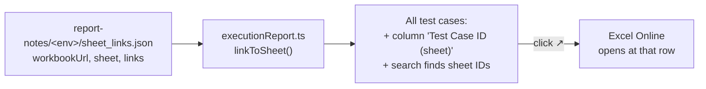
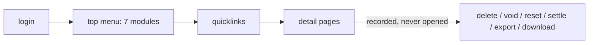

# Changelog: system-portal-automation (TryOut)

Every change to this folder is recorded here: **what** changed, **why**, **which files**, the **key code**
and **how to run or check it**. Newest first. Times are Malaysia time (MYT).

> **Rule:** every time something is added, changed or removed, add an entry at the top of
> [Changes](#changes). Code merged from a teammate says whose it is and what was adapted to fit
> the agreed structure (see README "Rules").

<details>
<summary>Entry template (copy this)</summary>

~~~markdown
### YYYY-MM-DD HH:MM: <short title>

**Why:** <the reason / request>

| File / folder | Change |
|---|---|
| `path/to/file.ts` | New / Changed / Removed: what |

**Key code**
```ts
// the important lines
```

**How to run / check**
```powershell
<command>
```
~~~
</details>

## Changes

- [2026-11-20 11:15: Merged Kai Wen's branch (kaiwen/tryout) into Derrick's repo](#2026-11-20-1115-merged-kai-wens-branch-kaiwentryout-into-derricks-repo)
- [2026-11-20 11:08: Automated tests mapped to the APH and FassBayar baseline test case workbooks](#2026-11-20-1108-automated-tests-mapped-to-the-aph-and-fassbayar-baseline-test-case-workbooks)
- [2026-11-20 11:00: Report links each test to its row in the Excel test case sheet (from ecom-automation)](#2026-11-20-1100-report-links-each-test-to-its-row-in-the-excel-test-case-sheet-from-ecom-automation)
- [2026-11-20 10:55: Open any Markdown file in the browser (npm run md)](#2026-11-20-1055-open-any-markdown-file-in-the-browser-npm-run-md)
- [2026-11-20 10:50: Site map of both portals: every module, flow and difference](#2026-11-20-1050-site-map-of-both-portals-every-module-flow-and-difference)
- [2026-11-20 10:41: Shared on GitHub (private repo, branch kaiwen/tryout)](#2026-11-20-1041-shared-on-github-private-repo-branch-kaiwentryout)
- [2026-11-19 17:30: Tests grouped by menu module (tests/&lt;module&gt;/)](#2026-11-19-1730-tests-grouped-by-menu-module-testsmodule)
- [2026-11-19 16:00: TC-CS-006 archive-hours message is an expected result, not a skip](#2026-11-19-1600-tc-cs-006-archive-hours-message-is-an-expected-result-not-a-skip)
- [2026-11-19 15:27: Structure map updated (no code change)](#2026-11-19-1527-structure-map-updated-no-code-change)
- [2026-11-19 14:41: Fassbayar pending batch shows "Settle Credit", same as APH (TC-CS-007)](#2026-11-19-1441-fassbayar-pending-batch-shows-settle-credit-same-as-aph-tc-cs-007)
- [2026-11-19 14:25: Fassbayar test transaction is now Settled (TC-TRX-001)](#2026-11-19-1425-fassbayar-test-transaction-is-now-settled-tc-trx-001)
- [2026-11-19 11:50: Full Test Execution Report is built again (tools/report-generator)](#2026-11-19-1150-full-test-execution-report-is-built-again-toolsreport-generator)
- [2026-11-19: APH test transaction is now Settled (TC-TRX-001)](#2026-11-19-aph-test-transaction-is-now-settled-tc-trx-001)
- [2026-11-19 10:52: Reporting and skipping from Derrick (auto Human Action / Gaps, per-portal summary, portal-only tests)](#2026-11-19-1052-reporting-and-skipping-from-derrick)
- [2026-11-19 09:47: Add a Company validations from Derrick (card schemes, Fassbayar extras, random data)](#2026-11-19-0947-add-a-company-validations-from-derrick)
- [2026-11-18 17:09: New module: Manage Credit Settlements (from Derrick)](#2026-11-18-1709-new-module-manage-credit-settlements-from-derrick)
- [2026-11-18 15:19: New Fassbayar-only module: Bill Payment Report](#2026-11-18-1519-new-fassbayar-only-module-bill-payment-report)
- [2026-11-18 15:07: Automation accounts in .env](#2026-11-18-1507-automation-accounts-in-env)
- [2026-11-18 15:01: New module: Transaction Summary](#2026-11-18-1501-new-module-transaction-summary)
- [2026-11-18 14:25: New module: Company Summary](#2026-11-18-1425-new-module-company-summary)
- [2026-11-18 afternoon: Old copied pages and specs removed](#2026-11-18-afternoon-old-copied-pages-and-specs-removed)
- [2026-11-18: Structure built: one codebase, two portals](#2026-11-18-structure-built-one-codebase-two-portals)

---

### 2026-11-20 11:15: Merged Kai Wen's branch (kaiwen/tryout) into Derrick's repo

**Why:** one codebase for the team, in the agreed structure ("TryOut Structure Map": tests grouped by menu
module, report generator in the project, portal-only screens in the portal folder).

Merged as ONE commit (not with history): Kai Wen's commit contains `.env` with passwords, and this repo is public, so its history is not copied. Derrick's state before the
merge is tagged `before-kaiwen-merge`.

| From | Taken |
|---|---|
| Kai Wen | Tests in `tests/<module>/`; Company Summary (TC-COMP-004), Transaction Summary (TC-TRX-001), Bill Payment Report (Fassbayar, TC-BILL-001); `tools/report-generator/`; `utils/portalDate.ts`; known* test data; card scheme IDs renumbered to TC-COMP-005 / 006-xx |
| Kai Wen (QA-confirmed) | TC-CS-006 passes on the archive-hours message; a pending batch expects "Settle Credit" on both portals (`settleCreditButton: true`) |
| Derrick | Excel test case column + APH / FassBayar baseline mappings, site map + `docs/`, `npm run md`, `.gitignore` additions, CHANGELOG entries |
| Not taken | Kai Wen's committed `.env` (passwords): removed from git, each PC keeps its own |

| File / folder | Resolution |
|---|---|
| `common/tests/*.spec.ts` (old flat location) | Removed: replaced by `common/tests/<module>/` (same content + the changes above) |
| `portals.config.ts`, `common/pages/CreditSettlementPage.ts`, `common/fixtures/base.ts`, `fassbayar/fixtures/pages.ts`, `playwright.config.ts`, `aph|fassbayar/tests/README.md` | Kai Wen's |
| `common/reporters/executionReport.ts`, `report-notes/README.md`, `package.json`, `.gitignore` | Derrick's (newer: Excel column, `npm run md`) |
| `README.md` | Kai Wen's + `npm run md` and `docs/` |
| `CHANGELOG.md` | Both: Kai Wen's history + Derrick's 20 Nov entries (times added) |

Note for QA: Fassbayar pending batch 485 showed **no** Settle Credit on 18 Nov; with the confirmed rule a case
like that now fails TC-CS-007.

**How to run / check**
```powershell
npm run typecheck
npm run test:all
```

---

### 2026-11-20 11:08: Automated tests mapped to the APH and FassBayar baseline test case workbooks

**By:** Derrick.

**Why:** each automated test in the report should link to its test case(s) in the team's baseline workbooks.

| File / folder | Change |
|---|---|
| `report-notes/uat-aph/sheet_links.json` | **New**: 12 of 16 APH tests -> `APH_System_Portal_Baseline_Test_Cases_v1.0.xlsx`, sheet "Test Case Library" |
| `report-notes/uat-fassbayar/sheet_links.json` | **New**: 11 of 18 Fassbayar tests -> `FassBayar_System_Portal_Baseline_Test_Cases_v1.0.xlsx`, sheet "Test Case Library" |

Only exact or reasonable partial matches are linked; the rest show "-":

| Automation ID | APH (TC-APH-BP-...) | FassBayar (TC-FB-BP-...) |
|---|---|---|
| TC-APH-001 Login / logout | AUTH-002, AUTH-013 | AUTH-002, AUTH-010 |
| TC-COMP-001 Add company (GP) | CMP-013, CMP-008 | CMP-014, CMP-008 |
| TC-COMP-002 GP Retail or IPP | CMP-013 | - (no case) |
| TC-COMP-003 Duplicate MID | CMP-020 | CMP-019 |
| TC-COMP-004 / 005 card schemes | - (no per-scheme case; no HSBC case) | - |
| TC-CS-001 list | STL-001 | STL-001 |
| TC-CS-002..005 filters / batch search | STL-002 | STL-002 |
| TC-CS-006 no record | XCUT-002, STL-004 | XCUT-002 |
| TC-CS-007 batch details | STL-003 | STL-003 |
| TC-CS-008 company settlements | - | - |
| TC-CS-009 schedule force settlement | STL-007 | STL-006 |

Gaps in the workbooks (no case to link): GP card scheme list / HSBC schemes, "View all credit settlements".
When a workbook gets new rows, update the `row` numbers (Excel row of the case).

**How to run / check**
```powershell
$env:ENV_NAME='UAT-APH'; npx playwright test --list     # rebuilds the report without running
start execution-report-uat-aph	est_execution_report.html
```

---

### 2026-11-20 11:00: Report links each test to its row in the Excel test case sheet (from ecom-automation)

**By:** Derrick.

**Why:** like ecom-automation's report, each test in "All test cases" should show the test case ID(s) of
the Excel test case sheet and open the workbook at that row.

| File / folder | Change |
|---|---|
| `common/reporters/executionReport.ts` | Changed: `linkToSheet()` replaced by ecom's version, made generic (any test ID; column title and workbook name from the mapping) |
| `report-notes/README.md` | Changed: `sheet_links.json` format (new optional `workbookName`, `columnLabel`) |

Before: the sheet ID was a small link under the automation ID. Now (ecom style):

| Automation ID | Test Case ID (SSR-xxx v1.0) | Module | ... |
|---|---|---|---|
| TC-CS-001 | TC-SP-CS-001 ↗ | Credit Settlement | |
| TC-CS-005 | TC-SP-CS-010 ↗<br>TC-SP-CS-011 ↗ | Credit Settlement | |
| TC-CS-002 | - (not in the sheet) | Credit Settlement | |



- No mapping file -> report unchanged (no column). Nothing is mapped yet: the System Portal test case
  workbook link, sheet name and rows are needed.
- Checked with a temporary mapping on the Fassbayar report: column, links (`activeCell='<sheet>'!A<row>`),
  "-" rows and search all work; the temporary mapping was removed.

**Key code**
```ts
.replace('<th>Test Case ID</th>',
  `<th>Automation ID</th><th title="${esc(workbook)}, sheet '${esc(mapping.sheet)}'">${esc(label)}</th>`)
.replace(/data-search="([^\s"]+)/g, (match, id) => ...sheet IDs + id...)        // search
.replace(/(<tr[^>]*data-search=...>\s*)<td class="mono">([^<]+)<\/td>/g, ...)   // + sheet cell
```

**How to run / check**: add `report-notes/uat-fassbayar/sheet_links.json`, then rebuild without running:
```powershell
$env:ENV_NAME='UAT-FASSBAYAR'; npx playwright test --list
start execution-report-uat-fassbayar	est_execution_report.html
```

---

### 2026-11-20 10:55: Open any Markdown file in the browser (npm run md)

**By:** Derrick.

**Why:** a browser shows a `.md` file as raw text; the module map and changelog should open as a formatted page.

| File / folder | Change |
|---|---|
| `scripts/md-to-html.js` | **New**: writes `<file>.html` next to the `.md` (tables formatted, mermaid diagrams drawn) and opens it |
| `package.json` | Changed: `npm run md` |
| `.gitignore` | Changed: the generated `.html` files stay local |

**How to run / check**
```powershell
npm run md -- docs/portal-module-map.md
npm run md -- CHANGELOG.md
```
The page loads its Markdown / diagram libraries from the internet (CDN).

---

### 2026-11-20 10:50: Site map of both portals: every module, flow and difference

**By:** Derrick.

**Why:** understand every module and flow on APH and Fassbayar, and how they differ, before automating more.
Crawled read-only with the dedicated automation accounts (`automationaph`, `automationfb`).

| File / folder | Change |
|---|---|
| `explore/scan/siteMap.scan.ts` | **New**: read-only crawler (opens pages only; never submits; never opens delete / void / reset / settle / export / download links) |
| `docs/portal-module-map.md` | **New**: module table, flows (mermaid), APH vs Fassbayar differences, automation status |
| `.gitignore` | Changed: crawl output `explore/scan/results/site-map-*.json` stays local (real MIDs / names; repo is public) |

**Result:** APH 49 pages, Fassbayar 56. Same 7 top-menu modules. Fassbayar only: Fasstap, Replace Readers +
report, Bulk Company Upload (Edit), Upload / Remove Company Logo, Bill Payment Report, Export SSO List,
Home dashboard. APH only: Host Settings, Fassbayar Sync History / Retrigger Sync, View Parent.



**How to run / check**
```powershell
$env:ENV_NAME='UAT-FASSBAYAR'; npx playwright test --config explore/scan/scan.config.ts siteMap
start docs\portal-module-map.md
```

---

### 2026-11-20 10:41: Shared on GitHub (private repo, branch kaiwen/tryout)

**Why:** to share the TryOut code with the team.

- Repo: **`ss-kaiwen/system-portal-automation`**, **private** (only invited people can see it).
- Branch: **`kaiwen/tryout`** (first and only branch).
- Included on request: **`.env` with the UAT automation logins** (force-added; `.gitignore` still lists `.env`,
  so a teammate's own `.env` edits are not committed by accident), and `explore/scan/results/`.
- Not included (generated, rebuilt by a run): `node_modules/`, `test-results/`, `playwright-report/`,
  `execution-report-*/`, `test_summary.html`, `Test_Execution_Report_*.html`.
- Pre-push check (19/20 Nov): structure rules hold (known: drift #1 `common/fixtures/portal.ts`; `'999999'`
  still in `creditSettlement.spec.ts`; Login / Add Company specs have no tag yet); `tsc --noEmit` OK.

**Keep the repo private**: `.env` holds the UAT passwords. If it is ever made public or shared outside
Softspace, change the automation passwords first.

**How a teammate gets it**
```powershell
git clone -b kaiwen/tryout https://github.com/ss-kaiwen/system-portal-automation.git
cd system-portal-automation; npm install; npx playwright test --list
```

---

### 2026-11-19 17:30: Tests grouped by menu module (tests/&lt;module&gt;/)

**Why:** one flat `common/tests` list gets hard to read as modules are added. Agreed on the structure map
first (versions 11–12), then applied. Only `tests/` is grouped; `pages/`, `fixtures/`, `testdata/` stay flat.
Folder names = the portal's top menu, in camelCase, the same on every portal.

| File / folder | Change |
|---|---|
| `common/tests/login/` | `login.spec.ts` moved here |
| `common/tests/allCompanies/` | `addCompany`, `addCompanyValidation`, `addCompanyCardScheme`, `companySummary` `.spec.ts` moved here |
| `common/tests/manageTransactions/` | `transactionSummary.spec.ts` moved here |
| `common/tests/manageCreditSettlements/` | `creditSettlement.spec.ts` moved here |
| `common/tests/home/`, `manageMobileUsers/`, `manageReaders/`, `administrator/` | **New**, empty (a `README.md` each) |
| `fassbayar/tests/manageTransactions/` | `billPaymentReport.spec.ts` moved here |
| every moved spec | imports one level deeper: `'../x'` -> `'../../x'` (nothing else changed) |
| `aph/tests/README.md`, `fassbayar/tests/README.md`, `common/fixtures/base.ts` (comment), `README.md` | Changed: say `tests/<module>/` and the new import depth; README rule 5 added |

Nothing else changed: same test IDs, titles, tags and `playwright.config.ts` (`testMatch` already covers
sub-folders). Checked: `tsc --noEmit` OK; `--list` APH 18 tests in 7 files, Fassbayar 21 in 8 files (same as before).
Not run on UAT. Backup of the old tests folders: `system-portal-automation(TryOut)-backup-before-tests-by-module`.

Older entries below keep the old paths (e.g. `common/tests/creditSettlement.spec.ts`), as they were at the time.

**How to run / check**
```powershell
npx playwright test common/tests/manageCreditSettlements   # one module (folder)
npx playwright test --grep "@credit-settlement"           # same, by tag
```

---

### 2026-11-19 16:00: TC-CS-006 archive-hours message is an expected result, not a skip

**Why:** searching a Batch No. that does not exist (`999999`) makes the portal look in the archive. In the
daytime it answers *"Archive data can only be viewed between 22:00 and 06:00. Please try again during that
time."* Derrick's test **skipped** on that message (APH, 15:53 run). The QA team confirmed the message is
correct behaviour, so it now counts as a **pass**, on both portals.

| File / folder | Change |
|---|---|
| `common/tests/creditSettlement.spec.ts` | Changed: TC-CS-006 passes on "No record found" **or** the archive-hours message; no `test.skip`; title now ends "... or the archive-hours message" |

Same test ID. Still fails if neither message appears, or if any row is listed. Effects in the report:
TC-CS-006 shows Passed with the step *Archive closed at this hour (expected): "..."* and its screenshot, and
it no longer appears in the Human Action table. (`reportNotes.ts` still has its archive rule; it is simply
not triggered any more, left unchanged.)

**Key code**
```ts
await expect(cs.noRecord.or(cs.archiveClosed), 'No record found or the archive-hours message').toBeVisible();
if (await cs.archiveClosed.isVisible()) {
  await test.step(`Archive closed at this hour (expected): "${message}"`, ...);   // pass
} else {
  await test.step('"No record found" (expected)', ...);                          // pass
}
```

**How to run / check**
```powershell
$env:ENV_NAME='UAT-APH'; npx playwright test --grep "does not exist"
```

---

### 2026-11-19 15:27: Structure map updated (no code change)

**Why:** the team's structure map (claude.ai artifact "TryOut Structure Map", version 8) still showed 18 Nov, 5:16 PM.

Added: the 19 Nov merges from Derrick (card scheme tests TC-COMP-005 / 006-xx, random data, Fassbayar extras,
reportNotes, run scripts), `tools/report-generator`, the project-root files, both transactions Settled, the
Fassbayar existing MID, the Credit Settlement rules per portal, the latest results, and the open TC-CS-007
question (when Settle Credit shows on Fassbayar). No file in this folder changed except this CHANGELOG.

**Version 9 (just before 16:00):** APH full run of 15:47–15:54 added (17 pass, 1 skip, 0 fail). Fixed on the map: TC-COMP-006-xx
is read-only (stops at Review, Confirm never clicked), not "creates a company".

**17:18, version 11 (proposal only):** the folder map shows `common/tests/` and `fassbayar/tests/` grouped by module
(`login/`, `allCompanies/`, `manageTransactions/`, `manageCreditSettlements/`) for review. The real folders were
not moved.

**17:26, version 12 (proposal only):** every portal menu module now has a `tests/` folder on the map, in menu order:
`login/`, `home/`, `allCompanies/`, `manageMobileUsers/`, `manageReaders/`, `manageTransactions/`,
`manageCreditSettlements/`, `administrator/` (dashed = empty). Still not created in the real folder.

---

### 2026-11-19 14:41: Fassbayar pending batch shows "Settle Credit", same as APH (TC-CS-007)

**Why:** TC-CS-007 failed on Fassbayar in the 14:10 run: today's first batch (000009) was **pending** and
showed a **Settle Credit** button, but the Fassbayar rule (from Derrick's code) said Fassbayar has none
(`Expected: 0  Received: 1`). The QA team confirmed Fassbayar behaves like APH: a pending batch offers
Settle Credit. Earlier runs passed only because the first batch was never pending, so the check was skipped.

| File / folder | Change |
|---|---|
| `portals.config.ts` | Changed: `fassbayar.creditSettlement.settleCreditButton` `false` -> `true` |

No test or page code changed. Effects on Fassbayar:
- TC-CS-007 now expects "Settle Credit" on a pending batch (only counted, **never clicked**).
- The report's Human Action table now also lists "Settle Credit on a pending batch (Fassbayar)", as APH does.

**Key code**
```ts
creditSettlement: {
  showsRefundedTotal: true,
  settleCreditButton: true,   // was false
  ...
```

**How to run / check**
```powershell
$env:ENV_NAME='UAT-Fassbayar'; npx playwright test --grep "View Details opens the batch"
```

---

### 2026-11-19 14:25: Fassbayar test transaction is now Settled (TC-TRX-001)

**Why:** the Fassbayar transaction `18052434181126000560` has been credit-settled, so its status changed
from **Approved** to **Settled** on UAT. TC-TRX-001 failed on Fassbayar in the 14:11 run
(`Expected: "Approved"  Received: "Settled"`).

| File / folder | Change |
|---|---|
| `common/testdata/knownTransactions.ts` | Changed: `UAT-FASSBAYAR` status `Approved` -> `Settled` (both portals now expect Settled) |

No test or page code changed: TC-TRX-001 reads the expected status from this file.

**Key code**
```ts
'UAT-FASSBAYAR': { trxId: '18052434181126000560', status: 'Settled', ... }
```

**How to run / check**
```powershell
$env:ENV_NAME='UAT-Fassbayar'; npx playwright test --grep "@transaction-summary"
```

---

### 2026-11-19 11:50: Full Test Execution Report is built again (tools/report-generator)

**Why:** `test_summary.html` showed **"Full report not generated"** for both portals. After a run,
`executionReport.ts` saves the data, then calls `generate_report.py` to build the HTML. The reporter looked
for that script in a folder on one PC (`%USERPROFILE%\skills\02 automation test execution report template
package - legacy\`) that does not exist here, so only data + screenshots were written.

| File / folder | Change |
|---|---|
| `tools/report-generator/` | **New** (from Derrick's first repo version, 18 Nov): `generate_report.py`, `template/test_execution_report.html.j2`, `README.md` |
| `playwright.config.ts` | Changed: `generatorPath` points to `tools/report-generator/generate_report.py` (`REPORT_GENERATOR` still overrides) |
| `README.md` | Changed: `tools/` and `scripts/` in the structure |

Nothing in `common/`, `aph/` or `fassbayar/` changed; the reporters were already Derrick's latest
(`Downloads\reporters` = identical to `common/reporters`).

**Key code** (`playwright.config.ts`)
```ts
generatorPath: process.env.REPORT_GENERATOR ?? `${__dirname}/tools/report-generator/generate_report.py`
```

**Needs:** Python 3 + jinja2 on the PC (`pip install jinja2`).

**Result:** rebuilt from the last runs without testing again: both portals now have
`test_execution_report.html` + a shareable `Test_Execution_Report_2026-11-19.html`, and the summary shows
**"Open full report"** for both.

**How to run / check**
```powershell
npx playwright test --list      # rebuild the report of ENV_NAME from its last run (nothing executed)
start test_summary.html         # "Open full report" button
```

---

### 2026-11-19: APH test transaction is now Settled (TC-TRX-001)

**Why:** the APH transaction `10029595181126001164` changed from **Approved** to **Settled** on UAT
(its batch was settled), so TC-TRX-001 would fail on APH while expecting Approved.

| File / folder | Change |
|---|---|
| `common/testdata/knownTransactions.ts` | Changed: `UAT-APH` status `Approved` -> `Settled` (Fassbayar unchanged at the time; Settled from 14:25) |

No test or page code changed: TC-TRX-001 reads the expected status from this file and checks it in the
search result's **Status** column and as **Payment Status** on Transaction Details.

**Key code**
```ts
'UAT-APH': { trxId: '10029595181126001164', status: 'Settled', ... }
```

**How to run / check**
```powershell
$env:ENV_NAME='UAT-APH'; npx playwright test --grep "@transaction-summary"
```

---

### 2026-11-19 10:52: Reporting and skipping from Derrick

**Why:** merge Derrick's commit `99f06a2` (19 Nov 10:23) so the reports explain skips and limits by
themselves, and a test that does not apply to a portal is not shown there at all.
Backup before: `system-portal-automation(TryOut)-backup-before-derrick-reports`.

| File / folder | Change |
|---|---|
| `common/reporters/reportNotes.ts` | **New** (Derrick): builds the **Human Action Required** and **Open Gaps / Limitations** tables on every run |
| `common/reporters/executionReport.ts` | Changed (Derrick): calls `buildNotes()`, writes `data/human_action_items.json` + `data/gaps.json`; both cards always shown ("none" row when empty) |
| `common/reporters/summaryReport.ts` | Changed (Derrick): new `folders` option = which portals the summary shows |
| `common/utils/testCase.ts` | Changed (Derrick): `testCase()` accepts `gaps` and `manual` |
| `playwright.config.ts` | Changed (Derrick): `SUMMARY_ENVS` decides the summary's portals |
| `scripts/run-all.js` | **New** (Derrick): runs portals one after another, one summary at the end |
| `package.json` | Changed (Derrick): `test:aph`, `test:fassbayar`, `test:all` |
| `common/tests/login.spec.ts`, `addCompany.spec.ts`, `addCompanyValidation.spec.ts` | Changed (Derrick): each test declares its gaps |
| `common/tests/creditSettlement.spec.ts` | Changed: Derrick's gaps / manual checks **added**; our tag `@credit-settlement`, module name and `utils/portalDate` kept |
| `common/tests/addCompanyCardScheme.spec.ts` | Changed: Derrick's "test only created on a portal that offers the scheme"; **our IDs kept** (TC-COMP-005, TC-COMP-006-0n) |
| `report-notes/README.md`, `README.md` | Changed: how the cards work; new run commands |
| Not merged | Derrick's `CHANGELOG.md` (his history, his IDs) and `CLAUDE.md`; this file is TryOut's own changelog |

**What goes in each table** (`reportNotes.ts`)

| In the run | Table |
|---|---|
| Skip a person can act on: APH archive only 22:00-06:00, no settlements today, no known MID | Human Action, with what to do |
| Failed because of the environment: server down, session logged out, no login in `.env` | Human Action |
| Any other failure | Gap, status **Open** (gone when the test passes again) |
| `testCase({ manual: [...] })`, e.g. Settle Credit, Schedule Force Settlement | Human Action |
| `testCase({ gaps: [...] })` | Gap, status **Known limitation** |
| Skip "Applicable for <portal> only" / "is not a host of" | Left out (not this portal's scenario) |

**Key code**
```ts
// addCompanyCardScheme.spec.ts: a scheme this portal doesn't offer gets NO test
for (const [i, scheme] of allSchemes.entries()) {
  if (!host?.cardSchemes.includes(scheme)) continue;   // not on this portal: no test at all
  test(`Global Payment with card scheme ${scheme}: ...`,
    testCase({ id: `TC-COMP-006-${String(i + 1).padStart(2, '0')}`, ... }), ...);
}

// a test declares what it does not cover / what needs a person
testCase({ id: 'TC-CS-009', module: MODULE, priority: 'Medium',
  manual: [{ title: '...', reason: '...', handling: '...' }],
  gaps:   [{ description: '...', impact: '...' }] })
```

| Tests listed | APH | Fassbayar |
|---|---|---|
| Before | 20 (HSBC tests skipped) | 21 |
| After | **18** (HSBC tests not created) | **21** |

**How to run / check**
```powershell
npm run test:aph          # summary: APH only
npm run test:fassbayar    # summary: Fassbayar only
npm run test:all          # APH then Fassbayar, summary: both
$env:SUMMARY_ENVS='all'   # summary: every execution-report-* folder
```

---

### 2026-11-19 09:47: Add a Company validations from Derrick

**Why:** take Derrick's Add a Company improvements that fit the structure: more validation, more stable
clicks, realistic data. Backup before: `system-portal-automation(TryOut)-backup-before-derrick-add-company`.

| File / folder | Change |
|---|---|
| `common/tests/addCompanyCardScheme.spec.ts` | **New** (Derrick): TC-COMP-005 GP offers exactly the portal's card schemes; TC-COMP-006-01…04 each scheme accepted at Submit and shown exactly on Review (renumbered from his TC-COMP-004 / 005-xx) |
| `common/pages/AddCompanyFormPage.ts` | Changed (Derrick): retry when Open / Submit clicks are lost; card scheme helpers; hooks `fillPortalCompanyFields` / `verifyPortalReview` |
| `fassbayar/pages/FassbayarAddCompanyFormPage.ts` | Changed (Derrick): fills SST, TIN, bank, MCC, Reference 1-5 and checks them on Review |
| `common/creation/hostCompanyData.ts`, `types.ts` | Changed (Derrick): realistic random data per run; timestamped name / User ID / MID kept |
| `common/creation/randomCompanyData.ts` | **New** (Derrick): pools of form-valid values (all 31 banks and 10 MCC codes exist on Fassbayar) |
| `common/testdata/existingMids.ts` | Changed (Derrick): Fassbayar MID `261118140251604` so TC-COMP-003 runs there |
| `common/reporters/summaryReport.ts` | Changed (Derrick): "applicable for one portal only" listed apart |

**Checked:** TC-COMP-001 passed on both portals after the merge (19 Nov 09:55 APH, 09:56 Fassbayar).

**How to run / check**
```powershell
npx playwright test common/tests/addCompanyCardScheme.spec.ts common/tests/addCompanyValidation.spec.ts   # creates nothing
```

---

### 2026-11-18 17:09: New module: Manage Credit Settlements (from Derrick)

**Why:** add the Manage Credit Settlements module Derrick wrote, adapted to the agreed structure.
Backup before: `system-portal-automation(TryOut)-backup-before-credit-settlement`.

| File / folder | Change |
|---|---|
| `common/pages/CreditSettlementPage.ts` | **New** (Derrick); changed to open from the top menu |
| `common/tests/creditSettlement.spec.ts` | **New** (Derrick): TC-CS-001 … 009, read-only; tag `@credit-settlement` added |
| `common/utils/portalDate.ts` | **New**: `portalToday()` moved here from the page |
| `common/fixtures/base.ts` | Changed: `creditSettlementPage` fixture |
| `portals.config.ts` | Changed: `creditSettlement` rules per portal (batch page differences) |
| `explore/scan/creditSettlement.scan.ts` | **New** (Derrick): read-only scan |

**Checked:** full run 18 Nov 17:32 (Fassbayar) / 17:41 (APH): Credit Settlement passed on both
(TC-CS-006 skipped on APH by design: archive opens 22:00-06:00).

**How to run / check**
```powershell
npx playwright test --grep "@credit-settlement"
```

---

### 2026-11-18 15:19: New Fassbayar-only module: Bill Payment Report

**Why:** Manage Transactions > Bill Payment Report exists only on Fassbayar.

| File / folder | Change |
|---|---|
| `fassbayar/pages/BillPaymentReportPage.ts`, `BillPaymentDetailsPage.ts` | **New** |
| `fassbayar/fixtures/pages.ts` | Changed: the two pages |
| `fassbayar/tests/billPaymentReport.spec.ts` | **New**: TC-BILL-001 search Harris_LH 01 Oct – 01 Nov 2026, view Batch 000060 |
| `common/testdata/knownBillPayments.ts` | **New** |
| `explore/scan/billPaymentReport.scan.ts` | **New**: read-only scan |

**How to run / check**
```powershell
$env:ENV_NAME='UAT-Fassbayar'; npx playwright test --grep "@bill-payment-report"
```

---

### 2026-11-18 15:07: Automation accounts in .env

**Why:** runs use dedicated automation accounts instead of personal logins.

| File / folder | Change |
|---|---|
| `.env` | Changed: `automationaph` (APH), `automationfb` (Fassbayar); `.env` is never shared in the repo |

---

### 2026-11-18 15:01: New module: Transaction Summary

| File / folder | Change |
|---|---|
| `common/pages/TransactionSummaryPage.ts`, `TransactionDetailsPage.ts` | **New** (no locator for Void Payment Now) |
| `common/tests/transactionSummary.spec.ts` | **New**: TC-TRX-001 search trxID, view details, status Approved |
| `common/testdata/knownTransactions.ts` | **New**: one trxID per environment |
| `explore/scan/transactionSummary.scan.ts` | **New** |

```powershell
npx playwright test --grep "@transaction-summary"
```

---

### 2026-11-18 14:25: New module: Company Summary

| File / folder | Change |
|---|---|
| `common/pages/CompanySummaryPage.ts` | **New** |
| `common/tests/companySummary.spec.ts` | **New**: TC-COMP-004 search sync company MID 000452839489382 |
| `common/testdata/knownCompanies.ts` | **New** |

```powershell
npx playwright test --grep "@company-summary"
```

---

### 2026-11-18 afternoon: Old copied pages and specs removed

**Why:** only code written for the agreed structure stays. Backup: `system-portal-automation(TryOut)-before-cleanup.zip`.

| File / folder | Change |
|---|---|
| `aph/pages` (6 old pages), `aph/tests/allCompanies.spec.ts` | Removed |
| `fassbayar/pages` (10 old pages), `fassbayar/tests` (8 specs) | Removed |
| old helpers in `common/creation`, `common/testdata`, `explore/aph`, `explore/fassbayar` | Removed |

---

### 2026-11-18: Structure built: one codebase, two portals

**Why:** the team's decision: one codebase that runs on APH and Fassbayar; `ENV_NAME` picks the portal.

| File / folder | Change |
|---|---|
| `portals.config.ts` | **New**: environments -> portal, hosts and form rules per portal |
| `common/hosts/` | **New**: 12 host profiles |
| `common/pages/AddCompanyFormPage.ts` + `aph/` / `fassbayar/` overrides | **New**: shared Add a Company |
| `common/tests/addCompany.spec.ts`, `addCompanyValidation.spec.ts` | **New**: TC-COMP-001 (creates), 002 GP Retail/IPP, 003 duplicate MID |
| `explore/scan/` | **New**: read-only scans of both portals |
