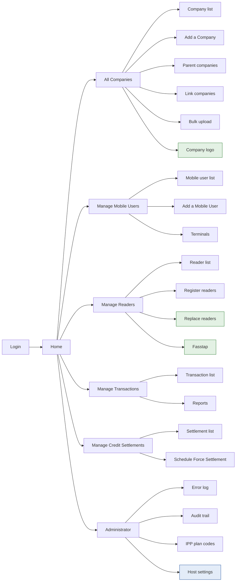
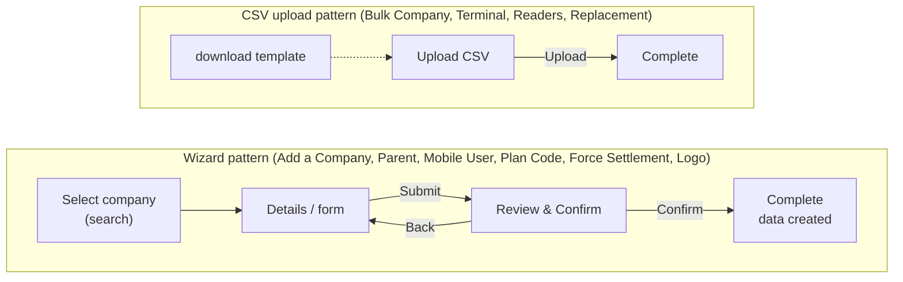
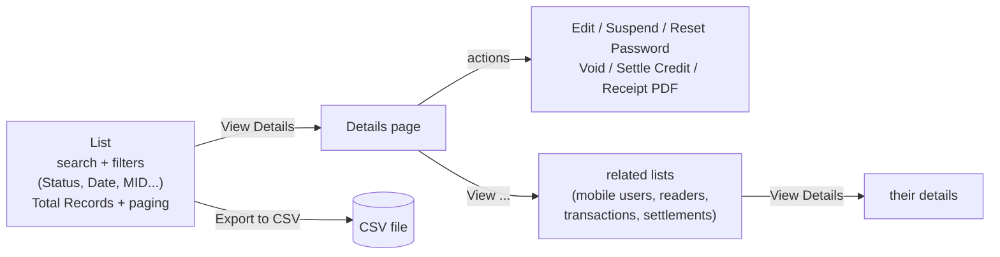
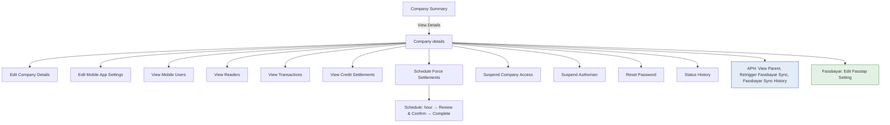

# System Portal: modules, flows and APH vs Fassbayar differences

Read-only crawl of both UAT portals on **20 Nov 2026** with the automation accounts
(`explore/scan/siteMap.scan.ts`). Every top-menu module, every quicklink and one level of detail
pages were opened; **nothing was submitted**. Action links (Delete, Void, Reset Password, Settle
Credit, Export, downloads) were recorded but **not opened**.

| | APH (`:35190`) | Fassbayar (`:36190`) |
|---|---|---|
| Pages mapped | 49 | 56 |
| Top menu | Home, All Companies, Manage Mobile Users, Manage Readers, Manage Transactions, Manage Credit Settlements, Administrator | same 7 |

Legend: ✅ on the portal · ❌ not on the portal · 🔹 same screen, differs (see notes) ·
⚠️ seen on one portal only by the crawler (one example per page type); may exist on both.

---

## 1. Module overview


Green = Fassbayar only, blue = APH only.

| Module | Screen | APH | Fassbayar | Notes |
|---|---|:-:|:-:|---|
| **Home** | Landing page after login | 🔹 | 🔹 | APH: console, no dashboard. Fassbayar: **Daily Transaction Snapshot** with View Details |
| **All Companies** | Company Summary (list) | 🔹 | 🔹 | Search, Status, Date filters; Fassbayar adds **Export SSO List** |
| | Company details | 🔹 | 🔹 | see [section 3](#3-company-details-actions) |
| | Add a Company | 🔹 | 🔹 | 3 steps; fields differ (section 4) |
| | Parent Company Summary | ✅ | ✅ | same columns |
| | Parent company details | ✅ | ⚠️ | Link Companies, Edit, Unlink Company, API Authentication Setting |
| | Add a Parent Company | 🔹 | 🔹 | Fassbayar adds SST, TIN, SSO |
| | Parent Child Company Link | ✅ | ✅ | 4 steps |
| | Bulk Company Upload (Create) | ✅ | ✅ | CSV upload; APH calls it "Bulk Company Upload" |
| | Bulk Company Upload (Edit) | ❌ | ✅ | CSV upload, own template |
| | Upload Company Logo | ❌ | ✅ | 4 steps: Logo > Company > Review & Confirm > Complete |
| | Remove Company Logo | ❌ | ✅ | 3 steps |
| | Status History (pop-up) | ✅ | ✅ | |
| | Fassbayar Sync History (pop-up) | ✅ | ❌ | APH syncs companies / terminals to Fassbayar |
| **Mobile Users** | Mobile user list | ✅ | ✅ | Search, MID, Status, Date |
| | Add a Mobile User | ✅ | ✅ | 4 steps: Select Company > Details > Review & Confirm > Complete |
| | Terminals (list) | 🔹 | 🔹 | APH adds **Fassbayar Sync History** column / View Sync History |
| | Register New Terminal | ✅ | ✅ | CSV upload |
| **Readers** | Reader list | ✅ | ✅ | Search, MID, Status, Date |
| | Register New Readers | ✅ | ✅ | CSV upload |
| | Replace Readers | ❌ | ✅ | CSV upload |
| | Readers Replacement Report | ❌ | ✅ | Date, Download Report (PDF) |
| | Fasstap Summary + details | ❌ | ✅ | Device UUID, Mobile User ID, Status; details: device, last login |
| **Transactions** | Transaction list | 🔹 | 🔹 | columns differ (section 5) |
| | Transaction details | 🔹 | 🔹 | Fassbayar adds **Special Fields** section; Void Payment Now, Merchant / Customer Receipt (PDF) on both |
| | Geofencing Bypassed Transaction Report | ✅ | ✅ | Date, Download Report (CSV) |
| | Reporting | ✅ | ✅ | |
| | Bill Payment Report | ❌ | ✅ | Business Name, MID, Status, Date |
| **Credit Settlements** | Settlement list | 🔹 | 🔹 | Fassbayar shows Business Name under Mobile User ID |
| | Batch details | 🔹 | 🔹 | APH: + Approval Code, Amount filters, Refunded status; Fassbayar: + Total Refunded Amount. Settle Credit on some pending batches (both) |
| | Schedule Force Settlement | ✅ | ✅ | 4 steps; Details step = settlement **hour** |
| **Administrator** | System Error Log + details | ✅ | ✅ | Type filter; details: Save to File |
| | Audit Trail (User Activities) | ✅ | ✅ | Search, Action, Date |
| | IPP Plan code & Term Summary | 🔹 | 🔹 | Fassbayar adds **Service Provider** column |
| | Add IPP Plan code & Term | 🔹 | 🔹 | 3 steps; Fassbayar adds **Service Provider** field |
| | Host Settings | ✅ | ❌ | Edit Host Setting Details |

---

## 2. Flows

### Wizards (all end with Review & Confirm → Complete; Confirm creates / changes data)

| Flow | Steps | APH | Fassbayar |
|---|---|:-:|:-:|
| Add a Company | Company Details → Review & Confirm → Complete | ✅ | ✅ |
| Add a Parent Company | Company Details → Review & Confirm → Complete | ✅ | ✅ |
| Link Companies (parent ↔ child) | Select Company → Details → Review & Confirm → Complete | ✅ | ✅ |
| Add a Mobile User | Select Company → Details → Review & Confirm → Complete | ✅ | ✅ |
| Schedule Force Settlement | Search / Select Company → Schedule (hour) → Review & Confirm → Complete | ✅ | ✅ |
| Add IPP Plan code & Term | Plan Code Details → Review & Confirm → Complete | ✅ | ✅ |
| Upload Company Logo | Logo → Company → Review & Confirm → Complete | ❌ | ✅ |
| Remove Company Logo | Details → Review & Confirm → Complete | ❌ | ✅ |
| Bulk Company Upload (Create / Edit), Register Terminal / Readers, Replace Readers | Upload CSV → Complete | Create, Terminal, Readers | all |



### List → details pattern (every module)



### Company: everything reachable from Company details



---

## 3. Company details: actions

| Button | APH | Fassbayar |
|---|:-:|:-:|
| Switch Company, Edit Company Details, Edit Mobile App Settings | ✅ | ✅ |
| View Mobile Users / Readers / Transactions / Credit Settlements | ✅ | ✅ |
| Reset Password, Schedule Force Settlements, Suspend Company Access, Suspend Authoriser | ✅ | ✅ |
| View Parent | ✅ | ❌ |
| Retrigger Fassbayar Sync | ✅ | ❌ |
| Edit Fasstap Setting | ❌ | ✅ |

Settings sections on company details:

| Section | APH | Fassbayar |
|---|:-:|:-:|
| Special Fields (Reference 1-5) | ❌ | ✅ |
| MID Settings, Contactless, MCCS, SSO, Unattended Schedule Time, Application Identifier, Types of presented QR, Merchant Settings, API Authentication | ✅ | ✅ |
| Bill Payment Settings | ❌ | ✅ |
| Bypass Login Level 2 (Void, Settlement) | ❌ | ✅ |
| Allow Terminal to Show QR Response String | ✅ | ❌ |
| Merchant Settings: OneCard / 1U Membership, FacePay | ✅ | ❌ |

## 4. Add a Company: field differences

| Field / setting | APH | Fassbayar |
|---|:-:|:-:|
| Business details, Authoriser, Transaction Limit, MID row (MID, Service Provider, Card Scheme, Payment Type) | ✅ | ✅ |
| SST, TIN | ❌ | ✅ |
| Bank Details (bank, account no., holder) | ❌ | ✅ |
| Merchant Category Code (MCC) | ❌ | ✅ |
| Special Fields: Reference 1-5 | ❌ | ✅ |
| MID row: Host Swing Priority | ✅ | ❌ |
| MID row: DBA | ❌ | ✅ |
| Bill Payment, Bypass Login Level 2 (Void / Settlement), Fasstap PIN, Skip Receipt, Disable Signature | ❌ | ✅ |
| Terminal QR Response, OneCard Membership, FacePay | ✅ | ❌ |
| Service Providers | 9 | 12 (+ OCBC, AEON360, NDPS) |

## 5. Transaction list: columns

| APH | Fassbayar |
|---|---|
| Date/Time | Date/Time |
| Transaction ID | Transaction ID (Business Name) |
| Status | Transaction Type / Status |
| Refunded | — |
| Amount | Amount (Approval Code) |
| Approval Code | — |
| — | Mobile User |
| Verification Method | Verification Method |
| TID (MID) | TID (MID) |
| — | Scheme Ref Id |
| Quicklink | Quicklink |

---

## 6. Actions found but never opened (change data or download)

| Action | Where | APH | Fassbayar |
|---|---|:-:|:-:|
| Void Payment Now | Transaction details | ✅ | ✅ |
| Merchant / Customer Receipt (PDF) | Transaction details | ✅ | ✅ |
| Settle Credit | Batch details (some pending batches) | ✅ | ✅ |
| Reset Password | Company details | ✅ | ✅ |
| Delete | Terminal list | ✅ | ✅ |
| Save to File | System error details | ✅ | ✅ |
| Export to CSV | Companies, Parent companies, Mobile users, Readers, Terminals, Transactions, Plan codes, Audit trail | ✅ | ✅ |
| Export to CSV | Fasstap | ❌ | ✅ |
| Export SSO List | Company list | ❌ | ✅ |
| download template | Bulk company (create), Terminal, Readers | ✅ | ✅ |
| download template | Bulk company (edit), Reader replacement | ❌ | ✅ |

## 7. Automation status

| Module | Automated now | Not yet |
|---|---|---|
| Login | TC-APH-001 | negative login |
| All Companies | Add a Company (TC-COMP-001 to 005) | list / filters, details, edit, parent company, link, bulk upload, logo, suspend |
| Mobile Users | — | list, add mobile user, terminals |
| Readers | — | list, register, replace, Fasstap |
| Transactions | — | list, details, reports (void / receipts = manual) |
| Credit Settlements | TC-CS-001 to 009 (read-only) | Settle Credit, Schedule Force Settlement steps 2-4 (manual) |
| Administrator | — | error log, audit trail, plan codes, host settings |

Raw data: `explore/scan/results/site-map-uat-aph.json`, `site-map-uat-fassbayar.json` (local only, contain
real MIDs / names); screenshots: `test-results/site-map-<env>/`. Re-run:
```powershell
$env:ENV_NAME='UAT-FASSBAYAR'; npx playwright test --config explore/scan/scan.config.ts siteMap
```
